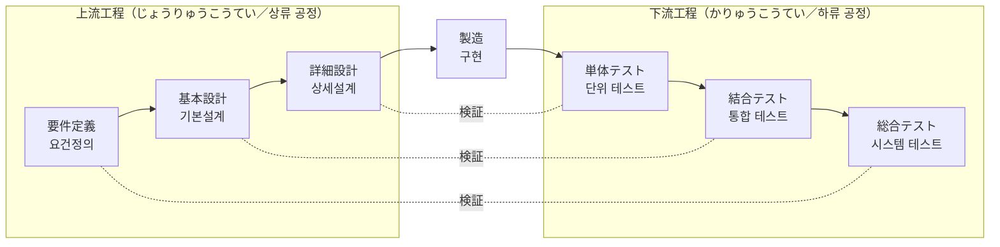
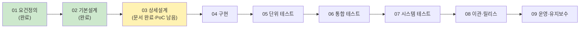

# 00. 전체 로드맵: 일본 SI 프로젝트는 이렇게 흘러간다

> 이 폴더(`docs/guide`)는 **교육자료**예요.
> "무엇을 만들었나"가 아니라 **"왜 이 순서로, 개발자는 무슨 생각을 하며 진행하나"** 를 정리합니다.
> 실제 산출물은 `docs/ja`(일본어 원본)와 `docs/ko`(한국어 번역)에 있어요.

---

## 1. V모델: 일본 SI의 기본 틀

일본 SIer(시스템 통합 업체) 프로젝트는 대부분 **워터폴 + V모델**로 진행돼요.
왼쪽에서 설계한 내용을 오른쪽에서 같은 높이의 테스트로 검증하는 구조예요.

| 설계 공정 | 짝이 되는 테스트 | 검증 질문 |
|---|---|---|
| 要件定義(요건정의) | 総合テスト(시스템 테스트) | 고객이 원한 업무가 실제로 돌아가는가? |
| 基本設計(기본설계) | 結合テスト(통합 테스트) | 화면·기능·데이터가 설계대로 연결되는가? |
| 詳細設計(상세설계) | 単体テスト(단위 테스트) | 클래스·메서드가 설계대로 동작하는가? |

**개발자 관점 포인트:** 설계 문서를 쓸 때 이미 "이걸 나중에 어떻게 테스트하지?"를 떠올려야 해요. 테스트할 수 없게 쓴 요건(예: "빠르게 동작할 것")은 나쁜 요건이에요.

---

## 2. 공정별 산출물과 이 프로젝트의 폴더

| 공정 | 일본어 | 주요 산출물 | 폴더 |
|---|---|---|---|
| 1 | 要件定義（ようけんていぎ） | 議事録, ヒアリングシート, 業務フロー(As-Is/To-Be), 課題一覧, QA管理表, 要件定義書 | `01_要件定義` ✅ |
| 2 | 基本設計（きほんせっけい） | 画面設計書, 帳票設計書, テーブル定義書, ER図, 機能一覧, IF設計書 | `02_基本設計` ✅ |
| 3 | 詳細設計（しょうさいせっけい） | クラス図, シーケンス図, 処理詳細, SQL設計 | `03_詳細設計` ✅(PoC 실행 남음) ← **지금 여기** |
| 4 | 製造（せいぞう） | 소스 코드, コーディング規約(코딩 규칙) | `04_製造` + `src/` |
| 5 | 単体テスト（たんたい） | 単体テスト仕様書, JUnit 코드, カバレッジ(커버리지) 리포트 | `05_単体テスト` |
| 6 | 結合テスト（けつごう） | 結合テスト仕様書, エビデンス(증적) | `06_結合テスト` |
| 7 | 総合テスト（そうごう） | 総合テスト仕様書, 性能テスト(성능 테스트) 결과 | `07_総合テスト` |
| 8 | 運用・保守（うんよう・ほしゅ） | 運用設計書, リリース手順書, 障害対応手順書 | `08_移行リリース`, `09_運用保守` |

---

## 3. 한일 용어 대응표 (자주 쓰는 것)

| 일본어 | 읽기 | 한국어 | 메모 |
|---|---|---|---|
| 要件定義 | ようけんていぎ | 요건정의 | 한국의 "요구사항 정의"에 해당 |
| 基本設計 / 外部設計 | きほんせっけい / がいぶせっけい | 기본설계 / 외부설계 | 사용자에게 보이는 부분 |
| 詳細設計 / 内部設計 | しょうさいせっけい / ないぶせっけい | 상세설계 / 내부설계 | 개발자만 보는 부분 |
| 製造 | せいぞう | 구현(코딩) | "제조"라고 직역하지 않기 |
| 結合テスト | けつごうテスト | 통합 테스트 | |
| 総合テスト | そうごうテスト | 시스템 테스트 | |
| 議事録 | ぎじろく | 회의록 | |
| 課題 | かだい | 이슈·과제 | |
| 宿題 | しゅくだい | 숙제(ToDo) | 회의에서 "다음까지 할 일" |
| 持ち帰り | もちかえり | 돌아가서 검토 | 「持ち帰って検討します」 |
| 認識合わせ | にんしきあわせ | 인식 맞추기 | 아주 자주 쓰임 |
| 属人化 | ぞくじんか | 속인화(특정인 의존) | |
| 工数 | こうすう | 공수 | |
| エビデンス | — | 증적(테스트 결과 캡처 등) | 일본은 매우 중시 |

---

## 4. 이 프로젝트의 진행 상황

## 5. 교육자료 읽는 순서

| 순서 | 파일 | 내용 |
|---|---|---|
| 1 | `00_전체_로드맵.md` | 이 문서 |
| 2 | `00-1_기술선정_생각법.md` | 현장의 기술 선정 기준 |
| 3 | `01_요건정의_첫미팅에서_요건까지.md` | 히어링 → 과제 → QA |
| 4 | `01-2_To-Be와_기능목록_만드는법.md` | 요망 → 요건 → 기능, 비기능 요건 |
| 5 | `01-3_요건정의서_리뷰와_승인.md` | 합의 문서, 변경 관리 |
| 6 | `02-1_기본설계란_무엇인가.md` | 구성도, 서브시스템, 개발 표준 |
| 7 | `02-2_화면설계서_쓰는법.md` | 입력 체크, 상태 × 권한 |
| 8 | `02-3_테이블설계_생각법.md` | 재고·분할 납품·청구의 데이터 설계 |
| 9 | `03-1_상세설계와_아키텍처.md` | 계층, 배타 제어, 트랜잭션 |
| 10 | `03-2_처리상세_쓰는법.md` | 처리 흐름, 배치, 테스트 관점 |
