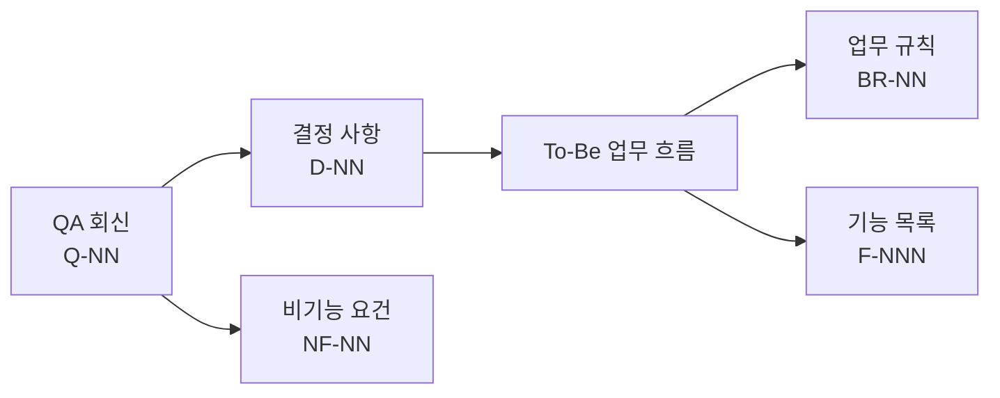

# 01-2. To-Be와 기능 목록 만드는 법

> 대상 산출물: `docs/ja/01_要件定義/06 ~ 09`
> "QA 회신을 받은 뒤, 그걸 어떻게 기능과 숫자로 바꾸는가"를 설명해요.

## 1. 흐름

모든 산출물이 **ID로 서로 연결**돼요. 「이 기능은 왜 있나?」라고 물으면 F → K(과제) → 회의록 발언까지 거슬러 올라갈 수 있어야 해요. 이걸 トレーサビリティ(추적 가능성)라고 해요.

## 2. QA 회신이 설계를 바꾼 실제 예

| 회신 | 내가 내린 판단 | 이유 |
|---|---|---|
| Q-01 「20日締めが15社」 | 마감일을 거래처 마스터에 둔다 | 전사 공통 설정으로는 대응 불가 |
| Q-03 「同じ受注のまま後日出荷」 | 수주 명세에 `출하 완료 수량`을 두고 상태에 「一部出荷」 추가 | 수주를 쪼개지 않으므로 잔량을 명세에서 관리해야 함 |
| Q-10 「不足でも登録したい」 | 재고 부족은 **에러가 아니라 경고**, 유효 재고는 마이너스 허용 | 에러로 막으면 영업이 시스템 밖(전화·메모)에서 받게 되어 일원화가 깨짐 |
| Q-13 「棚卸中は入出庫なし」 | 실사 중 입출고 등록을 **시스템이 금지** | "안 한다"는 운용 규칙은 언젠가 깨지므로 시스템으로 막음 |
| Q-04 「返品は月2〜3件」 | **대상 외**로 하고 운용으로 대체 | 빈도가 낮은 예외를 다 넣으면 일정이 무너짐 |

> 💡 **판단 요령:** ① 자주 일어나나? ② 틀리면 피해가 큰가? ③ 사람이 운용으로 대신할 수 있나? 이 세 가지로 「넣는다 / 뺀다」를 정해요.

## 3. To-Be 흐름도 그리는 요령

- As-Is와 **같은 틀**(같은 스윔레인, 같은 순서)로 그리고 「システム」 레인만 추가해요. 그래야 고객이 "어디가 바뀌는지"를 바로 알아봐요.
- 사람이 하는 일과 시스템이 하는 일을 분명히 나눠요. 「在庫を自動減算」은 시스템, 「ピッキング」은 사람.
- 각 상자에 **해결되는 과제 번호(✅ K-NN)** 를 붙여요. 과제 목록의 「높음」 과제가 하나도 빠지지 않았는지 마지막에 표로 확인해요(07 문서 5장).

## 4. 요망 → 요건 → 기능으로 쪼개기

예: 야마모토 주임 「在庫が一定数を下回ったら知らせてほしい」

| 단계 | 내용 |
|---|---|
| 요망 | 재고가 줄면 알려 달라 |
| 질문으로 구체화 | 기준은 누가 정하나? 창고별인가?(Q-07) 언제 알리나? 어떻게 알리나? 이미 발주한 건 빼야 하나? |
| 요건(업무 규칙) | BR-27 「有効在庫数 ＋ 発注残数 ≦ 発注点」인 상품을 매일 야간에 추출 |
| 기능 | F-104 発注点設定 / F-601 発注点チェックバッチ / F-306 発注アラート照会 / F-006 ダッシュボード |

요망 한 줄이 **기능 4개**가 됐어요. 그리고 「メールでも受け取りたい」는 비용 대비 효과를 설명해서 대상 외로 뺐어요(D-19). 이렇게 **대안을 제시하며 거절하는 것**도 요건정의의 일이에요.

## 5. Must / Should를 나누는 이유

일정이 밀렸을 때 **무엇을 먼저 포기할지 미리 합의**해 두는 장치예요. 전부 Must면 일정 위기 때 협상할 카드가 없어요. 이 프로젝트는 32개 중 6개가 Should예요.

## 6. 비기능 요건을 숫자로 정하는 법

"빠르게", "안전하게"는 요건이 아니에요. 테스트할 수 있는 숫자로 써야 해요.

| 요건 | 숫자를 정한 방법 |
|---|---|
| 性能 | 히어링의 데이터 양(H-04~H-08)으로 **5년 후 건수**를 계산 → 그 상태에서 「3초 이내」 |
| 可用性 | "시스템이 멈추면 어떻게 하나요?"라고 물어봄 → 전화·종이로 버틸 수 있음 → 이중화 없이 가동률 99%, RTO 4시간 |
| RPO | "데이터가 어디까지 날아가도 다시 입력할 수 있나요?" → 당일분은 FAX로 재입력 가능 → 전날 백업 |
| 移行 | 실사일(3/31)과 전환일(4/1)을 맞춤 → 초기 재고가 곧 실사 결과라 차이가 없음 |

> 💡 일본 현장은 IPA의 「非機能要求グレード(ひきのうようきゅうグレード)」 6대 항목을 목차로 써서 빠짐을 막아요. 면접에서 이 이름을 말할 수 있으면 상류 공정을 아는 사람으로 보여요.

## 7. 자주 하는 실수
- QA 회신을 회의록에만 쓰고 기능 목록에 반영하지 않는다 → QA表에 「反映先」 열을 두고 닫아요.
- To-Be에 해결책을 너무 자세히(화면 버튼까지) 그린다 → 그건 기본설계에서 해요.
- 비기능 요건의 근거를 안 쓴다 → 나중에 "왜 3초인가요?"에 답을 못 해요.

## 8. 면접 한마디
> 「非機能要件は、ヒアリングで得た業務量から5年後のデータ件数を見積もり、その条件で応答時間を定義しました。」
> (비기능 요건은 히어링에서 얻은 업무량으로 5년 후 데이터 건수를 추정하고, 그 조건에서 응답 시간을 정의했습니다.)
