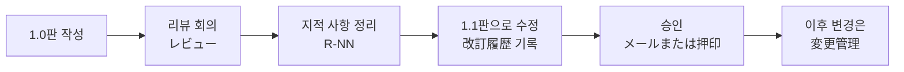

# 01-3. 요건정의서 리뷰와 승인

> 대상 산출물: `docs/ja/01_要件定義/10 ~ 12`

## 1. 요건정의서는 「합의 문서」

요건정의서는 기술 문서가 아니라 **고객과 맺는 약속**이에요. 그래서 고객이 읽고 이해할 수 있는 말로 써야 하고, 승인(承認, しょうにん)을 받아야 다음 공정으로 넘어가요.

## 2. 요건정의서 목차의 의미

| 장 | 왜 필요한가 |
|---|---|
| 1. 概要(목적·달성 기준) | "성공했다"를 판정할 기준. 숫자로 쓴다(예: 청구서 작성 3일 → 반나절) |
| 2. 対象範囲 | 누가, 어떤 업무에 쓰는지 |
| 3. 業務要件(業務ルール BR-NN) | 화면·코드가 아니라 **업무의 규칙**. 나중에 테스트 케이스의 원천이 된다 |
| 4. 機能要件 | 기능 목록(별지) |
| 5. 非機能要件 | 성능·보안 등(별지) |
| 6. 移行要件 | 기존 데이터를 어떻게 옮기나 |
| 7. 前提条件・制約事項 | **고객이 해 줘야 할 일**과 바꿀 수 없는 조건 |
| 8. 対象外 | 안 하는 일. 가장 분쟁이 많은 부분이라 반드시 명기 |

### 業務ルール를 따로 뽑는 이유
「現在庫数は0未満にならない」(BR-03) 같은 규칙은 화면이 여러 개여도 하나예요. 규칙을 화면 설명 속에 흩어 놓으면 출하 화면에서는 지키고 이동 화면에서는 빠뜨리는 일이 생겨요. 규칙에 번호를 붙여 두면 상세설계에서 "BR-03은 StockService 한 곳에서 지킨다"처럼 설계할 수 있어요.

## 3. 리뷰 회의에서 생긴 일과 대응 패턴

| 지적 | 패턴 | 대응 |
|---|---|---|
| R-01 CSV로 뽑고 싶다 | **작은 추가 요망** | 받아들이되 Should로. 일정 위험을 미리 말해 둠 |
| R-02 재발행 구분 | **사양 구체화** | 기존 기능 안에서 반영 |
| R-03 이월 금액 칸은? | **대상 외 기능을 전제로 한 질문** | 대상 외임을 다시 설명하고 **문서에 명기**(8장 10번) |
| R-04 초과 납품은? | **예외 케이스 질문** | 요건은 그대로 두고 **운용으로 대응**하기로 합의, 회의록에 기록 |
| T-07 메일 통지 | **범위 확대 요망** | 영향(비용·운영)을 설명하고 **대안 제시** 후 대상 외 |

> 💡 「できません」으로 끝내지 않고 「代替案(だいたいあん)としては…」으로 이어 가는 게 일본 현장 화법이에요.

## 4. 승인 후에는 「変更管理(へんこうかんり)」

D-24처럼 **"승인 후 변경은 영향과 공수를 제시하고 고객 승인을 받은 뒤 착수한다"** 고 미리 정해 둬요. 이게 없으면 「ついでにこれも」(하는 김에 이것도)가 쌓여서 일정이 무너져요.

## 5. 用語集(용어집)을 만드는 이유
- 같은 것을 「得意先」「顧客」「取引先」로 섞어 쓰면 문서를 읽는 사람이 다른 것으로 오해해요.
- 영어명을 여기서 정해 두면 테이블명·클래스명이 통일돼요(`customer`, `supplier`, `allocated_quantity`).
- 한국어 감각으로 번역하기 쉬운 말에 주의: 売上先(×) → 得意先(○), 割当(△) → 引当(○), 在庫実査(△) → 棚卸(○)

## 6. 改訂履歴(개정 이력) 쓰는 법
- 판수: 작은 수정은 1.0 → 1.1, 큰 변경(구성이 바뀜)은 2.0
- 「何を」「なぜ」가 보이게: 「第3回打合せの指摘を反映（F-405 追加）」
- 승인된 문서를 고칠 때는 반드시 판수를 올리고 고객에게 통지해요.

## 7. 면접 한마디
> 「要件定義書では対象外を明記し、承認後の変更は変更管理のルールに沿って対応することを顧客と合意しました。」
> (요건정의서에는 대상 외를 명기하고, 승인 후 변경은 변경 관리 규칙에 따라 대응하기로 고객과 합의했습니다.)
