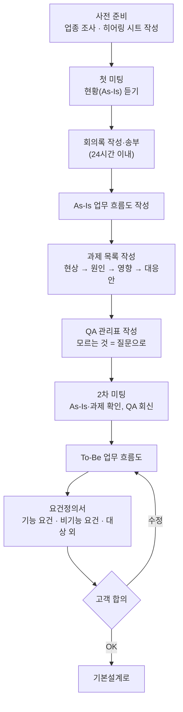
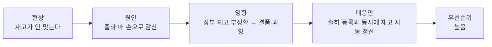

# 01. 첫 미팅에서 요건정의까지: 개발자는 무슨 생각을 하나

> 대상 산출물: `docs/ja/01_要件定義/00 ~ 05`
> 이 문서는 "첫 미팅(初回打合せ)에서 들은 이야기를 어떻게 요건으로 바꿔 가는가"를 개발자 시점에서 설명해요.

---

## 1. 전체 흐름

---

## 2. 사전 준비: 빈손으로 가지 않는다

### 하는 일
1. **업종 조사**: 조명 도매업이면 "발주 → 입하 → 수주 → 출하 → 청구"가 기본 흐름이라는 걸 미리 머릿속에 그려 둔다.
2. **히어링 시트 작성**: 물어볼 질문을 미리 표로 만든다. (`02_ヒアリングシート.md`)
3. **질문을 4가지로 분류**: 조직 / 데이터 양 / 현행 업무 / 요망·제약

### 개발자 생각 포인트
- **데이터 양 질문은 반드시 한다.** 상품 수, 하루 건수, 명세 행 수 같은 숫자는 나중에 비기능 요건(성능·용량), 테이블 설계, 페이징 여부를 정하는 근거가 돼요.
  - 예: "하루 40건, 성수기 80건, 명세 평균 5행" → 1년이면 수주 명세가 약 6만 행 → 인덱스만 제대로 걸면 PostgreSQL로 충분하다는 판단을 내릴 수 있음
- **예외 케이스를 묻는다.** 분할 납품, 반품, 부재 시 승인처럼 "가끔 있는 일"이 설계를 가장 크게 흔들어요.

---

## 3. 첫 미팅 중: 들으면서 머릿속으로 모델링하기

고객 이야기를 들을 때, 개발자는 문장을 이렇게 분해하면서 들어요.

| 들은 말 | 품사 | 개발자가 떠올리는 것 |
|---|---|---|
| 「**商品**が800くらい」 | 명사 | → `商品マスタ` 테이블 |
| 「**倉庫**は2か所」 | 명사 | → `倉庫マスタ` 테이블, 재고는 "상품 × 창고" 단위 |
| 「出荷したら在庫を**減らす**」 | 동사 | → 출하 등록 시 재고 감산 **트랜잭션** |
| 「部長が**押印**してから送る」 | 동사 | → 발주 **상태 전이**: 작성 → 승인 대기 → 승인 → 입하 완료 |
| 「1日**40件**、繁忙期は**2倍**」 | 숫자 | → 비기능 요건(성능), 테스트 데이터 양 |
| 「誰が変えたか**分からない**」 | 불만 | → 조작 로그, 권한 관리 |

**핵심:** 명사 → 테이블(엔티티), 동사 → 기능·상태 변화, 숫자 → 비기능·검증, 불만 → 과제

### 요망(要望)과 요건(要件)은 다르다
- **要望（ようぼう）** = 고객이 말한 그대로의 희망. 예: "재고가 줄면 알려 줬으면 좋겠다"
- **要件（ようけん）** = 시스템이 해야 할 일로 구체화하고 합의한 것. 예: "상품별 발주점을 설정하고, 매일 야간 배치로 발주점 이하 상품을 추출해 다음 날 아침 대시보드에 표시한다"

요망을 그대로 만들면 안 돼요. "알려 준다"가 메일인지 화면 표시인지, 실시간인지 하루 1번인지를 **질문(QA)으로 구체화**해야 요건이 돼요.

### 미팅 중 일본 현장 매너
- 그 자리에서 모르는 건 약속하지 않는다 → 「確認して、改めてご回答いたします」(확인 후 다시 답변드리겠습니다)
- 범위가 커질 것 같은 요망 → 「今回の対象とするかは、持ち帰って検討させてください」(이번 대상으로 할지는 돌아가서 검토하겠습니다)
- 마지막에 **결정 사항과 숙제를 소리 내어 확인**한다.

---

## 4. 미팅 직후: 회의록이 곧 계약서

### 왜 회의록을 바로 보내나
일본 현장에서는 「言った・言わない」(말했다/안 했다) 다툼을 막기 위해 회의록을 아주 중시해요.
그래서 회의록 끝에 이런 문장을 넣어요.

> 本議事録に相違がございましたら、11月20日（金）までにご連絡ください。
> （회의록에 다른 점이 있으면 11월 20일(금)까지 연락 주세요.）

→ 기한까지 연락이 없으면 **합의된 것으로 간주**하는 장치예요.

### 회의록 구성 (`01_初回打合せ議事録.md`)
1. 기본 정보(일시·장소·참석자)
2. 목적·안건
3. **決定事項(결정 사항)**: 가장 위에. 바쁜 사람은 여기만 읽어요
4. 議事内容(회의 내용): 업무별로 정리
5. **宿題事項(숙제)**: 누가 / 무엇을 / 언제까지
6. 다음 미팅 일정

> 💡 한국은 회의록을 생략하거나 메신저로 끝내는 경우도 많지만, 일본은 "결정 사항 + 숙제 + 기한"을 문서로 남기는 게 기본이에요.

---

## 5. As-Is 업무 흐름도: 현재를 그림으로 고정한다

### 왜 그리나
- 고객 본인도 자기 업무를 정확히 모르는 경우가 많아요. 그림으로 보여 주면 "아, 사실 여기서 이렇게 해요" 같은 숨은 업무가 나와요.
- **문제가 생기는 지점(⚠)** 을 그림 위에 표시하면 과제 목록과 바로 연결돼요.

### 그리는 요령
- **스윔레인(담당자별 영역)** 으로 나눈다: 누가 하는 일인지가 보여야 속인화나 정체 지점이 드러나요.
- 시스템이 아니라 **사람과 종이·Excel의 흐름**을 그린다.
- 이 단계에서는 해결책을 그리지 않는다. (해결책은 To-Be에서)

---

## 6. 과제 목록: 현상 → 원인 → 영향 → 대응안

`04_課題一覧.md`의 열 구성이 곧 사고 순서예요.

### 개발자 생각 포인트
- **현상만 보고 해결책으로 바로 가지 않는다.** "재고가 안 맞는다"의 원인이 갱신 누락(K-04)인지, 창고 간 이동 기록 누락(K-08)인지에 따라 만들 기능이 달라져요.
- **우선순위로 범위를 지킨다.** 전부 "높음"이면 아무것도 못 지켜요. 회계 연동(K-13)처럼 "낮음 = 2차 개발"을 명확히 정해 두는 것이 범위 관리예요.

---

## 7. QA 관리표: 모르는 것을 질문으로 바꾼다

### 좋은 질문의 조건
1. **답에 따라 설계가 바뀌는 질문**만 한다.
2. **왜 묻는지(背景・理由)** 를 같이 적는다. 그래야 고객이 정확히 답해 줘요.
3. 가능하면 **선택지**를 준다. ("切り捨て・四捨五入・切り上げのどれですか？")

### 이 프로젝트의 질문이 설계에 미치는 영향

| QA | 답에 따라 바뀌는 설계 |
|---|---|
| Q-01 마감일이 거래처마다 다른가? | 다르면 `取引先マスタ`에 `締日` 컬럼 추가, 청구 배치가 거래처별로 동작 |
| Q-02 소비세 끝수 처리 방법 | 금액 계산 로직, 단위 테스트 케이스 |
| Q-03 분할 납품 처리 | 수주 명세에 `出荷済数量` 컬럼 필요 여부, 수주 상태에 "일부 출하" 추가 |
| Q-05 대리 승인자 | 승인 테이블 구조, 권한 설계 |
| Q-07 발주점 단위 | 발주점을 `商品マスタ`에 둘지, `商品×倉庫` 테이블로 둘지 |

> 💡 이 표처럼 **"질문 → 설계 영향"** 을 설명할 수 있으면 면접에서 상류 공정 경험을 강하게 어필할 수 있어요.

---

## 8. 다음 단계 예고

| 순서 | 할 일 | 산출물 |
|---|---|---|
| 1 | 2차 미팅: As-Is·과제 확인, QA 회신 받기 | 第2回打合せ議事録 |
| 2 | To-Be 업무 흐름 설계: 시스템 도입 후 업무 | `06_新業務フロー_ToBe.md` |
| 3 | 기능 목록·비기능 요건 정리 | `07_要件定義書.md` |
| 4 | 고객 합의(承認) | 要件定義書 확정본 |

---

## 9. 면접에서 이렇게 말할 수 있어요

> 「初回ヒアリングでは、現状の業務フローと課題を整理し、課題一覧とQA管理表で顧客と認識を合わせながら要件を固めました。特に、要望をそのまま要件にせず、確認事項を通じて具体化することを意識しました。」
>
> (첫 히어링에서는 현행 업무 흐름과 과제를 정리하고, 과제 목록과 QA 관리표로 고객과 인식을 맞추면서 요건을 확정했습니다. 특히 요망을 그대로 요건으로 만들지 않고 확인 사항을 통해 구체화하는 것을 의식했습니다.)
