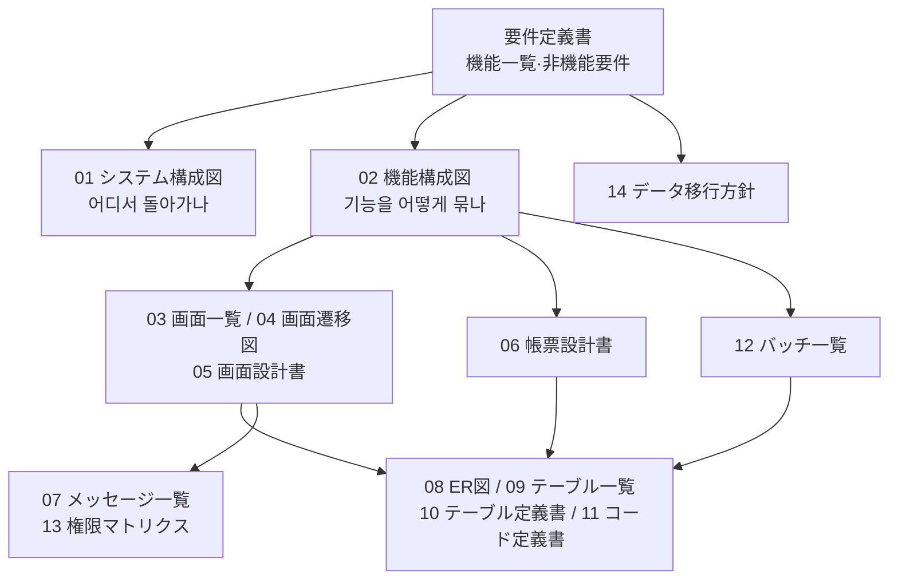

# 02-1. 기본설계란 무엇인가

> 대상 산출물: `docs/ja/02_基本設計/01, 02`, `docs/ja/00_プロジェクト管理/02_開発標準書.md`

## 1. 요건정의·기본설계·상세설계의 차이

| 공정 | 답하는 질문 | 읽는 사람 | 이 프로젝트의 예 |
|---|---|---|---|
| 要件定義(ようけんていぎ) | **무엇을** 할 수 있어야 하나 | 고객 | 「受注登録時に在庫を引き当てる」(BR-12) |
| 基本設計(きほんせっけい) = 外部設計 | 사용자에게 **어떻게 보이나** | 고객 + 개발자 | 수주 등록 화면에 「有効在庫」 열을 두고 부족하면 빨간 글씨, 등록 시 W-001 확인 |
| 詳細設計(しょうさいせっけい) = 内部設計 | 안에서 **어떻게 만드나** | 개발자 | `StockService.allocate()`가 t_stock 행을 잠그고 allocated_quantity를 더함 |

기본설계는 **고객이 리뷰하는 마지막 설계서**예요. 그래서 화면·장표·데이터 항목처럼 고객이 판단할 수 있는 것을 여기서 다 정해요. 반대로 클래스명이나 SQL은 고객이 판단할 수 없으니 상세설계로 넘겨요.

## 2. 기본설계 산출물 지도

순서에 의미가 있어요. **화면·장표를 먼저 정하고 테이블을 나중에** 정해요. 화면에 나와야 할 항목이 정해져야 어떤 데이터를 보관해야 하는지 알 수 있기 때문이에요.

## 3. システム構成図: 비기능 요건이 구성을 결정한다

구성도는 "멋있게" 그리는 게 아니라 **비기능 요건 하나하나에 답하는 그림**이에요.

| 요건 | 구성 판단 |
|---|---|
| NF-05 이중화 안 함, NF-02 가동률 99% | VM 1대 + 컨테이너 자동 재시작. 로드 밸런서·DB 복제는 넣지 않음 |
| NF-04 RPO 전날 야간 | 일별 `pg_dump` → Object Storage. 실시간 복제는 불필요 |
| NF-29 접속원 IP 제한 | 시큐리티 리스트에서 고객 거점 IP만 443 허용 |
| NF-35 환경 분리 | PRD와 STG를 다른 VM으로 |

> 💡 면접에서 "왜 쿠버네티스를 안 썼나요?"라고 물으면 "利用者15名、可用性要件は稼働率99%・RTO 4時間だったため、単一VMのDocker Composeで十分と判断しました"(사용자 15명, 가용성 요건이 가동률 99%·RTO 4시간이어서 단일 VM의 Docker Compose로 충분하다고 판단했습니다)라고 **요건으로 답하면** 돼요.

## 4. 機能構成図: 서브시스템과 의존 방향

기능을 6개 서브시스템(common / master / stock / purchase / sales / billing)으로 묶고 **의존 방향을 한쪽으로** 정했어요.

- purchase → stock, sales → stock (입하·출하가 재고를 바꿈)
- stock은 purchase·sales를 모름

이렇게 해 두면 "재고 수량을 바꾸는 코드는 stock 안에만 있다"가 보장돼요. 재고가 안 맞는 버그가 나면 볼 곳이 한 군데예요. 이게 고객의 가장 큰 고민(K-04, K-09)에 대한 구조적인 답이기도 해요.

## 5. 開発標準書를 이 시점에 만드는 이유

설계서와 코드에 이름이 쏟아지기 시작하는 게 기본설계부터예요. 그 전에 규칙을 정해 두지 않으면 `customer` / `client` / `tokuisaki`가 섞여요. 일본 현장에서는 여러 회사(パートナー, 협력사) 사람이 함께 일하므로 표준서가 없으면 통합할 때 엉망이 돼요.

이 프로젝트의 표준서에서 특히 눈여겨볼 규칙:
- **재고 테이블은 재고 갱신 서비스를 통해서만 갱신**(코딩 규칙 5)
- **설계와 다르게 구현하면 설계서를 먼저 고친다**(4장): 일본 현장은 「設計書と実装の乖離(かいり)」(설계서와 구현의 괴리)를 아주 싫어해요.
- 테스트 메서드명은 일본어: `現在庫数を超える出荷_エラーになる()`. 일본 현장에서 흔하고, 테스트 결과가 곧 사양서처럼 읽혀요.

## 6. 면접 한마디
> 「基本設計では、非機能要件を根拠にシステム構成を決め、サブシステム間の依存方向を一方向に定めました。」
> (기본설계에서는 비기능 요건을 근거로 시스템 구성을 정하고, 서브시스템 간 의존 방향을 한쪽으로 정했습니다.)
