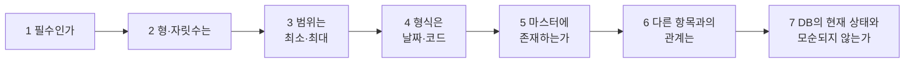

# 02-2. 화면 설계서 쓰는 법

> 대상 산출물: `docs/ja/02_基本設計/03 ~ 07`

## 1. 화면 설계서의 5요소

| 요소 | 일본어 | 정하는 것 |
|---|---|---|
| 레이아웃 | レイアウト | 무엇이 어디에 보이나 |
| 항목 정의 | 項目定義(こうもくていぎ) | 항목마다 형·자릿수·필수·입력 체크·초기값 |
| 이벤트 정의 | イベント定義 | 버튼을 누르면 무슨 일이 일어나고 어디로 가나 |
| 상관·업무 체크 | 相関チェック・業務チェック | 항목 여러 개나 DB 상태를 봐야 하는 체크 |
| 보충 | 補足 | 위에 안 들어가는 규칙 |

이 다섯 가지가 있으면 **다른 개발자가 물어보지 않고 만들 수 있고, 테스터가 테스트 케이스를 뽑을 수 있어요.** 그게 화면 설계서의 합격 기준이에요.

## 2. 입력 체크를 빠짐없이 정하는 순서

항목 하나마다 아래 순서로 질문해요.

- 1~4: 単項目チェック(たんこうもくチェック, 단일 항목 체크) → 항목 정의 표에
- 5: マスタ存在チェック → 「유효한 상품일 것(E-006)」
- 6: 相関チェック(そうかんチェック) → 「명세 안에서 같은 상품이 없을 것(E-009)」
- 7: 業務チェック → 「현재고 수 이하일 것(E-030)」, 「다른 사용자가 먼저 갱신하지 않았을 것(E-020)」

**7번이 가장 빠지기 쉽고 가장 중요해요.** 화면을 연 시점과 버튼을 누른 시점 사이에 다른 사람이 데이터를 바꿨을 수 있어요. 그래서 출하 등록(SCR-405)에는 「登録時点のデータで判定する」(등록 시점 데이터로 판정한다)고 명시했어요.

## 3. 에러와 경고를 구분한다

| 구분 | 의미 | 예 |
|---|---|---|
| エラー(E) | 등록할 수 없다 | 현재고보다 많이 출하(E-030) |
| 警告(W) | 확인하면 등록할 수 있다 | 유효 재고 부족인 수주(W-001) |

고객이 Q-10에서 "부족해도 받고 싶다"고 했기 때문에 수주는 **경고**, 출하는 물건이 실제로 없으니 **에러**예요. 같은 "재고 부족"이라도 업무 의미에 따라 달라져요.

## 4. 버튼 표시 조건은 「상태 × 권한」 표로

SCR-303(発注詳細)처럼 버튼이 많은 화면은 문장으로 쓰면 반드시 빠져요. **표로 쓰면 빈칸이 보여서** 누락을 잡을 수 있어요.

| 버튼 | 상태 | 권한 | 추가 조건 |
|---|---|---|---|
| 承認 | 承認待ち | 承認者 | 申請者本人でないこと |

그리고 "버튼을 숨기는 것"은 편의일 뿐이에요. 화면 표시 후 상태가 바뀌었거나 URL을 직접 치는 경우가 있으니 **서버에서 같은 조건을 다시 체크**해요(E-021, E-012). 이건 보안 면접 단골 질문이에요.

## 5. 메시지를 목록으로 따로 관리하는 이유
- 같은 뜻의 문구가 화면마다 달라지는 걸 막아요(「入力してください」 vs 「必須です」).
- 문구를 바꿀 때 프로그램을 안 고쳐도 돼요(`messages.properties`).
- 테스트 사양서에서 「E-030が表示されること」처럼 ID로 기대 결과를 쓸 수 있어요.

일본어 메시지 톤: 사용자를 탓하지 않고 **다음에 할 일**을 알려 줘요. 「不正な入力です」(×) → 「{0}を入力してください」(○)

## 6. 画面遷移図와 状態遷移図

- 画面遷移図(がめんせんいず): 화면에서 화면으로의 이동. 「登録後は詳細画面へ」처럼 등록 후 어디로 가는지를 꼭 넣어요.
- 状態遷移図(じょうたいせんいず): 전표 상태의 변화. **그려 보면 빠진 화살표가 보여요.** 실제로 이 프로젝트에서 「出荷を間違えたら戻せない」(출하를 잘못하면 못 되돌림)는 누락을 여기서 발견해 CR-01(출하 취소)로 이어졌어요.

## 7. 帳票設計(장표 설계) 포인트
- 일본 업무 시스템에서 장표는 "고객의 고객"이 보는 얼굴이에요. 「御中(おんちゅう)」, 창 봉투 위치, 페이지당 행 수 같은 디테일을 설계서에 써요.
- 금액은 **출력할 때 다시 계산하지 않아요.** 마감 때 계산해 저장한 값을 그대로 찍어요. 그래야 재발행해도 금액이 같아요.
- インボイス制度(적격청구서) 기재 사항을 항목 번호와 대응시켜 두면 "요건을 만족한다"를 문서로 증명할 수 있어요.

## 8. 자주 하는 실수
- 정상 흐름만 쓰고 「0건일 때」「에러일 때」「권한이 없을 때」를 안 쓴다.
- 초기값을 안 정한다 → 구현자마다 달라짐.
- 자릿수를 화면과 테이블에서 다르게 쓴다 → 화면 설계 후 테이블 정의서와 대조해요.

## 9. 면접 한마디
> 「画面設計では、単項目チェック・相関チェック・業務チェックを分けて定義し、登録時点のデータで再チェックする方針としました。」
> (화면 설계에서는 단일 항목 체크·상관 체크·업무 체크를 나눠 정의하고, 등록 시점 데이터로 다시 체크하는 방침으로 했습니다.)
