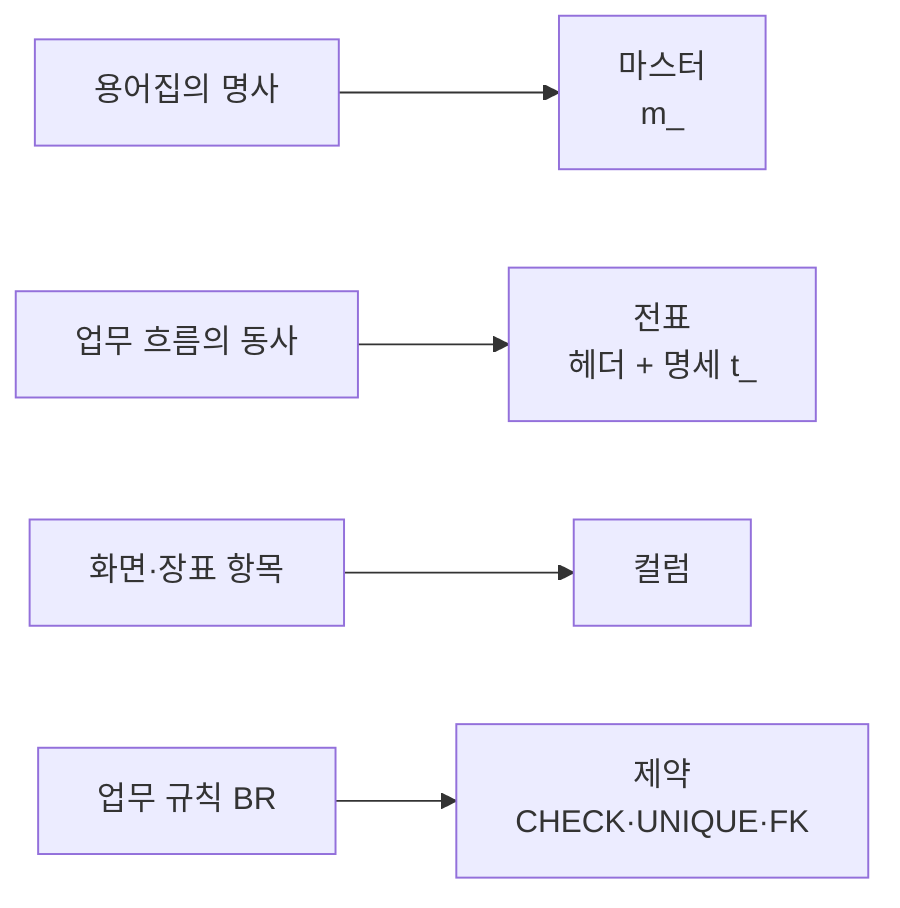

# 02-3. 테이블 설계 생각법

> 대상 산출물: `docs/ja/02_基本設計/08 ~ 15`

## 1. 테이블을 찾는 순서

- **명사 → 마스터**: 商品, 倉庫, 取引先
- **동사 → 전표**: 受注する → `t_sales_order`, 出荷する → `t_shipment`. "언제 누가 무엇을 얼마나"가 기록돼야 하는 일은 전표가 돼요.
- **헤더와 명세**: 전표 1장에 상품이 여러 줄이면 헤더(1) : 명세(N)로 나눠요. 일본 업무 시스템의 기본 형태예요.

## 2. 이 프로젝트의 핵심 판단 6가지

### (1) 재고: 「수량」으로 둘까, 「이력의 합계」로 둘까
| 방식 | 장점 | 단점 |
|---|---|---|
| 이력만 두고 합계 계산 | 불일치가 원천적으로 없음 | 건수가 늘면 느려짐. 할당 판단마다 집계 |
| 수량만 둠 | 빠름 | 왜 이 숫자인지 설명 못 함(=현행 Excel과 같은 문제) |
| **둘 다 둠(채택)** | 빠르고 추적 가능 | 둘이 어긋날 수 있음 → 한 트랜잭션에서 같이 갱신하고 `quantity_after`로 검증 |

고객의 최대 고민이 「在庫が合わない・原因が追えない」(K-04, K-09)이니 이력은 필수, 수주 입력 때 바로 보여 줘야 하니 수량도 필수예요.

### (2) 分納(분할 납품): 명세에 「済数量」을 둔다
수주 명세에 `shipped_quantity`를 두고 잔량 = `quantity − shipped_quantity`로 계산해요. 출하는 별도 전표(`t_shipment`)로 여러 번 쌓여요. 「受注1 : 出荷N」 관계예요.

### (3) 請求와 出荷의 연결: 출하에 `invoice_id`
"미청구 출하"를 `invoice_id IS NULL`로 표현하면 **이중 청구가 구조적으로 불가능**해요. 플래그(請求済フラグ)만 두는 것보다 어느 청구에 들어갔는지까지 알 수 있어요.

### (4) 과거 전표에 값을 복사해 둔다
수주 명세에 단가·세 구분, 청구 명세에 품명까지 **복사(スナップショット)** 해요. 정규화 원칙에는 어긋나 보이지만, 상품 마스터의 단가를 바꿨다고 지난달 청구서 금액이 바뀌면 안 되니까요. "정규화를 알고서 일부러 깬 것"이라고 설명할 수 있어야 해요.

### (5) 채번 테이블
`SO27040001`처럼 연월마다 1부터 시작해야 해서 DB 시퀀스를 못 써요. `t_numbering` 행을 잠그고 1 더하는 방식이 일본 현장의 정석이에요. 롤백되면 번호도 되돌아가서 **결번이 안 생기는** 장점이 있고, 대신 잠금 대기가 생겨요(이 규모에서는 문제없음).

### (6) 구분값을 10 단위로
`10 作成中 / 20 承認待ち / 25 差戻し / 30 承認済…`. 나중에 중간 상태가 생겨도 끼워 넣을 수 있어요(25가 실제로 그 예).

## 3. 업무 규칙을 DB 제약으로도 건다

| 업무 규칙 | DB 제약 |
|---|---|
| BR-03 현재고는 0 미만이 안 된다 | `CHECK (quantity >= 0)` |
| BR-26 입하 합계는 발주 수량을 못 넘는다 | `CHECK (received_quantity <= quantity)` |
| BR-05 같은 창고에 진행 중 실사는 1건 | 부분 UNIQUE 인덱스 |

프로그램에서 체크하더라도 버그가 있으면 뚫려요. DB 제약은 **마지막 방어선**이에요. "프로그램 체크 + DB 제약"의 이중 방어를 설명할 수 있으면 좋아요.

## 4. テーブル定義書 작성 요령
- 論理名(일본어)과 物理名(영어)을 둘 다 쓴다. 물리명은 용어집 영어명으로.
- 자릿수는 화면 설계서와 맞춘다. 금액 `NUMERIC(12,0)`: 엔화는 소수가 없고, `double`은 오차가 나서 금지.
- 건수 견적(09 テーブル一覧)을 해 두면 인덱스가 필요한 테이블이 보여요. 36만 행 명세를 전체 스캔하면 NF-07(5초)을 못 지켜요.
- `created_at/by`, `updated_at/by` 공통 컬럼은 "누가 언제"(K-12)의 최소 보장이에요.

## 5. 배치·권한·이관을 기본설계에서 정하는 이유
- **バッチ一覧**: 「異常終了したらどうなるか」「再実行できるか」를 반드시 써요. 일본 현장 배치 설계의 핵심은 **リラン(재실행) 설계**예요. 세 배치 모두 "그대로 다시 돌려도 결과가 같다(冪等, べきとう)"로 설계했어요.
- **権限マトリクス**: 「申請と承認を分ける」 같은 상호 견제(相互牽制, そうごけんせい)는 내부통제 요건이라 고객 승인이 필요해요.
- **データ移行方針**: 이관은 마지막에 생각하면 늦어요. 실사일과 전환일을 맞추는 것처럼 **업무 일정과 엮여** 있어서 일찍 합의해요.

## 6. 변경 관리(CR-01)를 실제로 해 본 것
기본설계 중에 "출하를 잘못 넣으면 고칠 수 없다"는 누락을 발견했어요. 몰래 기능을 넣지 않고 아래 순서로 처리했어요(15 第4回議事録).

1. 경위와 영향을 설명 (왜 생겼나, 안 하면 어떻게 되나)
2. 변경 내용·제한 사항·영향 범위(화면/테이블/문서)·공수·일정 영향 제시
3. 고객 승인(D-25) → 요건정의서 1.2판으로 개정

> 💡 "설계 중 누락을 발견하면 어떻게 하나요?"는 면접 단골이에요. 이 사례를 그대로 말하면 돼요.

## 7. 면접 한마디
> 「在庫は現在数量と入出庫履歴の両方を持たせ、同一トランザクションで更新することで、速度と追跡性を両立させました。」
> (재고는 현재 수량과 입출고 이력을 둘 다 두고 같은 트랜잭션에서 갱신해서 속도와 추적성을 함께 확보했습니다.)
