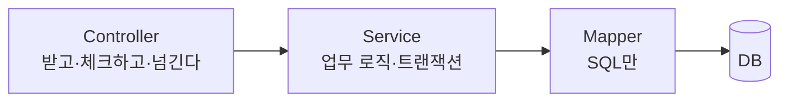

# 03-1. 상세설계와 아키텍처

> 대상 산출물: `docs/ja/03_詳細設計/01 ~ 04`
> 이 문서가 이 프로젝트에서 **면접 질문이 가장 많이 나올 부분**이에요. 특히 3장(배타 제어)은 자기 말로 설명할 수 있을 때까지 읽어 보세요.

## 1. 상세설계의 합격 기준

> **"이 문서만 보고 다른 개발자가 같은 코드를 쓸 수 있는가"**

기본설계가 "화면에서 무엇이 보이나"였다면, 상세설계는 "어느 클래스의 어느 메서드가, 어떤 순서로, 어떤 SQL을 실행하나"를 정해요. 일본 현장에서는 상세설계와 구현을 다른 사람(다른 회사)이 하는 경우가 많아서, 설계서가 곧 발주서 역할을 해요.

## 2. 계층(レイヤー) 구조와 "하면 안 되는 것"



계층을 나누는 이유는 책 설명보다 **"어디를 고치면 되는지 바로 알 수 있다"** 가 실감하기 쉬워요.
- 화면 문구가 틀렸다 → 템플릿 / Controller
- 금액 계산이 틀렸다 → Service / 계산 부품
- 검색 결과가 틀렸다 → Mapper XML

설계서에는 "하는 일"만큼 **"하면 안 되는 일"** 을 써요. 예: Controller에서 Mapper를 직접 부르지 않는다. 이걸 안 써 두면 급할 때 꼭 누군가 그렇게 해요.

### 이 프로젝트 고유의 규칙: 다른 서브시스템의 Mapper를 부르지 않는다
`ShipmentService`(판매)는 `StockMapper`(재고)를 직접 부르지 않고 `StockService`를 불러요. 그래서 "재고를 바꾸는 코드"가 `StockService` 한 곳에만 있어요.

## 3. 배타 제어(排他制御, はいたせいぎょ): 가장 중요한 설계

### 3.1 두 가지 시간을 나눠 생각한다

| 시간 | 길이 | 문제 | 해결 |
|---|---|---|---|
| 화면을 보고 있는 동안 | 수십 초~수 분 | 그사이 다른 사람이 고친 걸 모르고 덮어씀 | **楽観的排他(らっかんてきはいた, 낙관적 배타)**: `version` 비교 |
| 등록 버튼 누른 뒤 처리 중 | 1초 미만 | 두 처리가 동시에 같은 행을 읽고 각자 계산해서 써서 수량이 틀어짐 | **悲観的排他(ひかんてきはいた, 비관적 배타)**: `SELECT … FOR UPDATE` |

### 3.2 재고에 낙관적 배타를 쓰지 않은 이유
재고 행은 수많은 전표가 동시에 건드려요. 낙관적 배타면 A·B 두 사람이 같은 상품이 든 수주를 동시에 등록하기만 해도 한 명은 "다른 사용자가 먼저 갱신했습니다" 에러를 봐요. 둘 다 정당한 업무인데요. 그래서 재고는 **행을 잠그고 기다렸다가 순서대로** 처리해요.

반대로 마스터 편집은 낙관적 배타가 맞아요. 화면을 몇 분씩 열어 두는데 그동안 행을 잠가 둘 수는 없으니까요.

### 3.3 "확인하고 갱신"은 반드시 잠근 뒤에

```
❌ 잘못된 순서                         ✅ 올바른 순서
1. 현재고 조회 (10개)                   1. 행 잠금 + 현재고 조회 (10개)
2. 10 ≥ 8 이니까 OK                    2. 10 ≥ 8 이니까 OK
   ← 이 사이에 다른 사람이 5개 출하       (다른 사람은 대기)
3. 재고 = 10 − 8 = 2 로 갱신 (틀림!)     3. 재고 = 재고 − 8 로 갱신
                                       4. 커밋 → 다른 사람이 이어서 처리
```

두 가지가 핵심이에요.
1. **잠근 뒤에 확인한다** (`FOR UPDATE`)
2. **절댓값이 아니라 증감값으로 갱신한다** (`quantity = quantity − 8`)

### 3.4 데드락(デッドロック) 방지: 잠금 순서를 정한다
A가 상품 1 → 2 순으로, B가 상품 2 → 1 순으로 잠그면 서로 상대를 기다리며 멈춰요. **모든 처리가 같은 순서(상품 ID 오름차순)** 로 잠그면 이 일이 생기지 않아요. 프로젝트 전체의 순서는 「伝票ヘッダ → 採番 → 倉庫 → 在庫」예요.

### 3.5 실사와 입출고: 공유 잠금과 배타 잠금
"실사 중에는 입출고 금지"를 플래그 확인만으로 구현하면, 확인 직후 실사가 시작되는 틈이 생겨요. 그래서 창고 행에 입출고는 **共有ロック(FOR SHARE)**, 실사 시작은 **排他ロック(FOR UPDATE)** 을 걸어요. 입출고끼리는 서로 안 막고, 실사 시작만 진행 중인 입출고가 끝나길 기다려요.

> 💡 면접 답변 틀: 「在庫は複数の伝票から同時に更新されるため、楽観ロックではなく行ロックを採用しました。デッドロックを防ぐため、商品IDの昇順でロックを取得するルールにしています。」
> (재고는 여러 전표에서 동시에 갱신되므로 낙관적 잠금이 아니라 행 잠금을 채택했습니다. 데드락을 막기 위해 상품 ID 오름차순으로 잠금을 얻는 규칙으로 했습니다.)

## 4. 트랜잭션 경계를 Service에 두는 이유
출하 등록은 "출하 등록 + 수주 명세 갱신 + 재고 감산 + 이력 등록"이 **전부 성공하거나 전부 실패**해야 해요. 이 묶음을 아는 건 업무 로직(Service)뿐이에요. Mapper 단위로 트랜잭션을 끊으면 재고만 줄고 출하 전표는 없는 상태가 생길 수 있어요. 그래서 「1回のボタン操作＝1トランザクション＝Service の1メソッド」예요.

## 5. 공통 부품으로 뽑는 기준
"여러 곳에서 쓰이고, 틀리면 피해가 큰 것"을 뽑아요.

| 공통 부품 | 뽑은 이유 |
|---|---|
| StockService | 재고 규칙(BR-01~05)을 한 곳에서 보장 |
| NumberingService | 전표 번호 중복 방지 |
| TaxCalculator | 끝수 처리가 한 곳이라도 다르면 청구 금액이 틀어짐 |
| 조작 로그(AOP) | 각 메서드에서 직접 쓰면 반드시 빠뜨림 → 애너테이션으로 |
| Clock | `now()`를 직접 쓰면 "월말 마감" 테스트를 못 함 |

## 6. 예외 설계: 사용자가 고칠 수 있나로 나눈다

| 종류 | 사용자가 고칠 수 있나 | 표시 |
|---|---|---|
| 入力エラー / 業務エラー(BusinessException) | 있다(수량을 줄인다, 다시 연다) | 원래 화면 + 구체적 메시지 |
| システムエラー | 없다 | 에러 화면 + **受付番号(접수 번호)** |

접수 번호는 문의 대응을 위한 장치예요. 사용자가 번호만 불러 주면 로그에서 바로 찾을 수 있어요. 스택 트레이스를 화면에 보여 주면 안 되는 건 보안 이유(내부 구조 노출)예요.

## 7. 보안 설계: 3단계 인가
1. URL: 화면을 열 수 있나
2. 조작: 갱신 메서드를 실행할 수 있나(`@PreAuthorize`)
3. 데이터: 그 데이터에 대해 할 수 있나(자기 신청은 승인 불가)

"버튼을 숨겼으니 안전하다"는 틀려요. 브라우저에서 URL을 직접 치거나 요청을 고쳐 보낼 수 있으니까요. **화면은 편의, 서버가 보안**이에요.

## 8. PoC를 하지 못한 채 설계한 것에 대해
이번에는 작업 환경에서 라이브러리를 내려받을 수 없어 PoC를 실행하지 못했어요. 그래서
- 검증 보고서를 「未実施(미실시)」로 정직하게 남기고
- 문제가 나왔을 때의 **대안과 설계 영향**을 미리 써 뒀어요(01 문서 4장).

실제 현장에서도 "아직 확인 못 한 전제"는 숨기지 않고 **リスク(리스크)** 로 문서에 남겨요. P04(구현)의 첫 작업이 이 PoC 실행이에요.

## 9. 셀프 체크
- 낙관적 배타와 비관적 배타를 각각 어디에 썼고 왜인가?
- 「확인 → 갱신」을 잠금 없이 하면 어떤 일이 생기나? 예를 들어 설명할 수 있나?
- 트랜잭션 경계가 Service인 이유는?
- 업무 에러와 시스템 에러의 처리 차이는?
