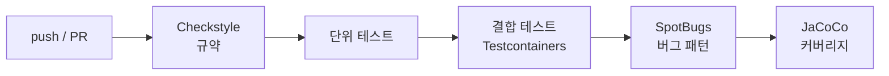

# 04-1. 개발 환경과 CI(開発環境・CI構築)

> 대상 산출물: `pom.xml`, `docker-compose.yml`, `src/main/resources/db/migration/`, `.github/workflows/ci.yml`, `docs/ja/04_製造/01_開発環境構築手順書.md`, `docs/ja/03_詳細設計/01_技術検証結果報告書.md`(1.0판)
> 구현(製造)의 첫 단계는 기능이 아니라 **"누가 받아도 같은 결과가 나오는 작업대"** 를 만드는 거예요. 면접에서 "CI는 어떻게 구성했나요?" "기술 검증에서 뭐가 나왔나요?"라는 질문에 답할 수 있게 읽어 보세요.

## 1. 개발 환경 구축(開発環境構築)이 왜 한 단계나 차지하나

일본 SI 현장에서는 구현에 들어가기 전에 **開発環境構築手順書**를 먼저 만들어요. 이유는 단순해요.
- 개발자가 여러 명(또는 나중에 유지보수 담당자)이 붙었을 때 **"내 PC에서는 되는데"** 를 없애기 위해
- 버전이 다르면 같은 코드가 다르게 동작하기 때문에(특히 Spring Boot 메이저 버전, JDBC 드라이버)

그래서 이 프로젝트는 "설치할 것을 줄이는" 방향으로 만들었어요.

| 장치 | 효과 |
|---|---|
| Maven Wrapper(`mvnw`) | Maven을 설치하지 않아도 정해진 버전(3.9.16)이 자동으로 받아짐 |
| docker compose | PostgreSQL을 설치하지 않아도 `docker compose up` 한 줄로 같은 DB가 뜸 |
| Flyway | 테이블을 손으로 만들지 않음. 앱이 뜰 때 DDL이 버전 순서대로 적용됨 |
| `.gitattributes` | Windows(CRLF)와 Linux(LF)의 줄바꿈 차이로 `mvnw`가 CI에서 안 도는 사고를 막음 |

## 2. DDL을 Flyway로 관리하는 이유(DBマイグレーション)

"테이블 정의서(Excel/Markdown)를 보고 DBA가 SQL을 실행한다"는 방식은 환경이 늘어날수록(개발·검증·운영) 차이가 생겨요. Flyway는 `V1__…sql`, `V2__…sql`처럼 **번호를 붙인 SQL을 한 번씩만** 실행하고, 실행 기록을 `flyway_schema_history`에 남겨요.

| 파일 | 내용 | 포인트 |
|---|---|---|
| `V1__create_tables.sql` | 업무 테이블 27개 | 테이블 정의서의 PK·FK·CHECK·인덱스를 그대로. 제약 이름도 개발표준서 규칙(`fk_자식_부모`) |
| `V2__create_batch_tables.sql` | Spring Batch 실행 관리 테이블 | 라이브러리가 자동으로 만들게 하지 않고 Flyway로. "DB를 바꾸는 것은 Flyway뿐"이라는 원칙 |
| `V3__grant_app_user.sql` | 권한 | 앱 사용자는 조작 로그를 UPDATE·DELETE할 수 없게(NF-31 조작 로그 변조 방지) |

> **한 번 적용한 V 파일은 고치지 않아요.** 바꾸고 싶으면 `V4__…`를 새로 추가해요. 이미 적용된 파일을 고치면 Flyway가 체크섬 불일치로 기동을 멈춰요. 운영 DB에 들어간 이력을 바꾸지 않는다는 뜻이에요.

### DB 사용자를 둘로 나눈 이유
`hanbai_owner`(테이블 소유자, Flyway용)와 `hanbai_app`(앱용, DML만)을 나눴어요. 앱에 SQL 인젝션 같은 구멍이 있어도 `DROP TABLE`이나 조작 로그 변조는 DB가 거부해요. **"앱 코드를 믿지 않고 DB 권한으로도 막는다"**(多層防御)는 설명은 보안 질문에서 좋은 답이 돼요.

## 3. CI(継続的インテグレーション)

`./mvnw verify` 한 줄이 위 순서를 모두 실행해요. CI(GitHub Actions)도 **같은 명령**을 실행해요. "CI에서만 다른 명령을 쓴다"가 되면 로컬에서 통과한 것이 CI에서 깨지는 원인을 찾기 어려워져요.

| 도구 | 하는 일 | 이 프로젝트에서 겪은 것 |
|---|---|---|
| Checkstyle | 코딩 규약(Google Java Style) 위반 검출 | Javadoc 첫 문장이 「。」로 끝나는데 규칙은 「.」를 기대해서 28건 위반 → 규칙의 `period`를 「。」로 바꿈. **규칙을 끄지 않고 프로젝트에 맞게 조정**한 것이 포인트 |
| SpotBugs | null 참조·리소스 누수 같은 버그 패턴 | Spring DI 빈을 필드에 두면 나오는 지적(EI_EXPOSE_REP)은 이유를 적고 제외 |
| JaCoCo | C0(명령)·C1(분기) 커버리지 | 단위 테스트와 결합 테스트를 합산해서 측정 |
| Testcontainers | 테스트마다 진짜 PostgreSQL 17을 컨테이너로 띄움 | H2 같은 인메모리 DB를 쓰지 않는 이유: `FOR UPDATE`, `ON CONFLICT`, 부분 인덱스처럼 **PostgreSQL에서만 되는 SQL을 쓰기 때문** |

> 제외(suppress) 설정을 할 때는 반드시 **이유를 주석으로** 남겨요. 이유 없는 제외는 리뷰에서 가장 먼저 지적받아요.

## 4. 기술 검증(技術検証/PoC)에서 실제로 나온 것

상세설계 때 "이 조합이 동작한다"는 전제로 설계했고, 그 전제를 여기서 확인했어요. 결과는 모두 합격이었지만 **"합격"보다 "알게 된 것"이 중요**해요. 면접에서 "기술 검증에서 무엇을 배웠나"는 이걸로 답하면 돼요.

| 검증 | 알게 된 것 | 설계에 반영한 것 |
|---|---|---|
| P-01 MyBatis | 선정 때 4.0.x로 적었는데 Boot 4.1용 4.1.0이 나와 있었음 | 기술 선정서 1.2판으로 개정(**버전을 바꾸면 문서도 바꾼다**) |
| P-02 일본어 PDF | IPAex 고딕에는 굵은 서체가 없어서 `bold`가 안 먹음 | 장표는 크기·괘선으로 강조 |
| P-05 Spring Batch | 청크 처리의 Reader를 싱글톤으로 만들면 **두 번째 실행부터 0건으로 「완료」** 가 됨 | BAT-03의 Reader를 `@StepScope`로(배치 상세설계 1.1판) |
| P-05 Spring Batch | Batch 6에서는 JobLauncher 대신 JobOperator. `@BatchTaskExecutor`만 붙이면 비동기 | `BatchConfig`, `JobLaunchService`로 구현 |
| 환경 | PC에 PostgreSQL이 설치돼 있으면 5432 포트가 겹쳐서 엉뚱한 DB에 접속 | 개발 DB 포트를 5433으로, 절차서 「자주 나는 에러」에 기재 |

특히 Reader 건은 좋은 이야깃거리예요. 테스트는 **첫 번째 실행만 보면 통과**해요. "같은 잡을 두 번 돌리면?"이라는 케이스를 테스트에 넣었기 때문에 찾았어요. 운영에서는 매월 같은 잡을 돌리니까, 이걸 놓쳤다면 **두 번째 달 청구 마감이 아무것도 안 하고 「완료」** 가 됐을 거예요.

## 5. 정직하게 남겨 둔 것(未実施・未検証)

| 항목 | 상태 | 언제 |
|---|---|---|
| P-03(OCI 서버에서 이미지 동작) | 미실시 | 서버 할당 후, 08 공정 |
| P-04 중 GitHub Actions에서의 동작 | 미검증(로컬 Testcontainers는 합격) | 첫 push 후 Actions 결과 확인 |

설계서에 "한 것처럼" 쓰지 않는 것도 일본 현장에서 중요한 태도예요. 확인 안 한 것은 「未検証」이라고 쓰고, 언제 확인할지를 같이 써요.

## 6. 셀프 체크
- [ ] `docker compose up -d` → `./mvnw verify` → `./mvnw spring-boot:run`을 내 PC에서 직접 해 봤다
- [ ] Flyway V 파일을 고치면 안 되는 이유를 설명할 수 있다
- [ ] DB 사용자를 둘로 나눈 이유를 설명할 수 있다
- [ ] Testcontainers를 쓰고 H2를 쓰지 않은 이유를 설명할 수 있다
- [ ] `@StepScope`가 없으면 무슨 일이 생기는지 설명할 수 있다
