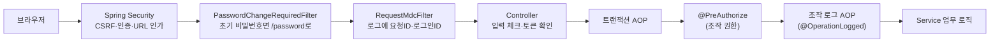

# 04-2. 공통 기능 구현 포인트(共通：認証・権限・操作ログ)

> 대상 코드: `common/config/SecurityConfig.java`, `common/security/*`, `common/operationlog/*`, `common/web/*`, `common/menu/*`, `master/*`(사용자 관리), `templates/fragments/layout.html`
> 관련 문서: `docs/ja/03_詳細設計/04_セキュリティ設計.md`(1.1판), `02_ソフトウェア構成.md`(1.1판), `docs/ja/04_製造/02_コードレビュー記録票.md`
> 업무 기능(재고·구매·판매)은 모두 이 위에서 돌아가요. 면접에서 **"인증·권한은 어떻게 했나요?" "감사 로그는?" "동시 갱신은?"** 이라는 질문에 코드로 답할 수 있게 읽어 보세요.

## 1. 전체 그림: 요청 하나가 지나가는 길



포인트는 **권한을 세 번 본다**는 것(セキュリティ設計 3장)이에요.

| 단계 | 어디서 | 이번 구현 |
|---|---|---|
| ① URL | `SecurityConfig` | 설계서의 URL↔역할 표를 그대로 코드로. **명시적으로 허용하지 않은 URL은 `denyAll()`** |
| ② 조작 | Service의 `@PreAuthorize` | `UserService.create/update`는 ADMIN만. Controller를 거치지 않고 불러도 막힘(테스트로 확인) |
| ③ 데이터 | Service의 업무 체크 | 이번 범위에는 없음(발주 승인 「자기 신청은 승인 불가」가 4단계에서 첫 사례) |

화면에서 메뉴를 숨기는 것(`MenuService`)은 **편의 기능이지 보안이 아니에요.** 그래서 `AuthorizationIT`는 메뉴가 아니라 URL을 직접 두드려서 403을 확인해요.

## 2. 로그인 실패 5회 잠금: "어디서 세느냐"

Spring Security는 인증 결과를 **이벤트**로 알려 줘요. 실패 횟수는 `AuthenticationEventListener` → `LoginService`에서 세요.

| 상황 | 이벤트 | 처리 | 메시지 |
|---|---|---|---|
| 비밀번호 틀림(ID 없음 포함) | BadCredentials | 실패 횟수 +1, 5회면 잠금, 로그 | E-010 |
| 잠긴 사용자 | Locked | 횟수는 그대로, 로그 | E-011 |
| 무효 사용자 | Disabled | 로그 | **E-010**(ID 존재 여부를 안 알려 줌) |
| 성공 | Success | 횟수 0, 최종 로그인 일시, 로그 | → 메뉴 |

면접 포인트 두 가지예요.
- **실패 기록은 `REQUIRES_NEW`**: 로그인 실패는 「실패한 처리」의 기록이라, 바깥 처리가 어떻게 끝나든 남아야 해요(共通処理設計 1장 No.6).
- **행 잠금(`FOR UPDATE`) 후 +1**: 같은 ID로 동시에 틀리면 횟수가 덜 세질 수 있어서, 읽고 → 더하고 → 쓰는 사이를 직렬화했어요. 재고와 같은 사고방식이에요.

## 3. 조작 로그: 어노테이션 하나로 기록하기(AOP)

```java
@OperationLogged(type = OperationType.UPDATE, screenId = "SCR-003", targetType = "m_user")
@Transactional
public String changePassword(LoginUser user, String current, String newPassword) { … }
```

메서드가 **정상 종료하면** 같은 트랜잭션에서 로그를 남기고, 예외(업무 에러)로 끝나면 남기지 않아요(롤백되니까).

이번에 가장 배울 점이 많았던 버그 후보(RV-01)가 여기 있어요.
- 트랜잭션 AOP와 조작 로그 AOP는 **둘 다 우선순위가 "최저"** 라서 어느 쪽이 바깥인지 보장되지 않아요.
- 로그 AOP가 바깥이 되면, 업무가 롤백돼도 **로그만 따로 커밋**돼요. 감사 로그가 거짓말을 하게 되는 거예요.
- 대책: `TransactionConfig`에서 순서를 명시하고, 로그 등록을 `Propagation.MANDATORY`(트랜잭션 없으면 예외)로 바꿨어요. 순서가 틀리면 **조용히 틀리지 않고 바로 터지게** 한 거예요.

## 4. 화면 공통 부품

| 부품 | 하는 일 | 설계 근거 |
|---|---|---|
| `fragments/layout.html` | 헤더(이름·역할·로그아웃), 브레드크럼, 메시지(녹/황/적), 페이징 | 画面一覧 5.1 |
| `MessageHelper` | 메시지 ID → 문구. 「{0}を登録しました」의 {0}도 메시지 키로 해석 | 프로그램에 문구를 쓰지 않음 |
| `Pagination` | 50건 단위, 범위 밖 페이지 보정, 5,000건 초과 경고(W-002) | 共通処理設計 10장 |
| `TransactionTokenManager` | 이중 전송 방지 토큰. 같은 토큰 2번째 POST는 처리 안 함 | 共通処理設計 10장 ③ |
| `CommonBinderAdvice` | 문자열 앞뒤 공백 제거. **비밀번호는 제외** | 共通処理設計 6장 |
| `GlobalExceptionHandler` | 예상 못 한 예외 → 접수 번호(受付番号)를 붙여 ERROR 로그, 화면에는 번호만 | 共通処理設計 5장, NF-32 |

공백 제거는 편리하지만 부작용도 있었어요(RV-02). `/login?timeout`처럼 **값이 빈 파라미터가 null로 바뀌어서** 세션 만료 메시지(E-013)가 안 나왔어요. 테스트가 잡아 줬고 `?timeout=1`로 고쳤어요. "공통 처리는 모든 곳에 영향을 준다"는 좋은 예예요.

## 5. 설계서에 없던 것을 어떻게 처리했나

구현하다 보면 설계에 빠진 게 반드시 나와요. 마음대로 정하지 않고 **질문 → 결정 로그 → 설계서 판수 올림** 순서로 처리했어요.

| 발견 | 결정 | 남긴 곳 |
|---|---|---|
| 처음 로그인할 관리자가 없음 | 사용자가 0명일 때만 환경 변수 비밀번호로 생성(저장소가 public이라 해시도 넣지 않음) | PD-19, セキュリティ設計 1.1 |
| 확인용 비밀번호 불일치·ID와 같은 비밀번호의 메시지가 없음 | E-016·E-017 추가. 기능 범위가 안 바뀌므로 CR이 아니라 판수만 올림 | PD-20, メッセージ一覧 1.2 |
| 관리자가 자기 자신을 무효로 할 수 있음 | 처음엔 **정하지 않고** 확인 사항(U-12)으로 남김 → 답을 받고 E-018·E-019로 금지. 「0명이 되는가」는 유효한 ADMIN 행을 잠근 뒤 판정(두 관리자가 동시에 서로를 무효로 하는 경우 대비) | RV-07, PD-23, 画面一覧 1.2 |

## 6. 브라우저 확인에서 나온 버그: "가끔 CSS가 안 먹는다"(RV-11)

앱을 재시작한 직후 로그인 화면이 한 번 CSS 없이 보였어요. 원인 찾기 순서가 좋은 연습이에요.

1. **가설을 세운다**: 처음엔 「첫 접속 때 URL에 `;jsessionid=`가 붙어서 방화벽에 막힌다」고 의심했어요.
2. **재현 테스트를 먼저 쓴다**: MockMvc는 실제 서버 동작(쿠키·URL 재작성)을 흉내 내지 못해서, 실제 Tomcat을 띄우는 `StaticResourceIT`를 썼어요.
3. **결과**: 가설은 틀렸어요(재현 안 됨). 대신 **사라진 세션 ID 쿠키를 가진 CSS 요청이 「세션 만료」로 로그인 화면에 리다이렉트(302)** 되는 게 재현됐어요.
4. **고친다**: CSS·JS는 사용자와 무관하니 세션을 아예 쓰지 않는 별도 보안 필터 체인으로 분리했어요.

"추측으로 고치지 않고, 실패하는 테스트로 원인을 확인한 뒤 고친다" — 면접에서 디버깅 경험을 물으면 이 순서로 이야기해 보세요.

## 7. 정직하게 남겨 둔 것(未検証)
- 두 관리자가 **동시에** 서로를 무효로 하는 경우는 행 잠금으로 설계했지만, 다중 스레드 테스트는 06 결합 테스트에서 해요(RV-12).
- 운영 환경(Nginx 경유)의 접속 IP 기록은 08 공정에서 확인해요.

## 8. 셀프 체크
- [ ] URL 인가가 있는데 왜 `@PreAuthorize`도 필요한지 설명할 수 있다
- [ ] 로그인 실패 기록이 `REQUIRES_NEW`이고 업무 조작 로그는 `MANDATORY`인 이유를 설명할 수 있다
- [ ] 「무효 사용자」를 E-011이 아니라 E-010으로 보여 주는 이유를 말할 수 있다
- [ ] 낙관적 배타(version)가 실패했을 때 사용자에게 무엇이 보이는지 화면으로 보여 줄 수 있다(E-020)
- [ ] 직접 해 보기: `http://localhost:8080/login`에 `admin` / `Admin2027`로 들어가서 비밀번호 변경 → 사용자 등록 → 다른 브라우저에서 5번 틀려 잠금 → 관리자 화면에서 잠금 해제 → 조작 로그 조회까지 따라가 보기
