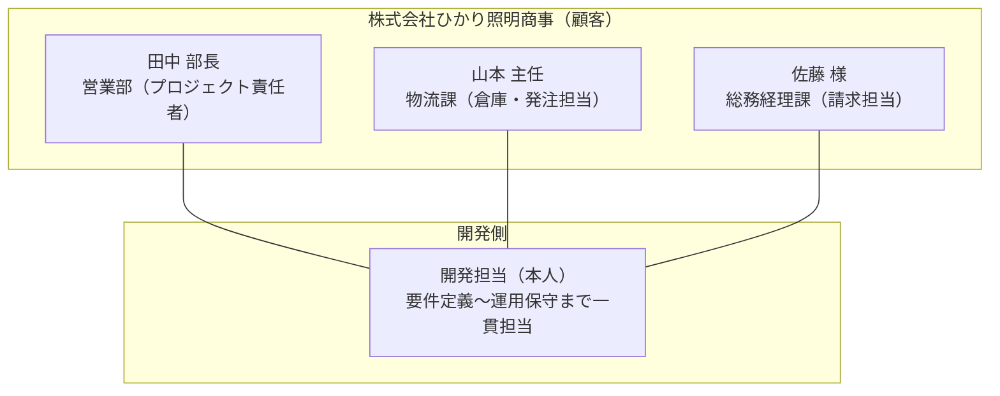
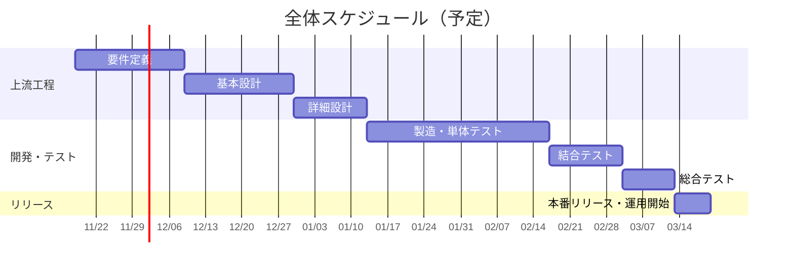

# プロジェクト概要

> ※ 本プロジェクトはポートフォリオ用の架空案件です。登場する企業・人物はすべて架空です。

| 項目 | 内容 |
|---|---|
| プロジェクト名 | 販売管理システム構築プロジェクト |
| 顧客 | 株式会社ひかり照明商事（以下「顧客」） |
| 業種 | 照明器具・LED製品の卸売業 |
| 所在地 | 福岡県福岡市博多区 |
| 従業員数 | 約30名（システム利用者 約15名） |
| 拠点 | 本社倉庫（福岡市）、北九州倉庫（北九州市） |
| 開発方式 | ウォーターフォール型（段階リリース） |
| 期間（予定） | 2026年11月 ～ 2027年4月 |
| 文書版数 | 第1.1版（2026/12/04 成果物一覧を更新） |

## 1. 背景

顧客は現在、受注・在庫・発注・請求の各業務を Excel・紙・FAX で個別に管理している。
事業拡大に伴い取扱商品数（約800SKU）と取引先数が増加し、以下の問題が顕在化している。

- 同じ情報を複数の Excel に転記しており、入力ミス・二重入力が多い
- 在庫数がリアルタイムに把握できず、欠品による失注や過剰在庫が発生している
- 発注タイミングが担当者の経験に依存（属人化）している
- 誰がいつデータを変更したか追跡できない

## 2. 目的

1. 受注・出荷・在庫・発注・請求の情報を一元管理し、二重入力をなくす
2. 在庫数をリアルタイムに可視化し、欠品・過剰在庫を削減する
3. 発注点による発注アラートで、発注業務の属人化を解消する
4. 操作ログ・権限管理により、データの信頼性と内部統制を確保する

## 3. 対象範囲（初回打合せ時点の想定）

| 区分 | 対象 | 対象外（2次開発以降で検討） |
|---|---|---|
| 共通 | ログイン、権限管理、操作ログ | SSO、パスワード再設定メール |
| マスタ | 商品、倉庫、取引先（得意先・仕入先） | 単価履歴、セット商品 |
| 在庫 | 入出庫、在庫照会、棚卸 | ロット・有効期限管理、ロケーション管理 |
| 購買 | 発注 → 承認 → 入荷（在庫自動加算） | 支払、買掛金管理 |
| 販売 | 受注 → 出荷（在庫自動減算） → 請求書PDF | 見積、入金消込、売掛金管理 |
| バッチ | 発注点アラート、月次在庫集計 | 会計システム連携 |

> 対象範囲は要件定義工程で顧客と合意のうえ確定する。

## 4. 体制

## 5. スケジュール（予定）

## 6. 要件定義工程の成果物一覧

| No | 文書名 | 状態 |
|---|---|---|
| 00 | プロジェクト概要（本書） | 作成済 |
| 01 | 初回打合せ 議事録 | 確定 |
| 02 | ヒアリングシート | 確定 |
| 03 | 現行業務フロー（As-Is） | 確定 |
| 04 | 課題一覧 | 確定 |
| 05 | 確認事項一覧（QA管理表） | 全件クローズ |
| 06 | 第2回打合せ 議事録 | 確定 |
| 07 | 新業務フロー（To-Be） | 確定 |
| 08 | 機能一覧 | 確定 |
| 09 | 非機能要件一覧 | 確定 |
| 10 | 用語集 | 確定 |
| 11 | 要件定義書 | 承認済（第1.1版 2026/12/04、第1.2版 2026/12/25） |
| 12 | 第3回打合せ 議事録 | 確定 |
