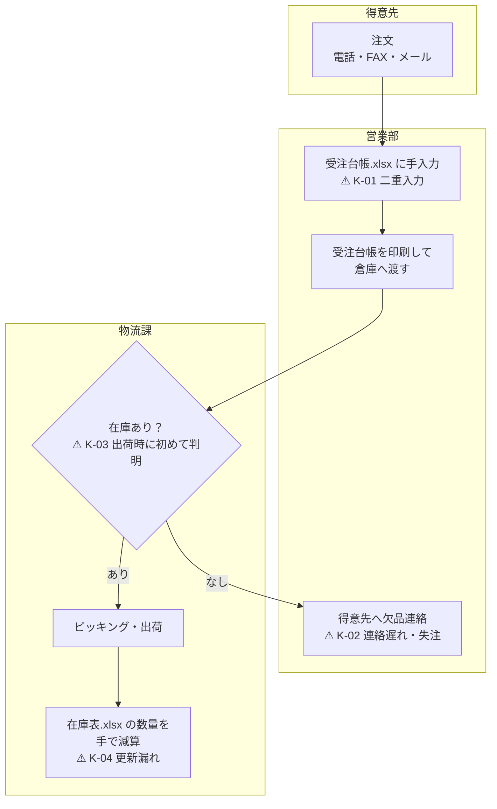
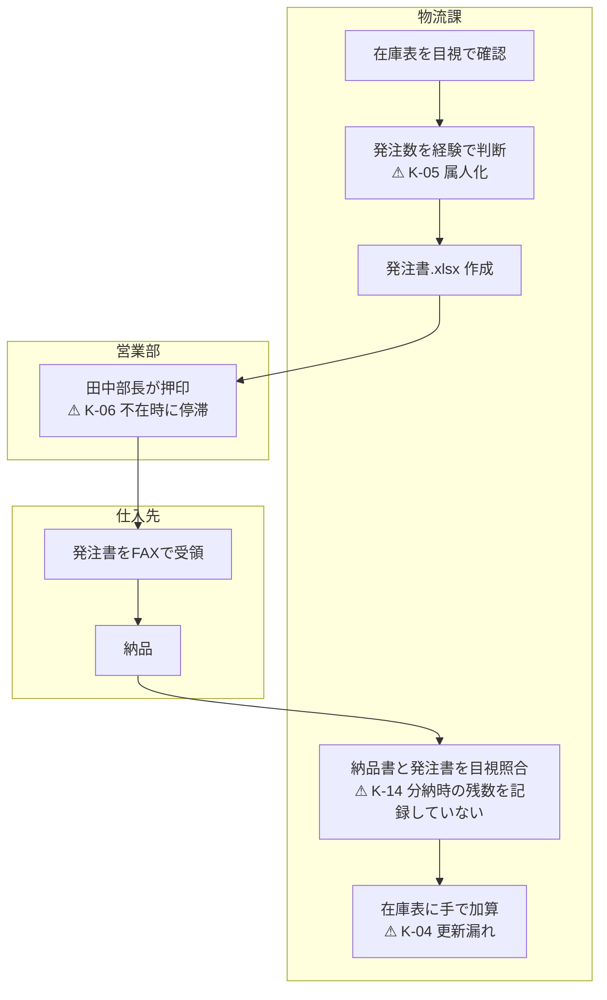
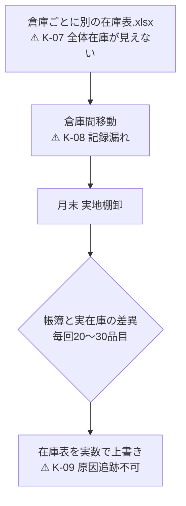
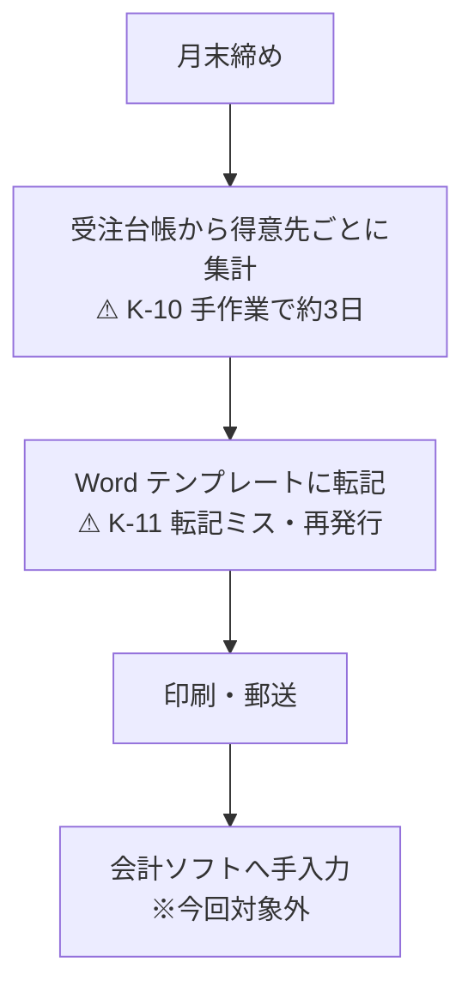

# 現行業務フロー（As-Is）

| 項目 | 内容 |
|---|---|
| 文書名 | 現行業務フロー（As-Is） |
| 版数 | 第1.1版 |
| 作成日 | 2026/11/24 |
| 作成者 | 開発担当 |
| 根拠 | 初回打合せ議事録（2026/11/18）、第2回打合せ議事録（2026/11/25） |

## 改訂履歴

| 版数 | 日付 | 変更内容 | 変更者 |
|---|---|---|---|
| 1.0 | 2026/11/24 | 新規作成 | 開発担当 |
| 1.1 | 2026/11/26 | 発注〜入荷フローに分納時の課題（K-14）を追記。顧客確認済み（D-06） | 開発担当 |

> 図中の ⚠ は課題一覧（04_課題一覧）の課題番号に対応する。

## 1. 受注〜出荷

## 2. 発注〜入荷

## 3. 在庫・棚卸

## 4. 請求

