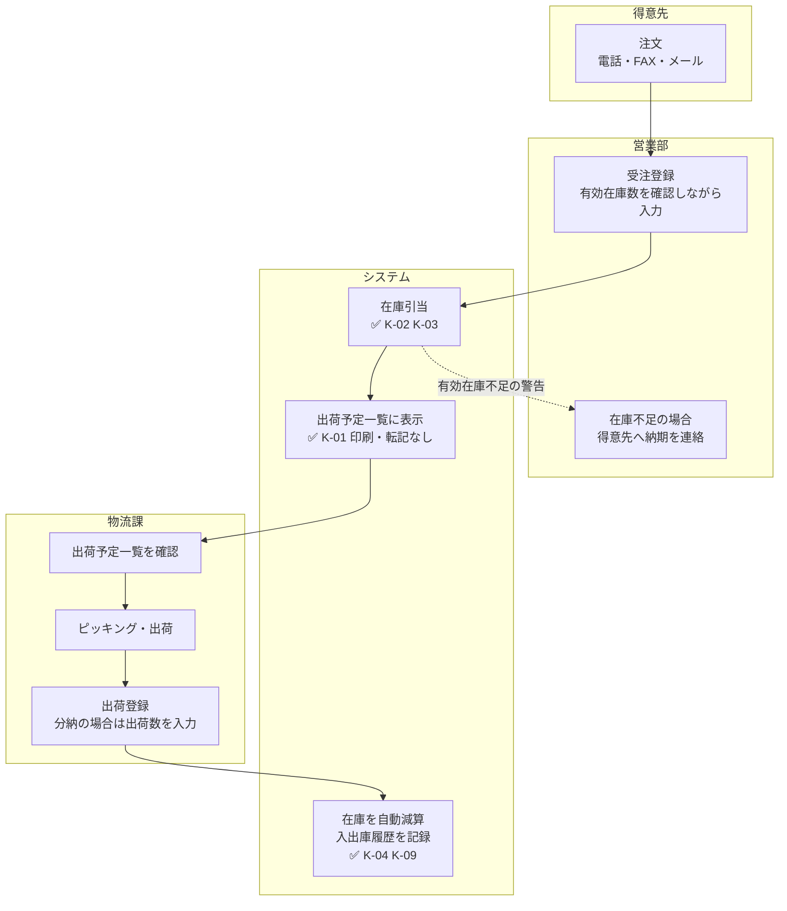
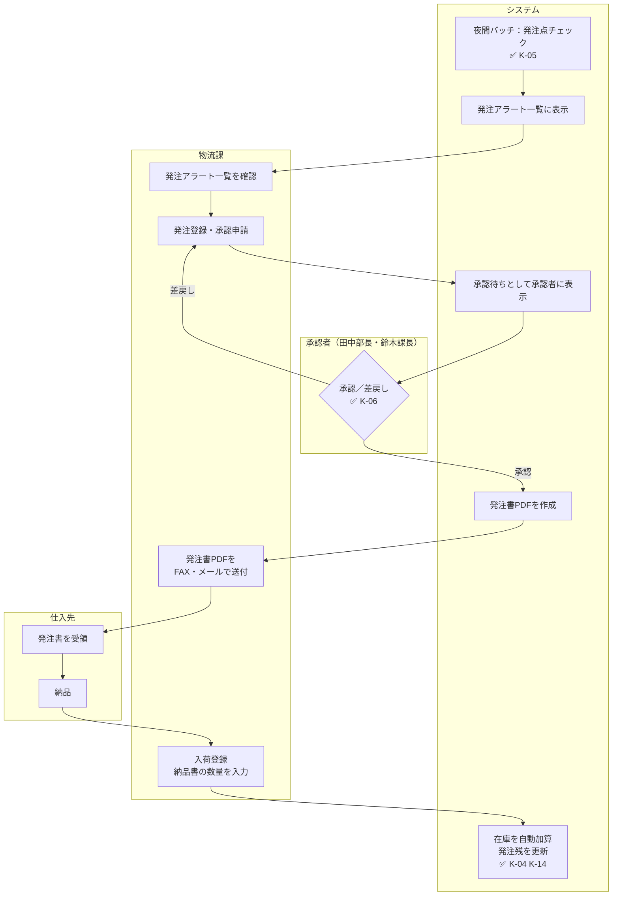
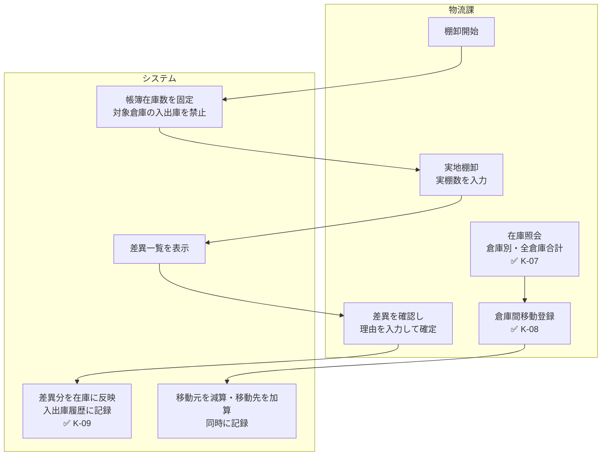
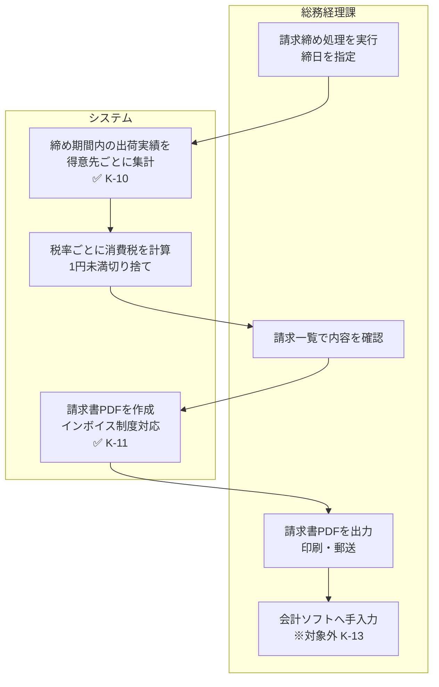

# 新業務フロー（To-Be）

| 項目 | 内容 |
|---|---|
| 文書名 | 新業務フロー（To-Be） |
| 版数 | 第1.0版 |
| 作成日 | 2026/11/30 |
| 作成者 | 開発担当 |
| 承認者 | 田中部長（株式会社ひかり照明商事） |

## 改訂履歴

| 版数 | 日付 | 変更内容 | 変更者 |
|---|---|---|---|
| 1.0 | 2026/11/30 | 新規作成 | 開発担当 |

> 図中の ✅ は、解決する課題番号（04_課題一覧）を示す。
> 「システム」レーンが本システムの処理である。

## 1. 受注〜出荷

## 2. 発注〜入荷

## 3. 在庫・棚卸

## 4. 請求

## 5. 課題と解決方法の対応

| 課題 | 内容 | 解決方法（To-Be） | 対応機能 |
|---|---|---|---|
| K-01 | 受注情報の二重入力 | 受注データを出荷・請求まで引き継ぐ | F-401, F-404, F-501 |
| K-02 | 欠品連絡の遅れ | 受注入力時に有効在庫数を表示 | F-401 |
| K-03 | 在庫不足が出荷時に判明 | 受注登録時に在庫を引当 | F-401 |
| K-04 | 在庫表の更新漏れ | 出荷・入荷登録と同時に在庫を自動更新 | F-304, F-404 |
| K-05 | 発注判断の属人化 | 発注点チェックバッチと発注アラート一覧 | F-104, F-306, F-601 |
| K-06 | 承認者不在時の停滞 | システム上の承認（承認者2名） | F-302 |
| K-07 | 全倉庫の在庫が見えない | 在庫照会（倉庫別・合計） | F-201 |
| K-08 | 倉庫間移動の記録漏れ | 倉庫間移動登録 | F-204 |
| K-09 | 在庫差異の原因が追えない | 入出庫履歴・操作ログ | F-202, F-004, F-005 |
| K-10 | 請求書作成に約3日 | 請求締め処理による自動集計 | F-501 |
| K-11 | 転記ミスによる再発行 | 請求書PDFの自動作成 | F-503 |
| K-12 | 変更者が分からない | 認証・権限・操作ログ | F-001, F-003, F-004 |
| K-13 | 会計ソフトへの手入力 | **対象外**（2次開発で検討） | — |
| K-14 | 分納時の催促漏れ | 発注明細ごとの入荷済数管理、発注残の照会 | F-304, F-305 |
