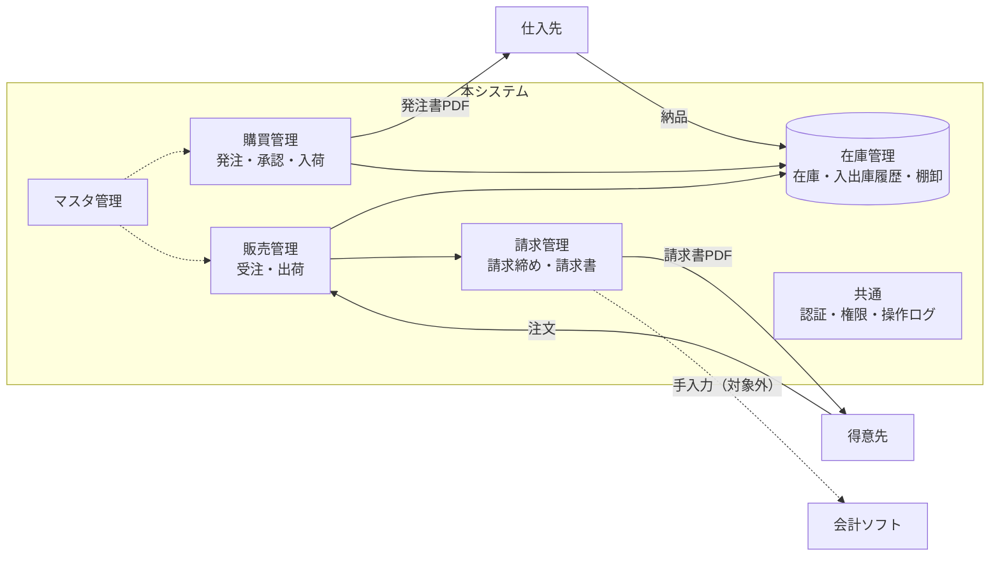

# 要件定義書

| 項目 | 内容 |
|---|---|
| 文書名 | 販売管理システム 要件定義書 |
| 版数 | 第1.2版 |
| 作成日 | 2026/11/30 |
| 作成者 | 開発担当 |
| 承認者 | 田中部長（株式会社ひかり照明商事） |
| 承認日 | 2026/12/04（第1.1版）、2026/12/25（第1.2版） |

## 改訂履歴

| 版数 | 日付 | 変更内容 | 変更者 |
|---|---|---|---|
| 1.0 | 2026/11/30 | 新規作成（レビュー用） | 開発担当 |
| 1.1 | 2026/12/03 | 第3回打合せの指摘を反映（F-405 追加、F-503 再発行表示、8章に対象外2件を追記）。2026/12/04 承認 | 開発担当 |
| 1.2 | 2026/12/24 | 変更要求 CR-01 を反映（BR-17、F-406 出荷取消を追加）。第4回打合せ D-25。2026/12/25 承認 | 開発担当 |

## 目次

1. 概要
2. 対象範囲
3. 業務要件
4. 機能要件
5. 非機能要件
6. 移行要件
7. 前提条件・制約事項
8. 対象外とする事項
9. 別紙一覧

---

## 1. 概要

### 1.1 背景

株式会社ひかり照明商事（以下「顧客」）は、受注・在庫・発注・請求の各業務を Excel・紙・FAX で個別に管理している。取扱商品数（約800SKU）と取引先数の増加に伴い、二重入力による入力ミス、在庫数の不一致、発注業務の属人化、請求書作成の負荷が課題となっている。

### 1.2 目的と達成基準

| No | 目的 | 達成基準 |
|---|---|---|
| 1 | 情報の一元管理により二重入力をなくす | 受注情報の入力が1回で済み、出荷・請求まで再入力が発生しないこと |
| 2 | 在庫数をリアルタイムに可視化する | 出荷・入荷の登録直後に在庫照会へ反映されること。月次棚卸の差異品目数が現行（20～30品目）の半数以下になること |
| 3 | 発注業務の属人化を解消する | 発注アラート一覧をもとに、物流担当の誰でも発注登録ができること |
| 4 | 請求書作成の負荷を下げる | 請求書作成にかかる作業を現行の約3日から半日以内にすること |
| 5 | データの信頼性と内部統制を確保する | すべての登録・変更・承認について、操作者と日時を追跡できること |

### 1.3 システム化の方針

- 「在庫」を中心に、購買（発注〜入荷）と販売（受注〜出荷〜請求）をつなぐ。
- 在庫の増減はすべて伝票の登録（入荷・出荷・調整・移動・棚卸）を通して行い、入出庫履歴に記録する。在庫数を画面から直接書き換える機能は設けない。
- 金銭の授受に関わる業務（支払、入金消込）と会計システム連携は対象外とし、2次開発で検討する。

## 2. 対象範囲

### 2.1 対象業務

| 業務 | 対象 | 対象外 |
|---|---|---|
| 共通 | 認証、権限管理、操作ログ | シングルサインオン、パスワード再設定メール |
| マスタ管理 | 商品、倉庫、取引先、発注点 | 得意先別単価、単価履歴、セット商品 |
| 在庫管理 | 在庫照会、入出庫履歴、在庫調整、倉庫間移動、棚卸 | ロット・有効期限管理、ロケーション（棚番）管理 |
| 購買管理 | 発注、承認、発注書出力、入荷 | 仕入計上、支払、買掛金管理 |
| 販売管理 | 受注、出荷、出荷取消（入力誤りの訂正） | 見積、返品、出荷伝票・納品書の出力 |
| 請求管理 | 請求締め、請求書出力 | 入金消込、売掛金管理、繰越金額の表示 |

### 2.2 利用者と権限

| 権限 | 対象者（想定） | 主な業務 |
|---|---|---|
| 営業担当 | 営業部 8名 | 受注登録、在庫照会、取引先管理 |
| 物流担当 | 物流課 5名 | 出荷、入荷、発注登録、在庫調整、棚卸 |
| 経理担当 | 総務経理課 2名 | 請求締め、請求書出力 |
| 承認者 | 田中部長、鈴木課長 | 発注承認 |
| システム管理者 | 顧客側1名、開発担当 | ユーザー管理、マスタ管理、操作ログ照会 |

※ 1人の利用者に複数の権限を付与できる（D-14）。

### 2.3 システム化の範囲図

## 3. 業務要件

新業務の流れは「別紙07 新業務フロー（To-Be）」のとおりとする。主な業務ルールを以下に定める。

### 3.1 在庫

| No | 業務ルール | 根拠 |
|---|---|---|
| BR-01 | 在庫は「商品 × 倉庫」ごとに、現在庫数と引当数を管理する | K-07 |
| BR-02 | 有効在庫数 ＝ 現在庫数 − 引当数。有効在庫数はマイナスになりうる（在庫不足を表す） | D-15 |
| BR-03 | 現在庫数は0未満にならない。現在庫数を超える出荷・移動・調整（減）は登録できない | K-04 |
| BR-04 | 在庫の増減は必ず入出庫履歴に記録する | K-09 |
| BR-05 | 棚卸の実施中は、対象倉庫に対する入荷・出荷・在庫調整・倉庫間移動を登録できない | D-18 |
| BR-06 | 棚卸の確定時、実棚数と帳簿在庫数の差異を在庫に反映する。差異がある明細は理由の入力を必須とする | K-09 |

### 3.2 販売

| No | 業務ルール | 根拠 |
|---|---|---|
| BR-11 | 受注は出荷倉庫を1つ指定して登録する | H-03 |
| BR-12 | 受注登録時に、受注数量を引当数に加算する。有効在庫数が不足する場合は警告を表示するが、登録できる | D-15 |
| BR-13 | 単価は商品マスタの標準販売単価を初期表示し、受注ごとに変更できる | D-16 |
| BR-14 | 1つの受注を複数回に分けて出荷できる。受注明細ごとに出荷済数量を管理する | D-09 |
| BR-15 | 出荷登録時に、現在庫数と引当数から出荷数量を減算する | K-04 |
| BR-16 | 受注の変更・取消は、未出荷の場合のみ可能とする。一部出荷済みの受注は、残数量の取消（受注残の打ち切り）のみ可能とする | D-09 |
| BR-17 | 出荷の取消は、未請求の出荷に限り可能とする。取消時は、現在庫数・引当数・受注明細の出荷済数量を出荷前の状態に戻す。残数量の取消を行った受注の出荷は取り消せない | D-25（CR-01） |

### 3.3 購買

| No | 業務ルール | 根拠 |
|---|---|---|
| BR-21 | 発注は入荷倉庫を1つ指定して登録する | D-13 |
| BR-22 | 発注は承認者の承認を必須とする。承認者は申請者本人以外とする | D-11 |
| BR-23 | 承認者は差戻しができる。差戻し時は理由の入力を必須とする | D-11 |
| BR-24 | 発注書は承認済みの発注のみ出力できる | K-06 |
| BR-25 | 1つの発注を複数回に分けて入荷できる。発注明細ごとに入荷済数量を管理する | D-09 |
| BR-26 | 入荷数量の合計は発注数量を超えられない | K-14 |
| BR-27 | 「有効在庫数 ＋ 発注残数 ≦ 発注点」となった商品を、毎日夜間に発注アラートとして抽出する | D-13 |

### 3.4 請求

| No | 業務ルール | 根拠 |
|---|---|---|
| BR-31 | 請求は出荷実績をもとに作成する（出荷基準） | K-10 |
| BR-32 | 締日は得意先ごとに設定する | D-07 |
| BR-33 | 請求締めでは、締め期間内（前回締日の翌日～今回締日）の未請求の出荷を得意先ごとに集計する | D-07 |
| BR-34 | 消費税は請求書単位で税率ごとに対価の額を合計し、税率を乗じて1円未満を切り捨てる | D-08 |
| BR-35 | 請求書には、適格請求書の記載事項（発行者の名称と登録番号、取引年月日、取引内容、税率ごとの対価の額と適用税率、税率ごとの消費税額、宛名）を記載する | Q-09 |
| BR-36 | 発行済みの請求は取り消せない。未発行の請求は取り消して再度締め処理ができる | K-11 |

## 4. 機能要件

機能の一覧は「別紙08 機能一覧」のとおりとする（全33機能：Must 26、Should 7）。

| 区分 | 機能数 | 主な機能 |
|---|---|---|
| 共通 | 6 | ログイン、ユーザー管理、操作ログ、ダッシュボード |
| マスタ管理 | 4 | 商品、倉庫、取引先、発注点 |
| 在庫管理 | 5 | 在庫照会、入出庫履歴、在庫調整、倉庫間移動、棚卸 |
| 購買管理 | 6 | 発注登録、承認、発注書PDF、入荷、発注照会、発注アラート |
| 販売管理 | 6 | 受注登録、受注照会、出荷予定、出荷登録、CSV出力、出荷取消 |
| 請求管理 | 4 | 請求締め、請求照会、請求書PDF、締め取消 |
| バッチ | 2 | 発注点チェック、月次在庫集計 |

### 4.1 帳票

| 帳票 | 用途 | 出力形式 |
|---|---|---|
| 請求書 | 得意先への請求（適格請求書） | PDF（A4縦） |
| 発注書 | 仕入先への発注 | PDF（A4縦） |

## 5. 非機能要件

非機能要件の詳細は「別紙09 非機能要件一覧」のとおりとする。主な要件を以下に示す。

| 区分 | 主な要件 |
|---|---|
| 可用性 | 運用時間 平日 8:00～19:00、稼働率 99%、RTO 4時間、RPO 前日夜間 |
| 性能 | 登録・更新 3秒以内、一覧検索 5秒以内、請求締め 5分以内（5年後のデータ量・同時20ユーザー） |
| 運用・保守性 | 日次バックアップ（7世代）、死活・リソース・バッチ監視 |
| 移行性 | 2027/3/31 の棚卸結果を初期在庫とし、2027/4/1 に一括切替 |
| セキュリティ | ID・パスワード認証、5種類の権限、HTTPS、アクセス元IP制限、操作ログ |
| システム環境 | Windows 11 / Chrome、クラウド（国内リージョン） |

## 6. 移行要件

| No | 対象 | 件数（概算） | 移行元 | 方法 |
|---|---|---|---|---|
| 1 | 商品マスタ | 800 | 在庫表.xlsx | CSV に変換して一括取込 |
| 2 | 取引先マスタ | 230 | 受注台帳.xlsx、発注書.xlsx | 同上（締日は T-08 の一覧をもとに設定） |
| 3 | 倉庫マスタ | 2 | — | 手入力 |
| 4 | ユーザー・権限 | 15 | T-09 の一覧 | 手入力 |
| 5 | 発注点・標準発注数 | 最大1,600 | 山本主任が新規に作成 | CSV 一括取込 |
| 6 | 初期在庫 | 最大1,600 | 2027/3/31 棚卸結果 | CSV 一括取込（入出庫履歴に「移行」として記録） |
| 7 | 受注残・発注残 | 数十件 | 受注台帳・発注書 | 顧客が画面から手入力 |

## 7. 前提条件・制約事項

| No | 区分 | 内容 |
|---|---|---|
| 1 | 前提 | 顧客は、打合せへの出席、確認事項への回答、受入テストの実施、移行データの準備を行う |
| 2 | 前提 | 取扱商品はすべて標準税率（10%）の対象である。軽減税率の商品を扱う場合に備え、商品ごとに税区分を保持する |
| 3 | 前提 | 棚卸は月末の営業終了後に実施し、棚卸中の入出庫はない |
| 4 | 制約 | 稼働開始は 2027/4/1 とする |
| 5 | 制約 | 利用端末は社内PC（Windows / Chrome）のみとする |
| 6 | 制約 | 会計ソフトは現行のものを継続利用し、本システムとは連携しない |
| 7 | 制約 | ソフトウェアのライセンス費用が発生しない構成とする |

## 8. 対象外とする事項

以下は初期リリースの対象外とし、稼働後に2次開発として検討する。

| No | 項目 | 理由・当面の運用 |
|---|---|---|
| 1 | 支払・買掛金管理、入金消込・売掛金管理 | 範囲を在庫中心に絞るため。現行の会計ソフトで継続 |
| 2 | 会計ソフトとの連携（K-13） | 同上。当面は手入力 |
| 3 | 返品処理・適格返還請求書（D-10） | 月2～3件と少ないため。在庫は在庫調整で戻し、返還請求書は手作業で発行 |
| 4 | 見積 | 現行業務で課題として挙がっていないため |
| 5 | 得意先別単価・単価履歴 | 受注時の単価変更で対応（D-16） |
| 6 | ロット・有効期限・ロケーション管理 | 取扱商品の特性上、不要 |
| 7 | スマートフォン・タブレット対応、社外からの利用 | D-04 |
| 8 | 請求書・発注書のメール送信（D-17） | 現行の送付方法を継続 |
| 9 | 発注アラートのメール通知（第3回打合せ T-07） | ダッシュボードの件数表示で代替 |
| 10 | 請求書への前回請求額・入金額・繰越金額の表示（第3回打合せ） | 入金管理が対象外のため。当月請求額のみを表示 |

## 9. 別紙一覧

| 別紙 | 文書名 |
|---|---|
| 別紙03 | 現行業務フロー（As-Is） |
| 別紙04 | 課題一覧 |
| 別紙05 | 確認事項一覧（QA管理表） |
| 別紙07 | 新業務フロー（To-Be） |
| 別紙08 | 機能一覧 |
| 別紙09 | 非機能要件一覧 |
| 別紙10 | 用語集 |
