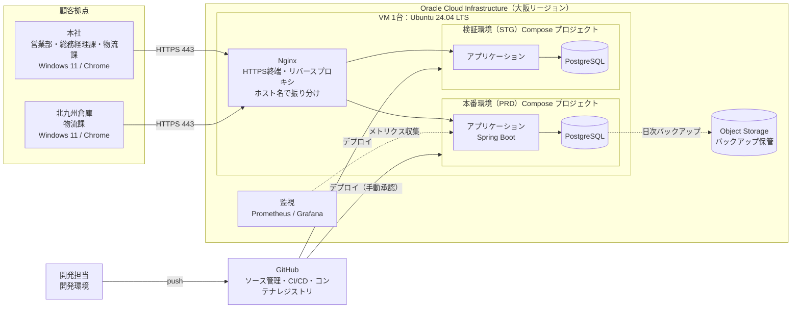

# システム構成図

| 項目 | 内容 |
|---|---|
| 文書名 | システム構成図 |
| 版数 | 第1.1版 |
| 作成日 | 2026/12/07 |
| 作成者 | 開発担当 |
| 承認者 | 田中部長（株式会社ひかり照明商事） |

## 改訂履歴

| 版数 | 日付 | 変更内容 | 変更者 |
|---|---|---|---|
| 1.0 | 2026/12/07 | 新規作成 | 開発担当 |
| 1.1 | 2027/01/15 | サーバーを1台（VM 1台）とし、本番環境と検証環境を同一VM上の別の Docker Compose プロジェクトとして分離する構成に変更 | 開発担当 |

## 1. 全体構成

## 2. 環境一覧

| 環境 | 用途 | 配置 | 利用者 |
|---|---|---|---|
| 開発環境（DEV） | 製造、単体テスト | 開発担当のPC（Docker Compose で DB を起動） | 開発担当 |
| 検証環境（STG） | 結合テスト、総合テスト、受入テスト、移行リハーサル | OCI の VM（本番と同じVM・別の Compose プロジェクト） | 開発担当、顧客（受入テスト時） |
| 本番環境（PRD） | 本番運用 | OCI の VM | 顧客 |

## 3. サーバー構成

予算制約により VM は1台とする（NF-05：冗長化なし）。1台の VM 上に、本番（PRD）と検証（STG）を**別の Docker Compose プロジェクト**として配置し、コンテナ・ネットワーク・DB・データ用ボリュームを環境ごとに分ける。Nginx のみ両環境で共用し、ホスト名で振り分ける。

| コンテナ | ソフトウェア | 役割 | 公開ポート |
|---|---|---|---|
| nginx（共用） | Nginx | HTTPS 終端（Let's Encrypt）、ホスト名による PRD／STG への振り分け | 443（外部）、80（443 へリダイレクト） |
| prd-app / stg-app | Spring Boot（Java 21） | 画面、業務処理、帳票出力、バッチ（アプリ内スケジューラで起動） | 内部のみ |
| prd-db / stg-db | PostgreSQL 17 | データ保管（環境ごとに別のコンテナ・ボリューム） | 内部のみ |

| 項目 | 本番（PRD） | 検証（STG） |
|---|---|---|
| Compose プロジェクト名 | hanbai-prd | hanbai-stg |
| ホスト名 | hanbai.（ドメイン） | stg.hanbai.（ドメイン） |
| メモリ上限（app / db） | 2GB / 2GB | 1GB / 1GB |
| バッチのスケジュール起動 | 有効 | 無効（必要時に手動で起動） |
| アクセス元制限 | 顧客拠点の固定IP | 顧客拠点＋開発担当の固定IP |

- バッチはアプリケーション内のスケジューラから起動する。本番のアプリケーションは1インスタンスのため、二重起動は発生しない。検証環境ではスケジュール起動を無効にし、本番と同時に重い処理が走らないようにする。
- 検証環境の負荷（性能テストなど）が本番に影響しないよう、コンテナごとに CPU・メモリの上限を設定する。性能テストは本番の運用時間外に実施する。
- 帳票（PDF）はアプリケーション内で生成し、ファイルとしては保存しない（出力のたびに生成する）。

## 4. ネットワーク・セキュリティ

| 通信 | 送信元 | 宛先 | ポート | 制御 |
|---|---|---|---|---|
| 画面利用 | 顧客拠点の固定IP（本社・北九州倉庫） | nginx | 443 | OCI セキュリティリストで送信元IPを制限（NF-29） |
| 保守 | 開発担当の固定IP | VM | 22（SSH・公開鍵認証） | 同上。パスワード認証は無効 |
| デプロイ | GitHub Actions | VM | 22 | デプロイ専用ユーザー・鍵を使用 |
| 証明書更新 | VM | Let's Encrypt | 443（外向き） | DNS 認証方式（80番を外部公開しないため） |
| アプリ → DB | app | db | 5432 | Docker 内部ネットワークのみ |

## 5. 運用ジョブ

| ジョブ | 時刻 | 内容 | 対応要件 |
|---|---|---|---|
| 発注点チェックバッチ（BAT-01） | 毎日 22:00 | アプリ内で実行 | NF-10 |
| 月次在庫集計バッチ（BAT-02） | 毎月1日 0:30 | アプリ内で実行 | NF-10 |
| DBバックアップ | 毎日 2:00 | `pg_dump` を取得し Object Storage へ保管（日次7世代・月次12世代） | NF-13 |
| ログローテーション | 毎日 | アプリケーションログを日次で切替、90日保持 | NF-16 |

## 6. 非機能要件との対応

| 要件 | 構成上の対応 |
|---|---|
| NF-02 稼働率 99% | コンテナの自動再起動（restart: always）、死活監視 |
| NF-03 RTO 4時間 | VM 障害時は新規 VM に Compose 一式を展開し、バックアップからリストアする手順を整備 |
| NF-04 RPO 前日夜間 | 日次バックアップ |
| NF-28 通信の暗号化 | Nginx で TLS 1.2 以上のみ許可 |
| NF-35 環境分離 | PRD と STG を別の Compose プロジェクト・別の DB コンテナ・別のボリュームとする（VM は共用） |
| NF-03 RTO 4時間 | VM 障害時は本番・検証とも停止する。復旧は本番を優先する |
