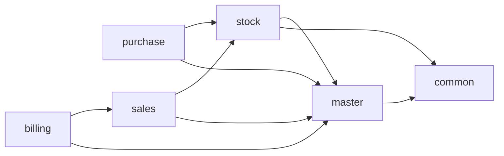

# 機能構成図

| 項目 | 内容 |
|---|---|
| 文書名 | 機能構成図 |
| 版数 | 第1.1版 |
| 作成日 | 2026/12/07 |
| 作成者 | 開発担当 |
| 承認者 | 田中部長（株式会社ひかり照明商事） |

## 改訂履歴

| 版数 | 日付 | 変更内容 | 変更者 |
|---|---|---|---|
| 1.0 | 2026/12/07 | 新規作成 | 開発担当 |
| 1.1 | 2026/12/24 | 変更要求 CR-01 を反映（F-406 追加） | 開発担当 |

## 1. サブシステム構成

```mermaid
flowchart TB
    SYS[販売管理システム]
    SYS --> CM[共通]
    SYS --> MS[マスタ管理]
    SYS --> ST[在庫管理]
    SYS --> PU[購買管理]
    SYS --> SA[販売管理]
    SYS --> BL[請求管理]

    CM --> CM1[F-001 ログイン・ログアウト]
    CM --> CM2[F-002 パスワード変更]
    CM --> CM3[F-003 ユーザー管理]
    CM --> CM4[F-004 操作ログ記録]
    CM --> CM5[F-005 操作ログ照会]
    CM --> CM6[F-006 ダッシュボード]

    MS --> MS1[F-101 商品マスタ管理]
    MS --> MS2[F-102 倉庫マスタ管理]
    MS --> MS3[F-103 取引先マスタ管理]
    MS --> MS4[F-104 発注点設定]

    ST --> ST1[F-201 在庫照会]
    ST --> ST2[F-202 入出庫履歴照会]
    ST --> ST3[F-203 在庫調整]
    ST --> ST4[F-204 倉庫間移動]
    ST --> ST5[F-205 棚卸]
    ST --> ST6[F-602 月次在庫集計バッチ]

    PU --> PU1[F-301 発注登録]
    PU --> PU2[F-302 発注承認]
    PU --> PU3[F-303 発注書PDF出力]
    PU --> PU4[F-304 入荷登録]
    PU --> PU5[F-305 発注照会]
    PU --> PU6[F-306 発注アラート照会]
    PU --> PU7[F-601 発注点チェックバッチ]

    SA --> SA1[F-401 受注登録]
    SA --> SA2[F-402 受注照会]
    SA --> SA3[F-403 出荷予定照会]
    SA --> SA4[F-404 出荷登録]
    SA --> SA5[F-405 受注一覧CSV出力]
    SA --> SA6[F-406 出荷取消]

    BL --> BL1[F-501 請求締め処理]
    BL --> BL2[F-502 請求照会]
    BL --> BL3[F-503 請求書PDF出力]
    BL --> BL4[F-504 請求締め取消]
```

## 2. サブシステム間の関係

| サブシステム | 識別子 | 依存先 | 説明 |
|---|---|---|---|
| 共通 | common | — | 認証・権限・操作ログ・採番・例外処理など、全サブシステムが利用する |
| マスタ管理 | master | common | 商品・倉庫・取引先・発注点 |
| 在庫管理 | stock | common, master | 在庫数量の更新は、すべて在庫管理の共通部品（在庫更新サービス）を通して行う |
| 購買管理 | purchase | common, master, stock | 入荷登録時に在庫管理を呼び出して在庫を加算する |
| 販売管理 | sales | common, master, stock | 受注登録時に引当、出荷登録時に在庫と引当を減算する |
| 請求管理 | billing | common, master, sales | 販売管理の出荷実績を集計する。在庫には影響しない |

> 依存の向きは一方向とする。在庫管理から購買管理・販売管理を呼び出さない（循環依存の禁止）。

## 3. 機能と設計書の対応

| 機能ID | 画面 | 帳票 | バッチ |
|---|---|---|---|
| F-001 | SCR-001 | — | — |
| F-002 | SCR-003 | — | — |
| F-003 | SCR-011, SCR-012 | — | — |
| F-004 | （全画面共通の内部処理） | — | — |
| F-005 | SCR-013 | — | — |
| F-006 | SCR-002 | — | — |
| F-101 | SCR-101, SCR-102 | — | — |
| F-102 | SCR-111, SCR-112 | — | — |
| F-103 | SCR-121, SCR-122 | — | — |
| F-104 | SCR-102（発注点設定欄） | — | — |
| F-201 | SCR-201 | — | — |
| F-202 | SCR-202 | — | — |
| F-203 | SCR-203 | — | — |
| F-204 | SCR-204 | — | — |
| F-205 | SCR-211, SCR-212 | — | — |
| F-301 | SCR-302 | — | — |
| F-302 | SCR-303 | — | — |
| F-303 | SCR-303 | RPT-02 | — |
| F-304 | SCR-304 | — | — |
| F-305 | SCR-301, SCR-303 | — | — |
| F-306 | SCR-305 | — | — |
| F-401 | SCR-402 | — | — |
| F-402 | SCR-401, SCR-403 | — | — |
| F-403 | SCR-404 | — | — |
| F-404 | SCR-405 | — | — |
| F-405 | SCR-401 | — | — |
| F-406 | SCR-403 | — | — |
| F-501 | SCR-501 | — | BAT-03 |
| F-502 | SCR-502, SCR-503 | — | — |
| F-503 | SCR-503 | RPT-01 | — |
| F-504 | SCR-503 | — | — |
| F-601 | — | — | BAT-01 |
| F-602 | — | — | BAT-02 |
