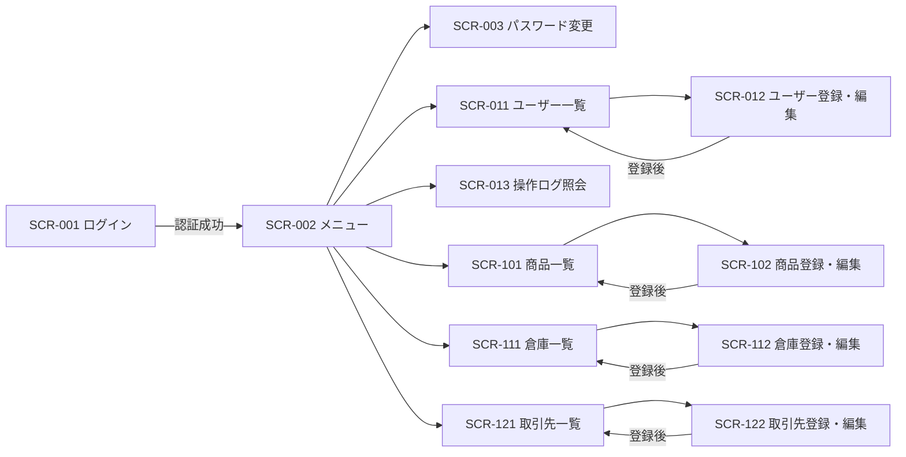
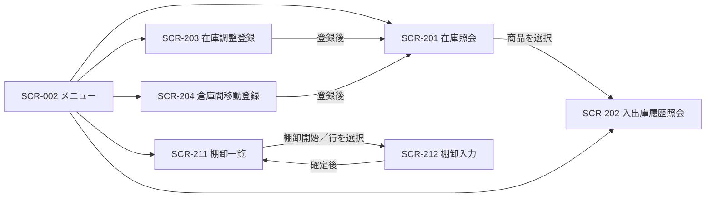
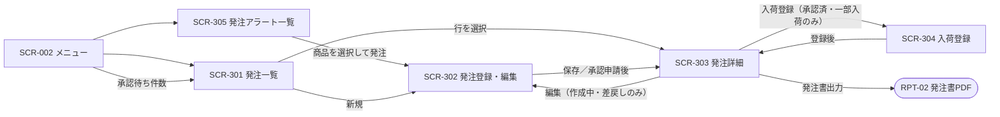
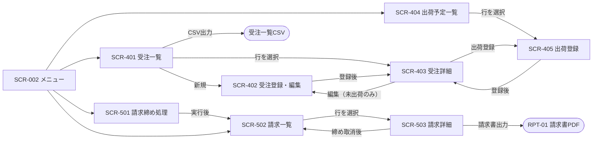
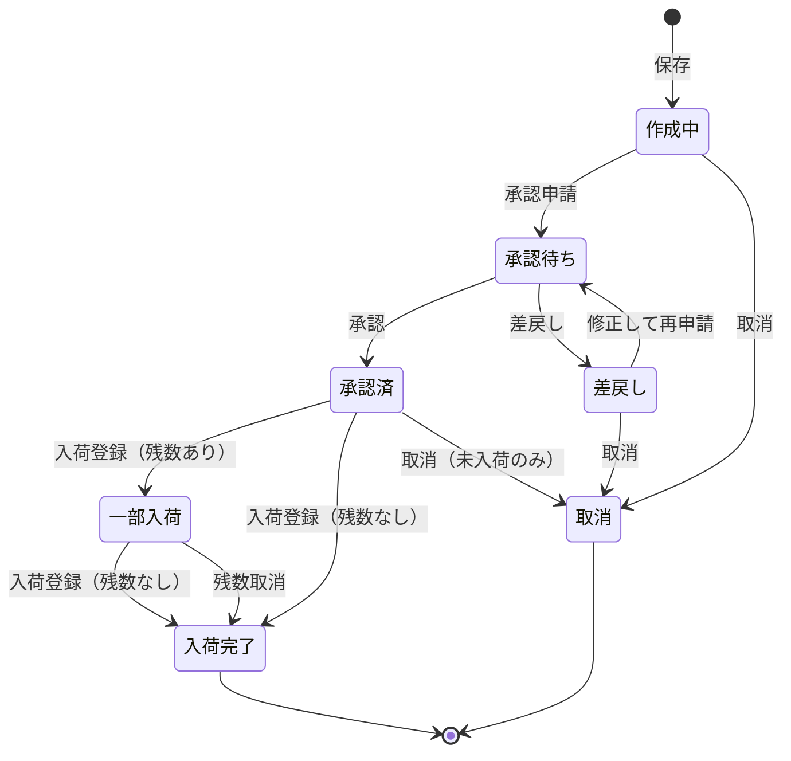
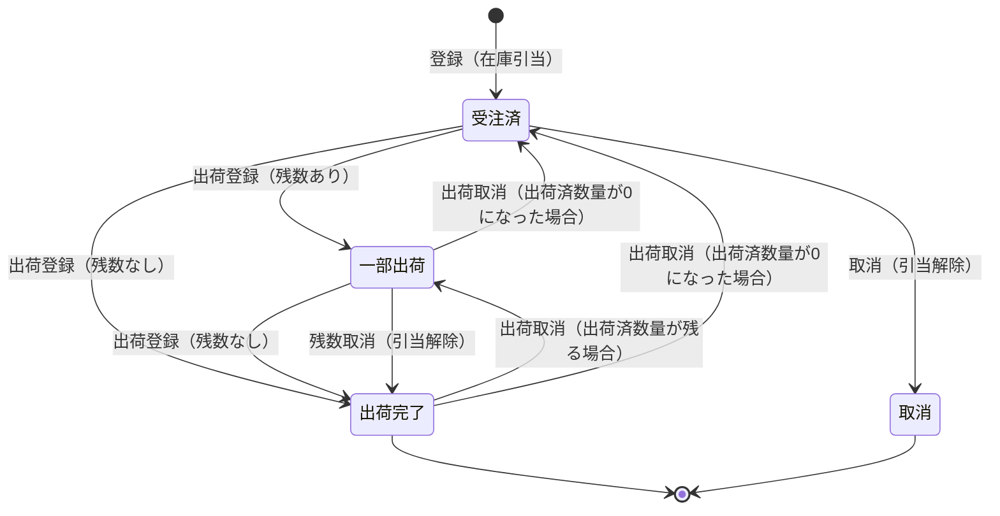
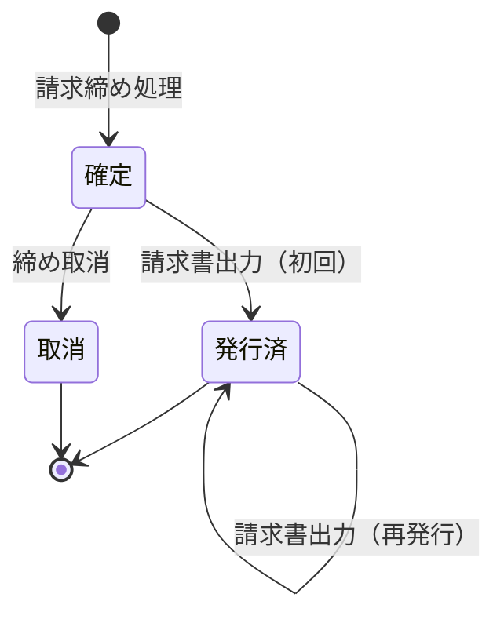
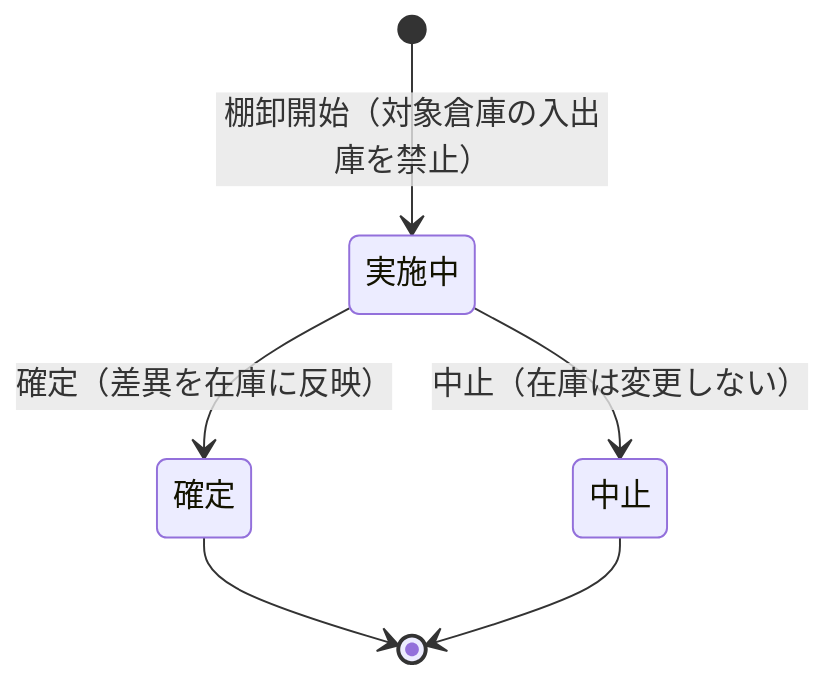

# 画面遷移図

| 項目 | 内容 |
|---|---|
| 文書名 | 画面遷移図 |
| 版数 | 第1.1版 |
| 作成日 | 2026/12/11 |
| 作成者 | 開発担当 |
| 承認者 | 田中部長（株式会社ひかり照明商事） |

## 改訂履歴

| 版数 | 日付 | 変更内容 | 変更者 |
|---|---|---|---|
| 1.0 | 2026/12/11 | 新規作成 | 開発担当 |
| 1.1 | 2026/12/24 | 変更要求 CR-01 を反映（受注ステータスに出荷取消の遷移を追加） | 開発担当 |

> すべての画面はヘッダーの「メニュー」から SCR-002 に戻れる。図では省略する。

## 1. 共通・マスタ管理

## 2. 在庫管理

## 3. 購買管理

## 4. 販売管理・請求管理

## 5. 伝票のステータス遷移

### 5.1 発注

### 5.2 受注

※ 出荷取消は、残数取消を行っていない受注の未請求の出荷に限る（BR-17）。

### 5.3 請求

### 5.4 棚卸

