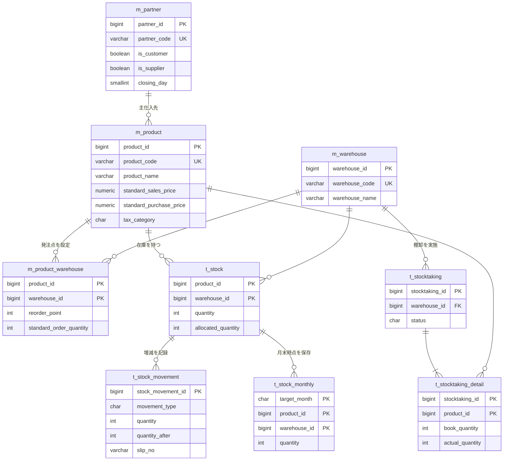
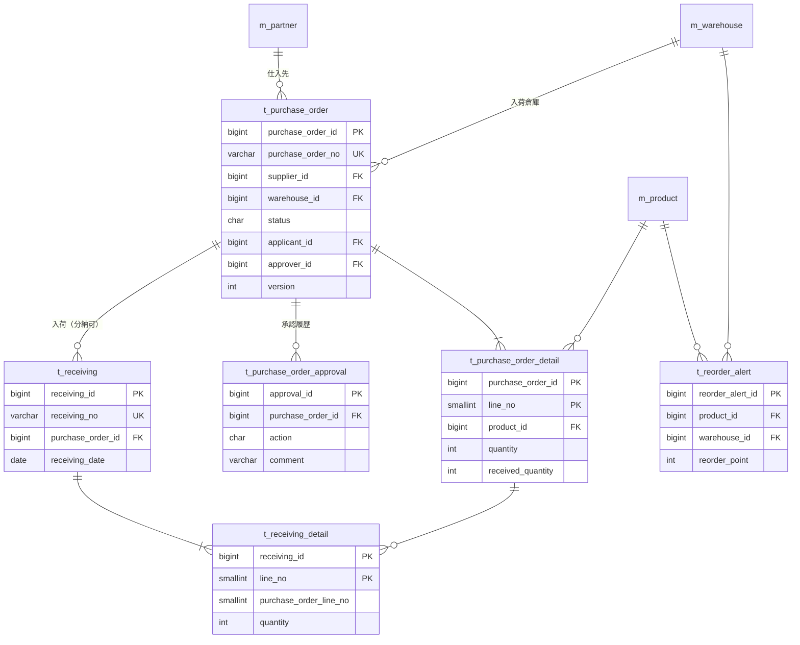
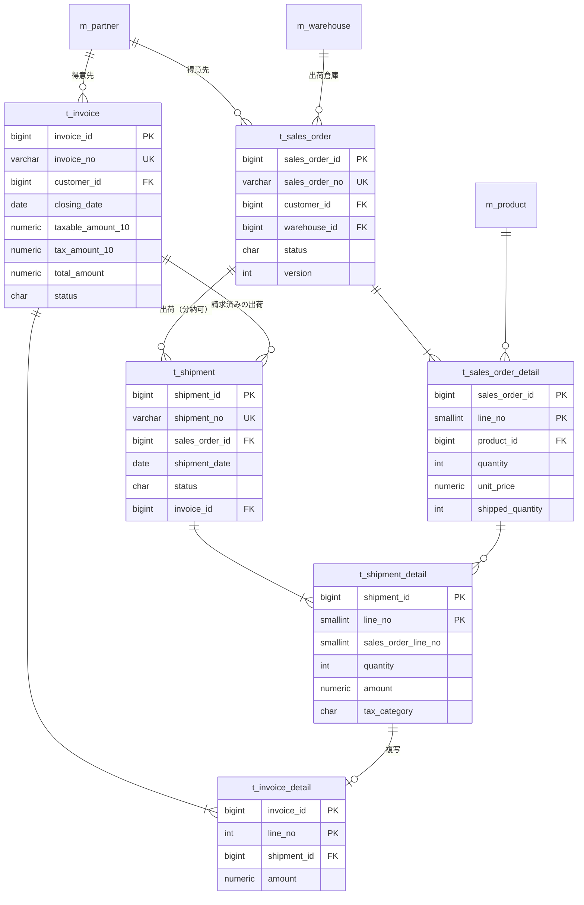
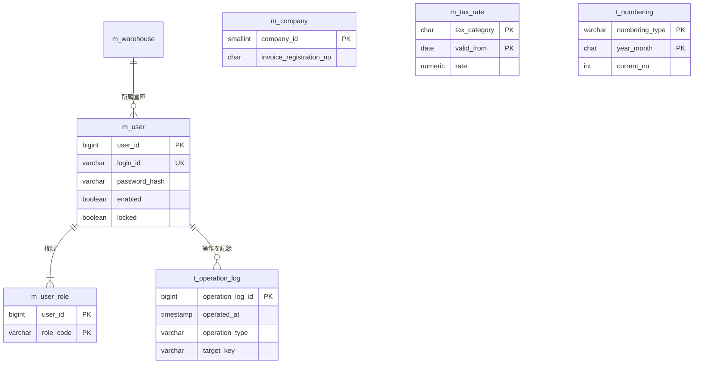

# ER図

| 項目 | 内容 |
|---|---|
| 文書名 | ER図 |
| 版数 | 第1.0版 |
| 作成日 | 2026/12/17 |
| 作成者 | 開発担当 |
| 承認者 | 田中部長（株式会社ひかり照明商事） |

## 改訂履歴

| 版数 | 日付 | 変更内容 | 変更者 |
|---|---|---|---|
| 1.0 | 2026/12/17 | 新規作成 | 開発担当 |

> 属性は主キーと主要な項目のみを示す。全項目は「10_テーブル定義書」を参照。

## 1. マスタ・在庫

## 2. 購買

## 3. 販売・請求

## 4. 共通

## 5. 設計上の判断

| No | 判断 | 理由 |
|---|---|---|
| 1 | 在庫は「現在の数量」（t_stock）と「増減の履歴」（t_stock_movement）の両方を持つ | 在庫照会・引当では現在の数量を高速に取得する必要がある。一方、差異の原因追跡（K-09）には履歴が必要である。履歴の合計を毎回計算する方式は、件数の増加とともに遅くなるため採用しない |
| 2 | 入出庫履歴に「変動後在庫数」を持つ | 履歴だけで任意の時点の在庫数を確認でき、t_stock との不整合を検出できる |
| 3 | 得意先と仕入先を1つのテーブル（m_partner）とし、フラグで区別する | 同じ会社が得意先と仕入先を兼ねる場合に二重登録を避けるため |
| 4 | 受注明細・出荷明細・請求明細に、単価・税区分・品名（請求のみ）を複写して保持する | 商品マスタを変更しても、過去の伝票・請求書の内容が変わらないようにするため |
| 5 | 請求と出荷の関係は、出荷に請求ID（invoice_id）を持たせて表す | 「未請求の出荷」を invoice_id IS NULL で判定でき、二重請求を構造的に防げる |
| 6 | 消費税率をマスタ（m_tax_rate）とし、適用開始日を持つ | 税率改定時にプログラムを変更せずに対応するため |
| 7 | 伝票番号は採番テーブル（t_numbering）で管理する | 年月ごとに1から始まる番号とするため。DB のシーケンスでは年月ごとのリセットができない |
| 8 | マスタ・伝票ヘッダに version（更新回数）を持つ | 楽観的排他制御に使用する |
