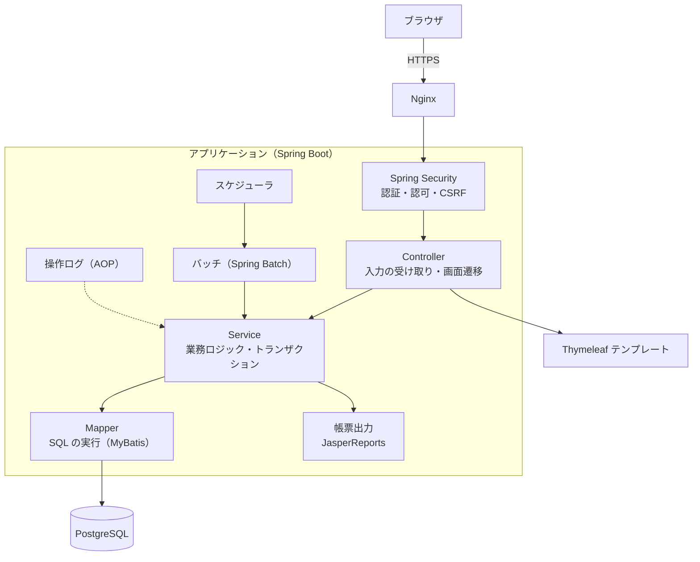
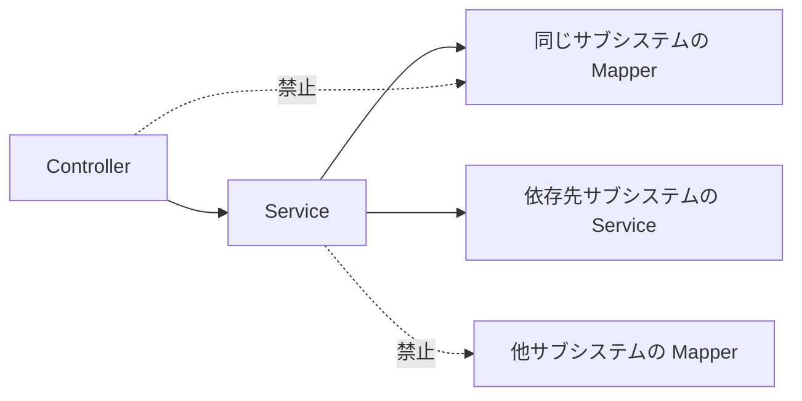

# ソフトウェア構成

| 項目 | 内容 |
|---|---|
| 文書名 | ソフトウェア構成 |
| 版数 | 第1.0版 |
| 作成日 | 2027/01/06 |
| 作成者 | 開発担当 |

## 改訂履歴

| 版数 | 日付 | 変更内容 | 変更者 |
|---|---|---|---|
| 1.0 | 2027/01/06 | 新規作成 | 開発担当 |

## 1. 全体構成

1つの Spring Boot アプリケーション（1つの jar）として構成する。画面・業務処理・帳票・バッチを同じアプリケーションに含める。



## 2. 層の責務

| 層 | 責務 | してはいけないこと |
|---|---|---|
| Controller | リクエストの受け取り、Form への変換、単項目・相関チェックの実行、Service の呼び出し、画面（テンプレート）の選択、メッセージの設定 | 業務ロジック、Mapper の直接呼び出し、トランザクション制御 |
| Form | 画面の入力値を保持する。Bean Validation のアノテーションで単項目チェックを定義する | DB アクセス、Model（テーブル対応クラス）との兼用 |
| Service | 業務ロジック、業務チェック、トランザクション境界、他の Service の呼び出し | HTTP に依存する処理（セッション・リクエストの参照）。ログインユーザーは引数で受け取る |
| Mapper | SQL の実行。1つの Mapper は1つの主テーブル（とその明細）を担当する | 業務上の判断（if による分岐など）。動的 SQL は検索条件の組み立てに限る |
| Model | テーブルの1行に対応するデータを保持する | 画面表示用の編集 |
| Dto | 複数テーブルを結合した検索結果、Service 間の受け渡しデータを保持する（record で定義） | — |

### 呼び出しのルール



- 他のサブシステムのテーブルを更新する場合は、必ずそのサブシステムの Service を呼び出す（例：出荷登録は在庫を直接更新せず、`StockService` を呼び出す）。
- 他のサブシステムのマスタを**参照**するだけの場合も、そのサブシステムの Service（または参照専用の Query Service）を経由する。
- サブシステム間の依存方向は「機能構成図」2章に従う（循環依存の禁止）。

## 3. パッケージ構成

```
jp.co.hikari.hanbai
├── HanbaiApplication.java
├── common                          共通
│   ├── config                      設定（Security、MyBatis、Batch、Web、Clock）
│   ├── security                    認証・認可（LoginUser、LoginUserDetailsService、認証イベントリスナー）
│   ├── exception                   例外（BusinessException、OptimisticLockException、GlobalExceptionHandler）
│   ├── operationlog                操作ログ（@OperationLogged、OperationLogAspect、OperationLogService、Mapper）
│   ├── numbering                   採番（NumberingService、NumberingMapper）
│   ├── message                     メッセージID の定数、メッセージ取得
│   ├── code                        区分値の Enum（SlipType、TaxCategory など）、MyBatis の TypeHandler
│   ├── web                         画面共通（ページング、二重送信防止、共通の ModelAttribute）
│   ├── report                      帳票出力の共通部品（ReportService）
│   └── util                        日付計算（締日・支払期限）、消費税計算
├── master                          マスタ管理
│   ├── controller / form / service / mapper / model
├── stock                           在庫管理
│   ├── controller / form / service / mapper / model / dto
│   └── batch                       BAT-02 月次在庫集計
├── purchase                        購買管理
│   ├── controller / form / service / mapper / model / dto
│   └── batch                       BAT-01 発注点チェック
├── sales                           販売管理
│   └── controller / form / service / mapper / model / dto
└── billing                         請求管理
    ├── controller / form / service / mapper / model / dto
    └── batch                       BAT-03 請求締め
```

### リソース

```
src/main/resources
├── application.yml                 共通設定
├── application-dev.yml / -stg.yml / -prd.yml   環境別設定（接続先・ログレベル）
├── messages.properties             メッセージ（メッセージ一覧に対応）
├── ValidationMessages.properties   Bean Validation のメッセージ
├── db/migration                    Flyway の DDL・初期データ（V1__create_tables.sql …）
├── mapper/{サブシステム}/*.xml      MyBatis の SQL
├── templates/{サブシステム}/*.html  Thymeleaf テンプレート
├── templates/fragments             共通レイアウト（ヘッダー、メッセージ、ページング）
├── static/css, static/js           スタイル、画面の動的処理（明細行の追加、金額計算、商品検索）
├── reports/*.jrxml                 帳票定義（RPT-01、RPT-02）
└── fonts                           IPAexゴシック、フォント拡張の定義
```

## 4. 主要クラス一覧

### 4.1 共通（common）

| クラス | 種別 | 役割 |
|---|---|---|
| SecurityConfig | 設定 | URL ごとの認可、ログイン・ログアウト、セッション、CSRF の設定 |
| LoginUser | 認証情報 | ログイン中のユーザー（ユーザーID、氏名、ロール、所属倉庫）を保持する |
| LoginUserDetailsService | Service | ログインIDからユーザーとロールを取得する |
| AuthenticationEventListener | リスナー | 認証成功・失敗時に失敗回数の更新、ロック、操作ログの記録を行う |
| BusinessException | 例外 | 業務エラー。メッセージIDと埋め込み値を持つ |
| OptimisticLockException | 例外 | 楽観的排他エラー（E-020）。BusinessException の子クラス |
| GlobalExceptionHandler | 例外処理 | Controller で処理されなかった例外を共通のエラー画面に振り分ける |
| OperationLogged | アノテーション | 操作ログを記録する Service メソッドに付ける |
| OperationLogAspect | AOP | `@OperationLogged` の付いたメソッドの実行結果を操作ログに記録する |
| NumberingService | Service | 伝票番号を採番する |
| ReportService | Service | 帳票定義とデータから PDF を生成する |
| TaxCalculator | 部品 | 税率の取得、消費税額の計算（切り捨て） |
| ClosingDateCalculator | 部品 | 締日区分・支払条件から、締日・支払期限の日付を求める |

### 4.2 業務（サブシステムごと）

| サブシステム | Controller | Service | Mapper |
|---|---|---|---|
| master | ProductController, WarehouseController, PartnerController, UserController | ProductService, WarehouseService, PartnerService, UserService | ProductMapper, ProductWarehouseMapper, WarehouseMapper, PartnerMapper, UserMapper, CompanyMapper, TaxRateMapper |
| stock | StockController, StockMovementController, StockAdjustmentController, StockTransferController, StocktakingController | **StockService**（在庫更新の共通部品）, StockQueryService, StockAdjustmentService, StockTransferService, StocktakingService | StockMapper, StockMovementMapper, StocktakingMapper, StockMonthlyMapper |
| purchase | PurchaseOrderController, ReceivingController, ReorderAlertController | PurchaseOrderService, ReceivingService, ReorderAlertService | PurchaseOrderMapper, PurchaseOrderApprovalMapper, ReceivingMapper, ReorderAlertMapper |
| sales | SalesOrderController, ShipmentController, ShipmentPlanController | SalesOrderService, ShipmentService, SalesOrderCsvService | SalesOrderMapper, ShipmentMapper |
| billing | InvoiceClosingController, InvoiceController | InvoiceClosingService, InvoiceService | InvoiceMapper |

※ ユーザー管理・操作ログ照会の画面は、URL は `/admin` だが、パッケージは master・common に含める。

## 5. 設計方針

| No | 方針 | 理由 |
|---|---|---|
| 1 | Service はインターフェースを作らず、クラスのみとする | 実装が1つしかないインターフェースは保守の手間を増やすだけのため。テストでは Mockito でクラスをモック化できる |
| 2 | Form と Model を分ける | 画面項目とテーブルのカラムは一致しない（表示専用項目、明細の配列など）。兼用すると、画面から意図しないカラムを更新される危険がある |
| 3 | 現在日時は `Clock` を DI して取得する（`LocalDate.now(clock)`） | 締日・月替わりなど日付に依存する処理を、テストで日付を固定して検証できるようにするため |
| 4 | 区分値は Enum とし、MyBatis の TypeHandler で DB の値と相互変換する | SQL・Java のどちらにも区分値のリテラルを書かないため |
| 5 | 検索結果は Model ではなく Dto（record）で受け取る | 一覧画面は複数テーブルの結合結果であり、テーブルの1行に対応しないため |
| 6 | バッチの業務ロジックも Service に置き、バッチのクラスは起動・進捗管理のみとする | 画面とバッチで同じロジックを共有し、単体テストを Service に集約するため |
| 7 | PostgreSQL 固有の構文は、使用箇所を限定して一覧化する（共通処理設計 9章） | 将来の DBMS 移行時の影響範囲を明確にするため |
