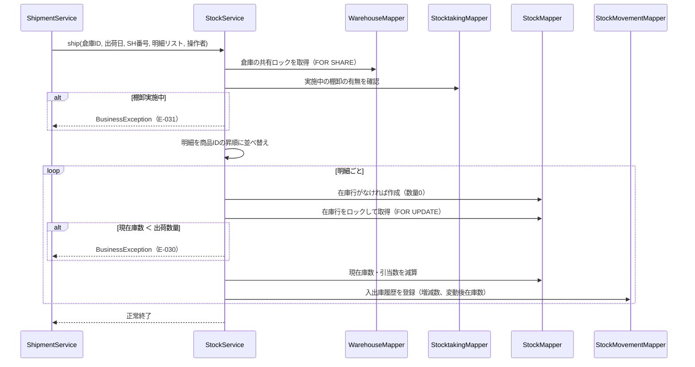
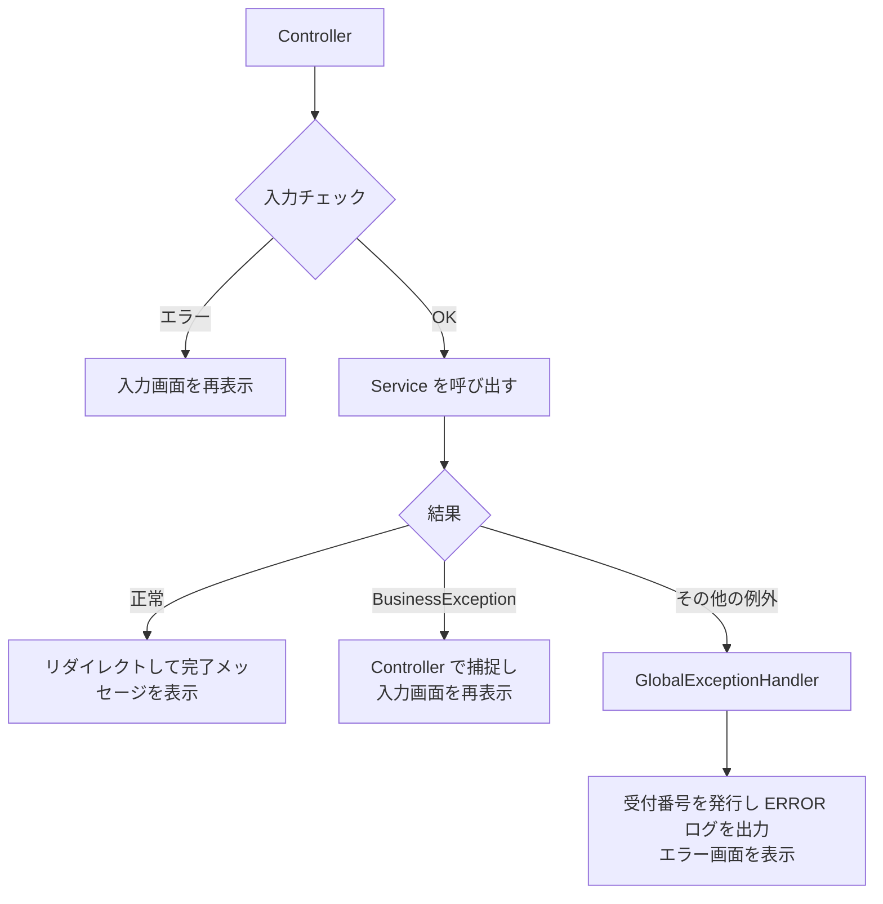

# 共通処理設計

| 項目 | 内容 |
|---|---|
| 文書名 | 共通処理設計 |
| 版数 | 第1.0版 |
| 作成日 | 2027/01/08 |
| 作成者 | 開発担当 |

## 改訂履歴

| 版数 | 日付 | 変更内容 | 変更者 |
|---|---|---|---|
| 1.0 | 2027/01/08 | 新規作成 | 開発担当 |

## 1. トランザクション

| No | 項目 | 設計 |
|---|---|---|
| 1 | 境界 | Service の公開メソッドを1トランザクションとする（`@Transactional`）。1回のボタン操作＝1トランザクション |
| 2 | 参照のみの処理 | `@Transactional(readOnly = true)` とする |
| 3 | ロールバック | 実行時例外（BusinessException を含む）が送出された場合にロールバックする。検査例外は使用しない |
| 4 | 分離レベル | READ COMMITTED（PostgreSQL の既定値）。更新の整合性は、分離レベルではなく行ロックで保証する（2章） |
| 5 | 伝播 | 既定（REQUIRED）。Service から別の Service を呼び出した場合は同じトランザクションに参加する |
| 6 | 例外 | 失敗を記録する操作ログ（ログイン失敗など）のみ `REQUIRES_NEW` とし、業務処理がロールバックされても記録を残す |
| 7 | タイムアウト | オンライン処理は30秒。超過した場合はロールバックし、システムエラー（E-090）とする |

## 2. 排他制御

### 2.1 基本方針

利用者が画面を見ている時間（数十秒～数分）と、登録ボタンを押してから処理が終わるまでの時間（1秒未満）を分けて考える。

| 対象 | 方式 | 目的 |
|---|---|---|
| 画面表示～登録ボタン押下の間 | **楽観的排他**（version の比較） | 他の利用者が先に更新した内容を、知らずに上書きしてしまうことを防ぐ |
| 登録処理の実行中 | **悲観的排他**（行ロック：SELECT … FOR UPDATE） | 同時に実行された2つの処理が、同じ在庫・伝票を同時に更新して数量が狂うことを防ぐ |

### 2.2 マスタの更新（楽観的排他のみ）

1. 編集画面の表示時に `version` を取得し、hidden 項目として保持する。
2. 更新時に `UPDATE … SET …, version = version + 1 WHERE id = ? AND version = ?` を実行する。
3. 更新件数が 0 の場合は `OptimisticLockException`（E-020）を送出する。

### 2.3 伝票の状態を変える処理（承認、出荷登録、入荷登録、取消など）

1. 伝票ヘッダを `SELECT … FOR UPDATE` で取得する（同じ伝票に対する同時操作を直列化する）。
2. 画面から渡された `version` と、取得した `version` を比較する。異なる場合は E-020。
3. ステータスが、その操作を行える状態であることを確認する。異なる場合は E-021。
4. 明細・関連テーブル・在庫を更新する。
5. 伝票ヘッダを更新する（`version = version + 1`）。

> 1 で行ロックを取得しているため、2～5 の間に他の処理が同じ伝票を更新することはない。
> これにより「同じ受注に対して2人が同時に出荷登録し、受注数量を超えて出荷される」ことを防ぐ。

### 2.4 在庫の更新

- 在庫（t_stock）の更新は、必ず在庫更新共通部品（`StockService`、3章）を通して行う。
- `StockService` は、更新対象の在庫の行を `SELECT … FOR UPDATE` でロックしてから、数量の確認・更新を行う。
- 在庫は多くの伝票から同時に更新されるため、楽観的排他（version）は使用しない。楽観的排他では、同じ商品を含む受注を2人が同時に登録しただけで一方がエラーになり、業務に支障が出るためである。

### 2.5 棚卸との排他（BR-05）

| 処理 | 取得するロック |
|---|---|
| 入荷・出荷・出荷取消・在庫調整・倉庫間移動 | 対象倉庫（m_warehouse の行）の**共有ロック**（`FOR SHARE`）を取得したうえで、その倉庫に実施中の棚卸がないことを確認する |
| 棚卸開始 | 対象倉庫の**排他ロック**（`FOR UPDATE`）を取得したうえで、帳簿在庫数を棚卸明細に複写する |

- 入出庫どうしは共有ロックのため互いに待たない。
- 棚卸開始は、実行中の入出庫がすべて終わるまで待ってから帳簿在庫数を取得する。棚卸開始後に始まった入出庫は、実施中の棚卸を検知してエラー（E-031）となる。
- 受注の登録・変更・取消（引当数のみを更新）は、棚卸中でも実行できる。

### 2.6 ロックの取得順序（デッドロックの防止）

複数の行をロックする処理は、必ず以下の順序でロックを取得する。

| 順序 | 対象 | 備考 |
|---|---|---|
| 1 | 伝票ヘッダ（受注・発注・出荷・請求・棚卸） | 1つの処理でロックする伝票ヘッダは、原則1つ。出荷取消は「受注 → 出荷」の順 |
| 2 | 採番（t_numbering） | 伝票番号が必要な処理のみ。棚卸開始も「採番 → 倉庫」の順とする |
| 3 | 倉庫（棚卸との排他） | `StockService` の中で取得する。倉庫間移動は倉庫IDの昇順 |
| 4 | 在庫（t_stock） | **商品ID・倉庫IDの昇順**にロックする |

> 例：受注A（商品1・2）と受注B（商品2・1）を同時に出荷しても、どちらも「商品1 → 商品2」の順でロックするため、デッドロックにならない。
> 万一デッドロックが発生した場合は、DB が一方を異常終了させる。この例外はシステムエラー（E-090）として扱い、利用者に再操作を促す。

## 3. 在庫更新共通部品（StockService）

### 3.1 位置づけ

業務ルール BR-01～BR-05 を1か所で保証する。在庫テーブルを更新する SQL は `StockMapper` にのみ存在し、`StockMapper` を呼び出すのは `StockService` のみとする。

### 3.2 メソッド一覧

| メソッド | 呼び出し元 | 現在庫数 | 引当数 | 入出庫履歴 | 棚卸中チェック | 主なエラー |
|---|---|---|---|---|---|---|
| `allocate`（引当） | 受注登録・変更 | — | ＋ | — | しない | — |
| `release`（引当解除） | 受注変更・取消・残数取消 | — | − | — | しない | — |
| `receive`（入荷） | 入荷登録 | ＋ | — | 入荷（10） | する | E-031 |
| `ship`（出荷） | 出荷登録 | − | − | 出荷（20） | する | E-030, E-031 |
| `cancelShipment`（出荷取消） | 出荷取消 | ＋ | ＋ | 出荷取消（21） | する | E-031 |
| `adjust`（調整） | 在庫調整 | ＋／− | — | 調整（30／31） | する | E-030, E-031 |
| `transfer`（移動） | 倉庫間移動 | 移動元 −、移動先 ＋ | — | 移動出庫（40）・移動入庫（41） | する（両倉庫） | E-031, E-033 |
| `applyStocktaking`（棚卸差異の反映） | 棚卸確定 | ＋／− | — | 棚卸差異（50／51） | しない（棚卸確定自身のため） | E-030 |
| `migrate`（初期在庫） | 移行ツール | ＋ | — | 移行（90） | しない | — |
| `findShortages`（有効在庫の不足確認） | 受注登録（警告の判定） | 参照のみ | 参照のみ | — | — | — |

引数の共通形式：倉庫ID、入出庫日、伝票種別・伝票番号、明細のリスト（商品ID、数量）、操作者。

### 3.3 共通の処理手順（`ship` の例）



### 3.4 主な SQL

```sql
-- 在庫行がなければ作成する（PostgreSQL 固有構文）
INSERT INTO t_stock (product_id, warehouse_id, quantity, allocated_quantity,
                     created_at, created_by, updated_at, updated_by)
VALUES (#{productId}, #{warehouseId}, 0, 0, #{now}, #{userId}, #{now}, #{userId})
ON CONFLICT (product_id, warehouse_id) DO NOTHING;

-- 在庫行をロックして取得する
SELECT product_id, warehouse_id, quantity, allocated_quantity
  FROM t_stock
 WHERE product_id = #{productId} AND warehouse_id = #{warehouseId}
   FOR UPDATE;

-- 数量を更新する（増減値を加算する。絶対値で上書きしない）
UPDATE t_stock
   SET quantity = quantity + #{quantityDelta},
       allocated_quantity = allocated_quantity + #{allocatedDelta},
       updated_at = #{now}, updated_by = #{userId}
 WHERE product_id = #{productId} AND warehouse_id = #{warehouseId};
```

### 3.5 設計上の注意

| No | 内容 |
|---|---|
| 1 | 数量の確認（現在庫数 ≧ 出荷数量）は、行ロックを取得した**後**に行う。ロック前に確認すると、確認と更新の間に他の処理が在庫を減らす可能性がある |
| 2 | 更新は「現在の値 ＋ 増減値」の形で行う。画面に表示していた値をもとに上書きしない |
| 3 | 引当解除で引当数がマイナスになる場合（データ不整合）は、DB の CHECK 制約違反となり、システムエラーとする。業務エラーにはしない（プログラムの誤りであり、利用者には対処できないため） |
| 4 | `findShortages` はロックを取得しない。警告の表示が目的であり、登録を妨げないため、厳密な一貫性は不要である |
| 5 | 入出庫履歴の「変動後在庫数」には、更新後に取得した値ではなく、ロックして取得した現在庫数 ＋ 増減値を設定する（同じトランザクション内でロック済みのため一致する） |

## 4. 採番（NumberingService）

| 項目 | 設計 |
|---|---|
| メソッド | `String next(SlipType 伝票種別, LocalDate 基準日)` |
| 手順 | ① 採番テーブルの該当行（種別・年月）がなければ作成する ② 該当行を `FOR UPDATE` でロックして現在番号を取得する ③ 現在番号＋1 で更新する ④ 「種別＋YYMM＋4桁ゼロ埋め」を返す |
| トランザクション | 呼び出し元のトランザクションに参加する。業務処理がロールバックされた場合は番号も戻る（欠番が発生しない） |
| 上限 | 9,999 を超える場合はシステムエラーとする |
| 性能上の注意 | 採番行のロックは、トランザクションの終了まで保持される。同じ種別の伝票登録は直列に実行されるが、1件の登録は1秒未満であり、想定件数（繁忙期 80件/日）では問題にならない |

## 5. 例外処理

### 5.1 例外の種類

| 例外 | 意味 | 利用者への表示 | ログ |
|---|---|---|---|
| 入力チェックエラー（BindingResult） | 単項目・相関チェックの違反 | 入力画面を再表示し、項目の下にメッセージ | 出力しない |
| BusinessException | 業務ルールの違反（在庫不足、状態不正など） | 元の画面を再表示し、メッセージ欄に表示 | INFO（メッセージIDのみ） |
| OptimisticLockException | 他の利用者が先に更新（E-020） | 同上 | INFO |
| AccessDeniedException | 権限なし（E-012） | エラー画面（403） | WARN（ユーザー・URL） |
| 上記以外の例外 | プログラムの誤り、DB・ネットワーク障害 | エラー画面（E-090、受付番号） | ERROR（スタックトレース、受付番号） |

### 5.2 処理の流れ



- BusinessException は Controller で捕捉する。入力内容を保持したまま元の画面に戻すには、その画面の Form と表示用データが必要なためである。
- 受付番号は「日時（yyyyMMddHHmmss）＋ランダム4桁」とし、エラー画面とエラーログの両方に出力する。問合せ時に、利用者から受付番号を聞くことでログを特定できる。
- エラー画面には、例外の内容・スタックトレース・SQL を表示しない（NF-32）。

## 6. 入力チェック

| 種類 | 実装場所 | 実装方法 | 例 |
|---|---|---|---|
| 単項目チェック | Form | Bean Validation（`@NotNull`, `@Size`, `@Min`, `@Max`, `@Pattern`）。メッセージは E-001～E-004 に対応させる | 数量は1以上999,999以下 |
| 相関チェック | Form に対応する Validator クラス | Spring の `Validator` を実装し、Controller で実行する | 明細が1行以上、同じ商品の重複なし |
| マスタ存在チェック | Service | 対象のマスタを取得し、存在・有効を確認する | 有効な得意先であること（E-006） |
| 業務チェック | Service | トランザクション内で、ロック取得後のデータに対して確認する | 現在庫数、ステータス、残数 |

- 画面側（JavaScript）のチェックは、入力のしやすさのための補助とする。サーバー側のチェックを省略しない。
- 明細行は、商品コードが空の行を取り除いてからチェックする。
- 文字列項目は、前後の空白を除去してからチェックする（空白のみの入力は未入力として扱う）。

## 7. 操作ログ

### 7.1 記録の方法

| 対象 | 方法 |
|---|---|
| 業務操作（登録・更新・取消・承認・確定・出力） | Service のメソッドに `@OperationLogged` を付ける。`OperationLogAspect` がメソッドの正常終了後に、同じトランザクションで操作ログを登録する |
| ログイン・ログアウト | Spring Security の認証イベントを `AuthenticationEventListener` で受け取り、操作ログを登録する |
| バッチ | ジョブの開始・終了時にリスナーで登録する |

```java
@OperationLogged(type = OperationType.CREATE, screenId = "SCR-405", targetType = "t_shipment")
@Transactional
public String register(ShipmentRegisterCommand command, LoginUser user) { … return 出荷番号; }
```

- メソッドの戻り値（伝票番号・コード）を「対象キー」として記録する。
- 「操作内容」には、主要な項目（数量・金額・ステータスの変更前後）を記録する。パスワードは記録しない。
- 業務処理がロールバックされた場合、操作ログも登録されない（同じトランザクションのため）。失敗した操作は、アプリケーションログで確認する。

### 7.2 記録しない操作

照会（一覧検索・詳細表示）は記録しない。件数が膨大になり、必要なログが探しにくくなるためである。帳票・CSV の出力は、データの持ち出しにあたるため記録する。

## 8. ログ出力

| ログ | 出力先 | 内容 | レベル | 保持 |
|---|---|---|---|---|
| アプリケーションログ | `logs/application.log` | 処理の開始・終了、業務エラー、バッチの処理件数 | INFO 以上 | 90日（日次ローテーション） |
| エラーログ | `logs/error.log` | システムエラーのスタックトレース、受付番号 | ERROR | 90日 |
| アクセスログ | Nginx | リクエストの日時、URL、ステータス、応答時間 | — | 90日 |
| 操作ログ | DB（t_operation_log） | 7章 | — | 5年 |

- 形式：`日時 レベル [リクエストID] [ログインID] クラス名 - メッセージ`。リクエストID・ログインID は MDC に設定する。
- 本番環境では SQL をログに出力しない（開発環境のみ DEBUG で出力）。
- 個人情報・パスワード・セッションID を出力しない。

## 9. PostgreSQL 固有構文の使用箇所

将来の DBMS 移行時に修正が必要となる箇所を、以下に限定する。

| No | 構文 | 使用箇所 | 用途 |
|---|---|---|---|
| 1 | `INSERT … ON CONFLICT DO NOTHING` | StockMapper、NumberingMapper | 行がなければ作成する |
| 2 | `FOR SHARE` | WarehouseMapper | 棚卸との排他 |
| 3 | `LIMIT … OFFSET …` | 各一覧検索 | ページング |
| 4 | 部分インデックス（`CREATE INDEX … WHERE …`） | DDL（棚卸、出荷） | 条件付きの一意制約・検索の高速化 |
| 5 | `GENERATED ALWAYS AS IDENTITY` | DDL | 主キーの自動採番（SQL 標準だが DBMS により差異あり） |

## 10. その他の共通処理

| 項目 | 設計 |
|---|---|
| 二重送信防止 | ① 登録後はリダイレクトする（PRG パターン） ② ボタン押下後に非活性にする ③ 入力画面の表示時にトークンを発行してセッションに保持し、登録時に照合・破棄する。不一致の場合は処理せず、一覧画面へ遷移する |
| ページング | 検索条件 Form に `page`（1始まり）を持つ。件数取得 SQL と一覧取得 SQL（`LIMIT 50 OFFSET (page−1)×50`）を実行する。件数が 5,000 件を超える場合は W-002 を表示する |
| 現在日時 | `Clock` を DI し、`LocalDate.now(clock)` / `LocalDateTime.now(clock)` で取得する。タイムゾーンは Asia/Tokyo。DB の `now()` は使用しない（テストで固定できないため） |
| 消費税計算 | `TaxCalculator.calculate(対象額, 税区分, 基準日)`：消費税率マスタから基準日時点の税率を取得し、`対象額 × 税率` を `RoundingMode.DOWN` で整数に丸める。`BigDecimal` で計算する |
| 締日・支払期限の計算 | `ClosingDateCalculator`：締日区分 99 はその月の末日。1～28 はその日。支払期限は締日の属する月に支払月区分を加算し、支払日（99 は末日）を適用する |
| 帳票出力 | `ReportService.exportPdf(帳票ID, パラメータ, 明細)`：コンパイル済みの帳票定義をキャッシュし、PDF をバイト列で返す。Controller は `Content-Type: application/pdf` で応答する |
