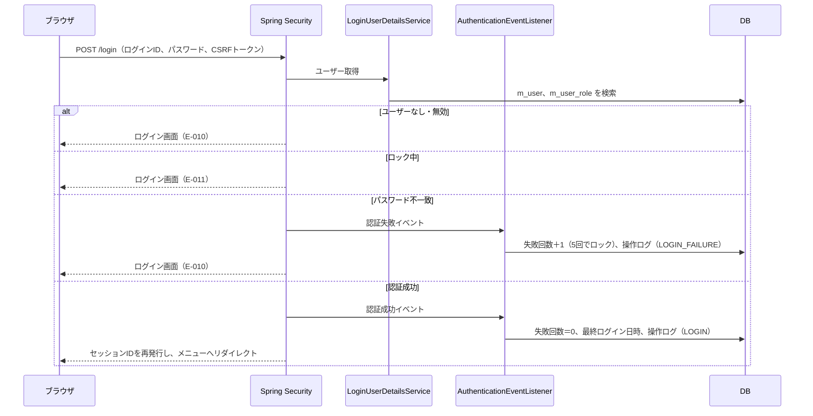

# セキュリティ設計

| 項目 | 内容 |
|---|---|
| 文書名 | セキュリティ設計 |
| 版数 | 第1.2版 |
| 作成日 | 2027/01/08 |
| 作成者 | 開発担当 |

## 改訂履歴

| 版数 | 日付 | 変更内容 | 変更者 |
|---|---|---|---|
| 1.0 | 2027/01/08 | 新規作成 | 開発担当 |
| 1.1 | 2027/01/25 | 製造（共通）の結果を反映。1章に No.8 初期管理者の作成（決定 PD-19）、No.9 未入力の扱いを追加。No.3 にエラーメッセージ（E-002・E-015・E-016）を明記。2章 No.1 にタイムアウト時の遷移先 URL と CSRF トークンがない送信の扱いを追記 | 開発担当 |
| 1.2 | 2027/01/26 | 2章に No.6 静的ファイルの配信（セッションを使わない）を追加（決定 PD-24）。3章 ③ の例にシステム管理者がいなくなる変更の禁止（E-018、E-019）を追加（決定 PD-23） | 開発担当 |

> 非機能要件（NF-24～NF-32）を、どの仕組みで実現するかを定める。
> 脅威の洗い出しは、IPA「安全なウェブサイトの作り方」の項目に沿って行う。

## 1. 認証

| No | 項目 | 設計 | 対応要件 |
|---|---|---|---|
| 1 | 方式 | Spring Security のフォーム認証。ログインID・パスワードを POST /login で受け付ける | NF-24 |
| 2 | パスワードの保管 | BCrypt でハッシュ化する（ストレッチング回数は Spring Security の既定値）。平文・復号可能な形式では保存しない | NF-30 |
| 3 | パスワードの条件 | 8文字以上64文字以下、英字と数字をそれぞれ1文字以上含む。ログインIDと同じ文字列は不可。使用できる文字は半角英数字記号のみ。違反時のメッセージは、8文字未満・文字の種類が E-015、65文字以上が E-002、ログインIDと同じが E-016（`PasswordPolicy`） | NF-24 |
| 4 | 初期パスワード | システム管理者が設定する。初回ログイン時にパスワード変更画面へ強制遷移し、変更するまで他の画面を利用できない | NF-24 |
| 5 | アカウントロック | 認証失敗のたびに失敗回数を1加算し、5回に達したらロックする。認証成功で0に戻す。ロックの解除はシステム管理者が行う | NF-25 |
| 6 | 認証エラーの表示 | ログインIDの誤り・パスワードの誤り・無効ユーザーは、同じメッセージ（E-010）とする | 情報漏えい対策 |
| 7 | ログアウト | セッションを無効化し、Cookie を削除する | — |
| 8 | 初期管理者の作成 | ユーザーが1人もいない状態で起動した場合に限り、初期のシステム管理者（ロール ADMIN、パスワード変更要求あり）を作成する。パスワードは環境変数 `HANBAI_INITIAL_ADMIN_PASSWORD` で渡し、ソースコード・リポジトリに含めない（開発環境のみ application-dev.yml に既定値）。未設定の場合は作成しない。以降のユーザーは画面（SCR-012）から登録する | NF-24 |
| 9 | 未入力 | ログインID・パスワードが未入力の場合は E-001 とする。認証の試行ではないため、認証失敗回数に数えず、操作ログにも記録しない | — |

### 認証処理の流れ

## 2. セッション管理

| No | 項目 | 設計 | 対応要件 |
|---|---|---|---|
| 1 | タイムアウト | 無操作30分。タイムアウト後の操作はログイン画面（`/login?timeout=1`）へ遷移する（E-013）。タイムアウト後に入力画面から送信した場合（CSRF トークンがセッションにない POST）も、処理せずに同じくログイン画面へ遷移する | NF-26 |
| 2 | セッション固定攻撃への対策 | ログイン成功時にセッションIDを再発行する | NF-32 |
| 3 | Cookie の属性 | `Secure`、`HttpOnly`、`SameSite=Lax` を設定する | NF-32 |
| 4 | 同時ログイン | 制限しない（同じ利用者が複数のタブ・PC で利用する場合があるため） | — |
| 5 | セッションに保持する情報 | ログインユーザー情報、二重送信防止トークン、一覧の検索条件のみ。業務データは保持しない | — |
| 6 | 静的ファイル（`/css/**`、`/js/**`） | 画面とは別のセキュリティフィルタで配信し、セッションを参照・作成しない。アプリの再起動後・セッション切れの後に、存在しないセッションIDで要求された静的ファイルまでセッション切れとしてログイン画面へ転送され、CSS が適用されない画面になることを防ぐ。セキュリティヘッダーは画面と同じく付与する | NF-26 |

## 3. 認可（権限制御）

権限マトリクスの内容を、以下の3段階で制御する。

| 段階 | 制御する内容 | 実装 | 例 |
|---|---|---|---|
| ① URL | 画面を開けるか | `SecurityConfig` で URL パターンとロールを対応付ける | `/billing/closings/**` は ACCOUNTING のみ |
| ② 操作 | 更新処理を実行できるか | Service のメソッドに `@PreAuthorize` を付ける | `ShipmentService.register` は WAREHOUSE のみ |
| ③ データ | 対象データに対して実行できるか | Service の業務チェック | 自分が申請した発注は承認できない（E-040）。自分自身の無効化・ADMIN 削除（E-018）、有効なシステム管理者が0人になる変更（E-019）はできない |

- 画面では、権限のないメニュー・ボタンを表示しない（Thymeleaf の Spring Security 連携機能を使用する）。これは操作性のためであり、①②の制御を省略する理由にはならない。
- ①で「照会のみ可」としているロール（システム管理者など）が更新用 URL に POST した場合は、②で拒否する。
- 権限エラーは E-012（HTTP 403）とし、WARN ログにユーザー・URL を出力する。

### URL とロールの対応（抜粋）

| URL パターン | 許可するロール |
|---|---|
| `/login`, `/css/**`, `/js/**` | 全員（未認証を含む） |
| `/menu`, `/password`, `/stock/stocks/**`, `/master/*`（一覧） | 認証済みの全員 |
| `/admin/**` | ADMIN |
| `/stock/adjustments/**`, `/stock/transfers/**` | WAREHOUSE |
| `/stock/movements/**`, `/stock/stocktakings/**`, `/purchase/reorder-alerts/**`, `/sales/shipment-plans/**` | WAREHOUSE, ADMIN |
| `/purchase/orders/**` | WAREHOUSE, APPROVER, ADMIN |
| `/sales/orders/**` | SALES, WAREHOUSE, ACCOUNTING, ADMIN |
| `/billing/closings/**` | ACCOUNTING |
| `/billing/invoices/**` | ACCOUNTING, SALES, ADMIN |
| 上記以外 | 拒否（明示的に許可した URL のみアクセス可能とする） |

## 4. 脆弱性対策

| No | 脅威 | 対策 | 確認方法 |
|---|---|---|---|
| 1 | SQL インジェクション | MyBatis のバインド変数（`#{}`）のみを使用する。`${}` は使用禁止とし、静的解析（grep による検査を CI に組み込む）で検出する。並び順など動的に変える部分は、Enum から固定の文字列に変換する | コードレビュー、CI、脆弱性診断 |
| 2 | クロスサイトスクリプティング（XSS） | Thymeleaf の `th:text`（自動エスケープ）を使用する。`th:utext` は使用禁止。JavaScript に値を渡す場合は Thymeleaf のインライン機能を使用する | 同上 |
| 3 | CSRF | Spring Security の CSRF 対策を有効にする（POST にトークンを付与）。状態を変える操作は GET で行わない | 脆弱性診断 |
| 4 | セッションハイジャック | HTTPS のみ、Cookie の `Secure`・`HttpOnly`、セッションIDの再発行 | 同上 |
| 5 | クリックジャッキング | `X-Frame-Options: DENY` | 同上 |
| 6 | パラメータ改ざん | 金額・ステータス・登録者などは画面から受け取らず、サーバー側で算出・設定する。Form には入力項目のみを定義する。ID を指定した操作は、③データの権限チェックを行う | コードレビュー、結合テスト |
| 7 | ディレクトリ・トラバーサル、OS コマンド・インジェクション | 利用者の入力をファイルパス・コマンドに使用しない（帳票は固定の定義ファイルのみを使用） | コードレビュー |
| 8 | CSV インジェクション | CSV 出力（F-405）で、値の先頭が `=` `+` `-` `@` の場合は先頭に `'` を付ける | 単体テスト |
| 9 | 情報の露出 | エラー画面にスタックトレース・SQL を表示しない。HTTP ヘッダーからサーバーのバージョン情報を削除する | 脆弱性診断 |
| 10 | 既知の脆弱性を持つライブラリ | CI で依存ライブラリの脆弱性検査を実行する。Spring Boot のパッチリリースに追随する | CI |

## 5. 通信・インフラ

| No | 項目 | 設計 | 対応要件 |
|---|---|---|---|
| 1 | 通信の暗号化 | Nginx で TLS 1.2 以上のみ許可する。HTTP（80）は HTTPS へリダイレクトする。HSTS を設定する | NF-28 |
| 2 | アクセス元制限 | OCI のセキュリティリストで、443 番ポートの送信元を顧客拠点の固定IPに限定する | NF-29 |
| 3 | 管理用エンドポイント | Spring Boot Actuator は、ヘルスチェックとメトリクスのみ有効にし、外部（Nginx 経由）からはアクセスできないようにする | NF-32 |
| 4 | DB への接続 | アプリケーションからのみ接続可能とする（Docker 内部ネットワーク）。DB のポートを外部に公開しない | NF-32 |
| 5 | DB ユーザーの権限 | アプリケーション用ユーザーには DML のみを許可する（DDL は不可）。操作ログテーブルには INSERT と SELECT のみを許可する。DDL を実行する Flyway 用ユーザーは別とする | NF-31 |
| 6 | 秘密情報の管理 | DB のパスワードなどは環境変数で渡し、ソースコード・リポジトリに含めない。GitHub Actions では Secrets を使用する | — |
| 7 | サーバーへのログイン | SSH は公開鍵認証のみ。送信元を開発担当の固定IPに限定する | — |

## 6. 監査

| No | 項目 | 設計 | 対応要件 |
|---|---|---|---|
| 1 | 操作ログ | 「共通処理設計」7章のとおり記録する | NF-31 |
| 2 | 改ざん防止 | 操作ログは画面から変更・削除できない。DB ユーザーの権限でも UPDATE・DELETE を許可しない | NF-31 |
| 3 | 不正の検知 | ログイン失敗・権限エラーを操作ログ・アプリケーションログに記録し、システム管理者が操作ログ照会（SCR-013）で確認できるようにする | — |

## 7. ポートフォリオ公開環境での扱い（参考）

本設計は顧客向けの本番環境を前提とする。ポートフォリオとしてインターネットに公開するデモ環境では、以下の点を変更する。変更点は環境別の設定で切り替え、設計・ソースコードは共通とする。

| 項目 | 本番環境 | デモ環境 |
|---|---|---|
| アクセス元制限（NF-29） | 顧客拠点の固定IPのみ | 制限なし |
| ユーザー | 顧客の利用者 | 閲覧用のデモユーザー（ロールごと）。パスワード変更・ユーザー管理は不可とする |
| データ | 顧客の業務データ | 架空のサンプルデータ。毎日夜間に初期化する |
