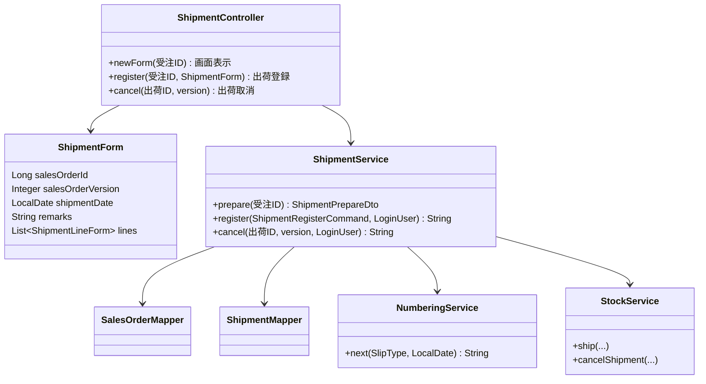
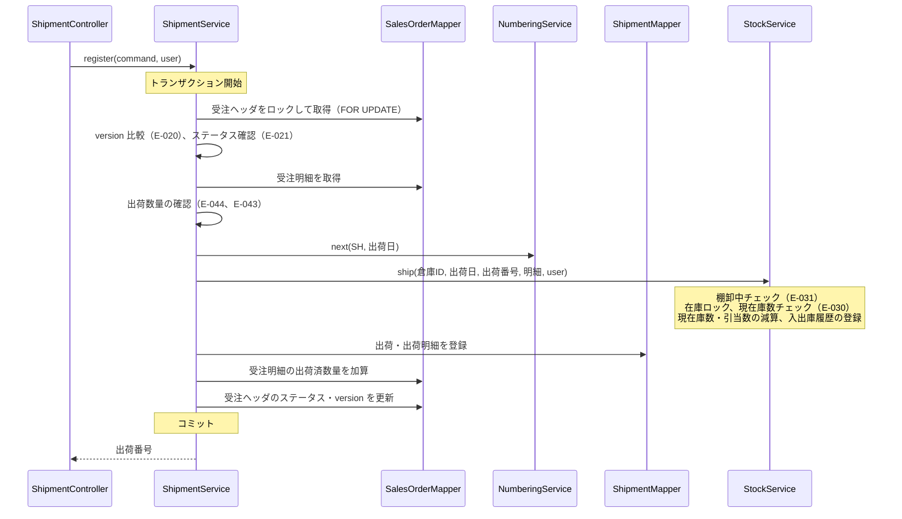

# 処理詳細：出荷登録・出荷取消

| 項目 | 内容 |
|---|---|
| 文書名 | 処理詳細 出荷登録・出荷取消 |
| 版数 | 第1.0版 |
| 作成日 | 2027/01/12 |
| 作成者 | 開発担当 |
| 対応する基本設計 | 画面設計書 SCR-405、画面一覧 SCR-403、BR-03, 04, 05, 14, 15, 17 |

## 改訂履歴

| 版数 | 日付 | 変更内容 | 変更者 |
|---|---|---|---|
| 1.0 | 2027/01/12 | 新規作成 | 開発担当 |

## 1. クラス構成



| クラス | メソッド | 概要 |
|---|---|---|
| ShipmentController | `GET /sales/orders/{id}/shipments/new` | `prepare` の結果を Form に設定して SCR-405 を表示する |
| ShipmentController | `POST /sales/orders/{id}/shipments` | 入力チェック → `register` → SCR-403 へリダイレクト。BusinessException の場合は SCR-405 を再表示する |
| ShipmentController | `POST /sales/shipments/{id}/cancel` | `cancel` → SCR-403 へリダイレクト |
| ShipmentService | `register` | 2章 |
| ShipmentService | `cancel` | 4章 |

## 2. 出荷登録（ShipmentService.register）

権限：`@PreAuthorize("hasRole('WAREHOUSE')")`、操作ログ：CREATE / SCR-405 / t_shipment

### 2.1 シーケンス



### 2.2 処理フロー

| No | 処理 | エラー時 |
|---|---|---|
| 1 | 受注ヘッダを `FOR UPDATE` で取得する | 存在しない：システムエラー |
| 2 | 画面から受け取った version と比較する | 不一致：E-020 |
| 3 | ステータスが「受注済（10）」または「一部出荷（20）」であることを確認する | E-021 |
| 4 | 出荷日が受注日以降かつ当日以前であることを確認する | E-007 |
| 5 | 受注明細を取得し、入力された明細（受注行番号・今回出荷数）と突き合わせる。今回出荷数が 0 の行は除外する | 受注明細に存在しない行番号：システムエラー |
| 6 | 出荷する明細が1行以上あることを確認する | E-044 |
| 7 | 明細ごとに「今回出荷数 ≦ 受注数量 − 出荷済数量」を確認する | E-043 |
| 8 | 出荷番号を採番する（SH、出荷日の年月） | — |
| 9 | `StockService.ship` を呼び出す（倉庫＝受注の出荷倉庫） | E-031、E-030 |
| 10 | 出荷（ステータス：出荷済、請求ID：NULL、得意先ID・倉庫IDは受注から複写）を登録する | — |
| 11 | 出荷明細を登録する（単価・税区分は受注明細から複写、金額＝今回出荷数×単価） | — |
| 12 | 受注明細の出荷済数量に今回出荷数を加算する | — |
| 13 | 受注ヘッダを更新する。全明細で「出荷済数量＝受注数量」なら「出荷完了（30）」、それ以外は「一部出荷（20）」。version＋1 | — |
| 14 | 出荷番号を返す | — |

### 2.3 主な SQL

```sql
-- No.1 受注ヘッダのロック
SELECT sales_order_id, sales_order_no, order_date, customer_id, warehouse_id,
       status, remaining_cancelled, version
  FROM t_sales_order
 WHERE sales_order_id = #{salesOrderId}
   FOR UPDATE;

-- No.12 出荷済数量の加算（増減値で更新する）
UPDATE t_sales_order_detail
   SET shipped_quantity = shipped_quantity + #{quantity},
       updated_at = #{now}, updated_by = #{userId}
 WHERE sales_order_id = #{salesOrderId} AND line_no = #{lineNo};

-- No.13 受注ヘッダの更新
UPDATE t_sales_order
   SET status = #{status}, version = version + 1,
       updated_at = #{now}, updated_by = #{userId}
 WHERE sales_order_id = #{salesOrderId};
```

## 3. 同時実行時の動作

| ケース | 動作 |
|---|---|
| 同じ受注に対して2人が同時に出荷登録 | 後から来た処理は No.1 のロックで待たされ、先の処理のコミット後に version 不一致（E-020）となる。受注数量を超える出荷は発生しない |
| 別の受注だが同じ商品を同時に出荷 | 在庫の行ロックにより直列に実行される。後の処理は、先の処理で減った後の現在庫数で不足を判定する（E-030） |
| 出荷登録中に棚卸が開始された | 棚卸開始は倉庫の排他ロックで出荷のコミットを待つ。出荷は棚卸開始前の在庫として反映される |
| 出荷登録中に請求締めが実行された | コミット前の出荷は請求締めから見えない。コミット後、次回の請求締めの対象となる |

## 4. 出荷取消（ShipmentService.cancel）

権限：`hasRole('WAREHOUSE')`、操作ログ：CANCEL / SCR-403 / t_shipment

| No | 処理 | エラー時 |
|---|---|---|
| 1 | 出荷から受注IDを取得し、受注ヘッダを `FOR UPDATE` で取得する（ロック順序：受注 → 出荷） | — |
| 2 | 出荷を `FOR UPDATE` で取得し、画面の version と比較する | E-020 |
| 3 | 出荷のステータスが「出荷済（10）」であることを確認する | E-021 |
| 4 | 出荷の請求ID が NULL であることを確認する | E-045（請求番号を表示） |
| 5 | 受注の残数取消フラグが false であることを確認する | E-046 |
| 6 | `StockService.cancelShipment` を呼び出す（現在庫数・引当数を加算、入出庫履歴：出荷取消。伝票番号は元の出荷番号） | E-031 |
| 7 | 受注明細の出荷済数量から、出荷明細の数量を減算する | — |
| 8 | 受注ヘッダのステータスを再計算する（全明細の出荷済数量が 0：「受注済」、それ以外：「一部出荷」）。version＋1 | — |
| 9 | 出荷のステータスを「取消（90）」に更新する。version＋1 | — |

> 請求締めバッチは、対象の出荷を `FOR UPDATE` でロックして請求IDを設定する。出荷取消の No.2 のロックと競合するため、「取消と同時に請求される」ことはない。

## 5. 単体テストで確認する主な観点

詳細は「07_単体テスト観点一覧」を参照。

- 全数出荷で「出荷完了」、一部出荷で「一部出荷」になること
- 今回出荷数が残数と等しい（境界値：可）、残数＋1（不可）
- version 不一致、ステータス不正（取消済、出荷完了）でエラーになること
- 出荷取消後、受注明細・ステータス・在庫・引当が出荷前の値に戻ること
