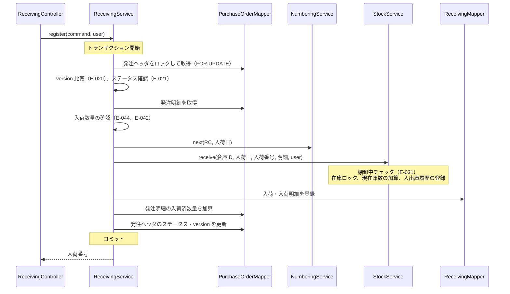

# 処理詳細：入荷登録

| 項目 | 内容 |
|---|---|
| 文書名 | 処理詳細 入荷登録 |
| 版数 | 第1.0版 |
| 作成日 | 2027/01/12 |
| 作成者 | 開発担当 |
| 対応する基本設計 | 画面一覧 SCR-304、BR-04, 05, 25, 26 |

## 改訂履歴

| 版数 | 日付 | 変更内容 | 変更者 |
|---|---|---|---|
| 1.0 | 2027/01/12 | 新規作成 | 開発担当 |

## 1. クラス構成

| クラス | メソッド | 概要 |
|---|---|---|
| ReceivingController | `GET /purchase/orders/{id}/receivings/new` | 未入荷の発注明細を表示する（SCR-304） |
| ReceivingController | `POST /purchase/orders/{id}/receivings` | 入力チェック → `ReceivingService.register` → SCR-303 へリダイレクト |
| ReceivingForm | — | 発注ID、発注の version、入荷日、備考、明細（発注行番号、今回入荷数） |
| ReceivingService | `register(ReceivingRegisterCommand, LoginUser)` | 2章。入荷番号を返す |
| PurchaseOrderMapper, ReceivingMapper | — | 発注・発注明細、入荷・入荷明細の SQL |
| NumberingService, StockService | — | 採番、在庫の加算 |

## 2. 入荷登録（ReceivingService.register）

権限：`hasRole('WAREHOUSE')`、操作ログ：CREATE / SCR-304 / t_receiving

### 2.1 シーケンス

### 2.2 処理フロー

| No | 処理 | エラー時 |
|---|---|---|
| 1 | 発注ヘッダを `FOR UPDATE` で取得する | 存在しない：システムエラー |
| 2 | 画面から受け取った version と比較する | E-020 |
| 3 | ステータスが「承認済（30）」または「一部入荷（40）」であることを確認する | E-021 |
| 4 | 入荷日が発注日以降かつ当日以前であることを確認する | E-007 |
| 5 | 発注明細を取得し、入力された明細と突き合わせる。今回入荷数が 0 の行は除外する | — |
| 6 | 入荷する明細が1行以上あることを確認する | E-044 |
| 7 | 明細ごとに「今回入荷数 ≦ 発注数量 − 入荷済数量」を確認する（BR-26） | E-042 |
| 8 | 入荷番号を採番する（RC、入荷日の年月） | — |
| 9 | `StockService.receive` を呼び出す（倉庫＝発注の入荷倉庫） | E-031 |
| 10 | 入荷・入荷明細を登録する | — |
| 11 | 発注明細の入荷済数量に今回入荷数を加算する | — |
| 12 | 発注ヘッダを更新する。全明細で「入荷済数量＝発注数量」なら「入荷完了（50）」、それ以外は「一部入荷（40）」。version＋1 | — |

## 3. 入荷による引当への影響

入荷では現在庫数のみを加算し、引当数は変更しない。有効在庫数（現在庫数 − 引当数）がマイナスだった場合、入荷によって自動的に解消される。受注ごとの「引当済み／未引当」は管理しないため、入荷時に特定の受注へ在庫を割り当てる処理は行わない（出荷の順番は、物流担当が出荷予定一覧の納期順に判断する）。

## 4. 残数取消（PurchaseOrderService.closeRemaining）

| No | 処理 | エラー時 |
|---|---|---|
| 1 | 発注ヘッダを `FOR UPDATE` で取得し、version を比較する | E-020 |
| 2 | ステータスが「一部入荷（40）」であることを確認する | E-021 |
| 3 | ステータスを「入荷完了（50）」、残数取消フラグを true に更新する。version＋1 | — |

- 発注明細の発注数量・入荷済数量は変更しない（当初の発注数量を記録として残す）。
- 発注残数の集計はステータス 20・30・40 を対象とするため、残数取消後の発注は発注残に含まれない。
- 在庫は変化しない。

## 5. 単体テストで確認する主な観点

- 全数入荷で「入荷完了」、一部入荷で「一部入荷」になること
- 今回入荷数が残数と等しい（可）、残数＋1（不可、E-042）
- 承認待ち・差戻し・取消の発注には入荷登録できないこと
- 入荷後、現在庫数が増え、引当数が変わらないこと。入出庫履歴の変動後在庫数が正しいこと
