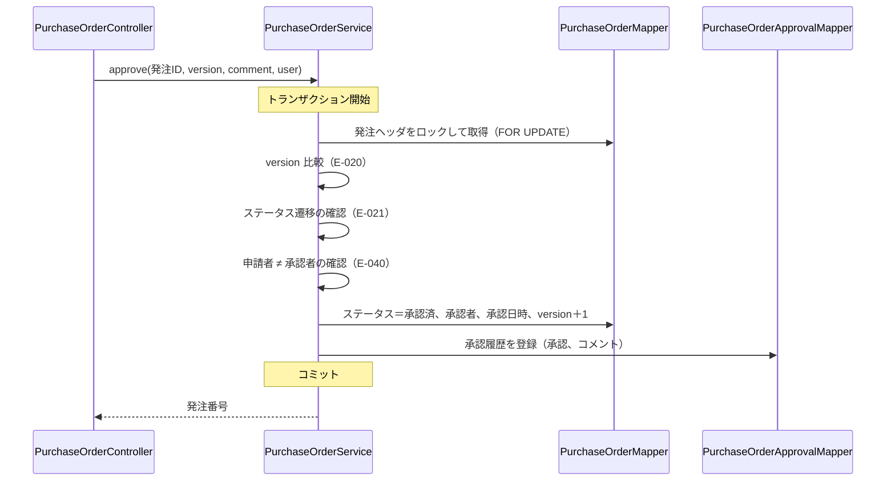

# 処理詳細：発注の承認申請・承認・差戻し

| 項目 | 内容 |
|---|---|
| 文書名 | 処理詳細 発注承認 |
| 版数 | 第1.0版 |
| 作成日 | 2027/01/13 |
| 作成者 | 開発担当 |
| 対応する基本設計 | 画面設計書 SCR-302、SCR-303、BR-22, 23, 24 |

## 改訂履歴

| 版数 | 日付 | 変更内容 | 変更者 |
|---|---|---|---|
| 1.0 | 2027/01/13 | 新規作成 | 開発担当 |

## 1. クラス構成

| クラス | メソッド | 権限 | 操作ログ | 概要 |
|---|---|---|---|---|
| PurchaseOrderService | `save(command, user)` | WAREHOUSE | CREATE／UPDATE | 一時保存（作成中） |
| PurchaseOrderService | `apply(発注ID, version, user)` | WAREHOUSE | APPLY | 承認申請 |
| PurchaseOrderService | `saveAndApply(command, user)` | WAREHOUSE | APPLY | 保存と承認申請を1トランザクションで行う（SCR-302 の承認申請ボタン） |
| PurchaseOrderService | `approve(発注ID, version, comment, user)` | APPROVER | APPROVE | 承認 |
| PurchaseOrderService | `reject(発注ID, version, comment, user)` | APPROVER | REJECT | 差戻し |
| PurchaseOrderService | `cancel(発注ID, version, user)` | WAREHOUSE | CANCEL | 取消 |
| PurchaseOrderStatusPolicy | `canTransit(現在, 操作)` | — | — | ステータス遷移の可否を判定する（2章の表をそのまま実装する） |

## 2. ステータス遷移表

行＝現在のステータス、列＝操作。セルは遷移後のステータス、「×」は E-021。

| 現在＼操作 | 保存 | 承認申請 | 承認 | 差戻し | 入荷（残あり） | 入荷（残なし） | 残数取消 | 取消 |
|---|---|---|---|---|---|---|---|---|
| （新規） | 作成中 | 承認待ち | × | × | × | × | × | × |
| 作成中（10） | 作成中 | 承認待ち | × | × | × | × | × | 取消 |
| 承認待ち（20） | × | × | 承認済 | 差戻し | × | × | × | × |
| 差戻し（25） | 差戻し ※ | 承認待ち | × | × | × | × | × | 取消 |
| 承認済（30） | × | × | × | × | 一部入荷 | 入荷完了 | × | 取消 |
| 一部入荷（40） | × | × | × | × | 一部入荷 | 入荷完了 | 入荷完了 | × |
| 入荷完了（50） | × | × | × | × | × | × | × | × |
| 取消（90） | × | × | × | × | × | × | × | × |

※ 差戻しされた発注を一時保存した場合、ステータスは「差戻し」のままとする（承認履歴との整合のため）。

> この表を `PurchaseOrderStatusPolicy` に1か所で実装し、各メソッドから呼び出す。
> ステータスの条件を各メソッドに if 文で分散させない。単体テストは、この表の全セル（8×8）を網羅する。

## 3. 承認（PurchaseOrderService.approve）

| No | 処理 | エラー時 |
|---|---|---|
| 1 | 発注ヘッダを `FOR UPDATE` で取得する | — |
| 2 | version を比較する | E-020 |
| 3 | ステータスが「承認待ち（20）」であることを確認する | E-021 |
| 4 | 発注の申請者ID と、ログインユーザーのIDが異なることを確認する（BR-22） | E-040 |
| 5 | 発注ヘッダを更新する（ステータス：承認済、承認者、承認日時、version＋1） | — |
| 6 | 承認履歴を登録する（操作：承認、コメント） | — |

### 設計上の注意

| No | 内容 |
|---|---|
| 1 | No.4 の確認は、画面でボタンを非表示にするだけでなく、必ず Service で行う。田中部長・鈴木課長は現状「物流担当」ロールを持たないため自分で申請することはないが、将来ロールの割り当てが変わっても業務ルールが守られるようにする |
| 2 | 承認者のロール確認は `@PreAuthorize("hasRole('APPROVER')")` で行う。No.4 は「誰の申請か」というデータに依存する確認のため、メソッド内で行う |
| 3 | 承認時点では在庫は変化しない |

## 4. 差戻し（reject）

承認と同じ手順で、以下が異なる。

| 項目 | 内容 |
|---|---|
| コメント | 必須（E-041）。Controller の入力チェックと Service の両方で確認する |
| 更新内容 | ステータス：差戻し（25）。承認者・承認日時は設定しない |
| 承認履歴 | 操作：差戻し、コメント |

## 5. 承認申請（apply / saveAndApply）

| No | 処理 | エラー時 |
|---|---|---|
| 1 | （saveAndApply の場合）発注・発注明細を登録または更新する。金額はサーバー側で再計算する | 入力チェックエラー |
| 2 | 発注ヘッダを `FOR UPDATE` で取得し、version を比較する（新規登録の場合は不要） | E-020 |
| 3 | ステータスが「作成中」または「差戻し」であることを確認する | E-021 |
| 4 | 明細の商品・仕入先・倉庫が有効であることを再確認する（一時保存後にマスタが無効になった場合） | E-006 |
| 5 | 発注ヘッダを更新する（ステータス：承認待ち、申請者、申請日時、version＋1） | — |
| 6 | 承認履歴を登録する（操作：承認申請） | — |

## 6. 発注書 PDF の出力（PurchaseOrderService.exportPdf）

| No | 処理 | エラー時 |
|---|---|---|
| 1 | 発注・明細・仕入先・倉庫・自社情報・申請者・承認者を取得する | — |
| 2 | ステータスが「承認済・一部入荷・入荷完了」であることを確認する（BR-24） | E-021 |
| 3 | 明細を税区分ごとに合計し、消費税額を計算する（`TaxCalculator`、基準日＝発注日） | — |
| 4 | `ReportService.exportPdf("RPT-02", …)` で PDF を生成する | — |
| 5 | 操作ログ（EXPORT）を記録する | — |

## 7. 単体テストで確認する主な観点

- ステータス遷移表の全セル
- 申請者本人による承認が E-040 になること。別の承認者は承認できること
- 差戻し時にコメントが空の場合 E-041 になること
- 承認履歴が「申請 → 差戻し → 申請 → 承認」の順に記録されること
