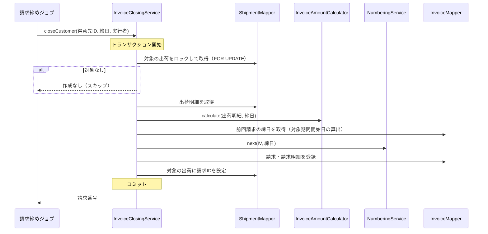

# 処理詳細：請求締め・締め取消・請求書出力

| 項目 | 内容 |
|---|---|
| 文書名 | 処理詳細 請求締め |
| 版数 | 第1.0版 |
| 作成日 | 2027/01/14 |
| 作成者 | 開発担当 |
| 対応する基本設計 | 画面設計書 SCR-501、帳票設計書 RPT-01、バッチ一覧 BAT-03、BR-31～36 |

## 改訂履歴

| 版数 | 日付 | 変更内容 | 変更者 |
|---|---|---|---|
| 1.0 | 2027/01/14 | 新規作成 | 開発担当 |

## 1. クラス構成

| クラス | メソッド | 概要 |
|---|---|---|
| InvoiceClosingController | preview / execute / status | 対象確認、バッチの起動、実行状況の取得（SCR-501） |
| InvoiceClosingService | `preview(締日, 締日区分, 得意先ID)` | 対象の出荷を得意先ごとに集計して返す（参照のみ） |
| InvoiceClosingService | `findTargetCustomerIds(締日, 締日区分, 得意先ID)` | 対象の得意先IDを取得する（バッチの入力） |
| InvoiceClosingService | `closeCustomer(得意先ID, 締日, 実行者)` | **得意先1社分の請求を作成する（1トランザクション）** |
| InvoiceService | `cancel(請求ID, version, user)` | 締め取消 |
| InvoiceService | `exportPdf(請求ID, user)` | 請求書 PDF の出力 |
| InvoiceAmountCalculator | `calculate(出荷明細リスト, 基準日)` | 税率ごとの対象額・消費税額・請求金額を求める（DB に依存しない純粋な計算） |
| ClosingDateCalculator | `closingDate(対象年月, 締日区分)` / `paymentDueDate(締日, 支払月区分, 支払日)` | 日付の計算 |
| InvoiceMapper, ShipmentMapper | — | SQL |

バッチのジョブ構成は「06_バッチ詳細設計」を参照。

## 2. 得意先1社分の請求作成（InvoiceClosingService.closeCustomer）

### 2.1 シーケンス



### 2.2 処理フロー

| No | 処理 | 備考 |
|---|---|---|
| 1 | 得意先マスタを取得する（締日区分、支払条件） | — |
| 2 | 対象の出荷を `FOR UPDATE` で取得する。条件：得意先ID一致、ステータス＝出荷済（10）、請求ID IS NULL、出荷日 ≦ 締日。出荷日・出荷番号の昇順 | 0件の場合は何もせず終了する（他の実行で処理済みの場合など） |
| 3 | 対象の出荷の出荷明細を取得する（商品名・単位は商品マスタから取得） | — |
| 4 | `InvoiceAmountCalculator.calculate` で金額を計算する（3章） | — |
| 5 | 対象期間を求める。開始日：その得意先の取消以外の請求のうち最も新しい締日の翌日（請求がない場合は、対象の出荷のうち最も古い出荷日）。終了日：締日 | 開始日より前の出荷日の出荷が含まれる場合がある（後から登録された過去日付の出荷） |
| 6 | 支払期限を求める（`ClosingDateCalculator.paymentDueDate`） | — |
| 7 | 請求番号を採番する（IV、締日の年月） | — |
| 8 | 請求を登録する（ステータス：確定、発行回数：0） | — |
| 9 | 請求明細を登録する（出荷明細1行につき1行。品名・単位・単価・金額・税区分を複写） | — |
| 10 | 対象の出荷の請求ID を更新する（No.2 で取得した出荷IDを指定） | 更新件数が No.2 の件数と一致しない場合はシステムエラー |

### 2.3 主な SQL

```sql
-- No.2 対象の出荷をロックして取得する
SELECT shipment_id, shipment_no, shipment_date, version
  FROM t_shipment
 WHERE customer_id = #{customerId}
   AND status = '10'
   AND invoice_id IS NULL
   AND shipment_date <= #{closingDate}
 ORDER BY shipment_date, shipment_no
   FOR UPDATE;

-- No.10 請求IDの設定（No.2 で取得した出荷のみ）
UPDATE t_shipment
   SET invoice_id = #{invoiceId}, version = version + 1,
       updated_at = #{now}, updated_by = #{userId}
 WHERE shipment_id IN
   <foreach collection="shipmentIds" item="id" open="(" separator="," close=")">#{id}</foreach>
   AND invoice_id IS NULL;
```

## 3. 請求金額の計算（InvoiceAmountCalculator）

| No | 処理 |
|---|---|
| 1 | 出荷明細の金額を、税区分ごとに合計する（10%対象額、8%対象額） |
| 2 | 税区分ごとに、締日時点の税率を消費税率マスタから取得する |
| 3 | 消費税額 ＝ 対象額 × 税率。1円未満を切り捨てる（`RoundingMode.DOWN`） |
| 4 | 請求金額 ＝ 10%対象額 ＋ 10%消費税額 ＋ 8%対象額 ＋ 8%消費税額 |

### 計算例

| 明細 | 金額（税抜） | 税区分 |
|---|---|---|
| A | 1,234 | 標準（10%） |
| B | 5,678 | 標準（10%） |
| C | 999 | 軽減（8%） |

- 10%対象額＝6,912、消費税額＝691.2 → **691**
- 8%対象額＝999、消費税額＝79.92 → **79**
- 請求金額＝6,912＋691＋999＋79＝**8,681**

> 明細ごとに消費税を計算して合計すると、A：123、B：567、C：79 で合計 769 となり、上記の 770（691＋79）と一致しない。
> インボイス制度では「1つの請求書につき、税率ごとに1回」の端数処理と定められているため、必ず合計してから計算する（BR-34）。

- 計算はすべて `BigDecimal` で行う。`double` は使用しない。
- 本クラスは DB にアクセスしない（税率は引数で受け取る）。単体テストで多数の組み合わせを高速に検証できるようにするためである。

## 4. 日付の計算（ClosingDateCalculator）

| 入力 | 結果 |
|---|---|
| 対象年月 2027/04、締日区分 99（末日） | 締日 2027/04/30 |
| 対象年月 2027/02、締日区分 99 | 締日 2027/02/28 |
| 対象年月 2028/02、締日区分 99 | 締日 2028/02/29（うるう年） |
| 対象年月 2027/04、締日区分 20 | 締日 2027/04/20 |
| 締日 2027/01/31、支払月区分 1（翌月）、支払日 99 | 支払期限 2027/02/28 |
| 締日 2027/04/20、支払月区分 1、支払日 20 | 支払期限 2027/05/20 |
| 締日 2027/12/31、支払月区分 2（翌々月）、支払日 10 | 支払期限 2028/02/10 |

支払期限が土日祝日にあたる場合の調整は行わない（現行の請求書と同じ扱い）。

## 5. 締め取消（InvoiceService.cancel）

権限：`hasRole('ACCOUNTING')`、操作ログ：CANCEL / SCR-503 / t_invoice

| No | 処理 | エラー時 |
|---|---|---|
| 1 | 請求を `FOR UPDATE` で取得し、version を比較する | E-020 |
| 2 | ステータスが「確定（10）」であることを確認する（BR-36） | 発行済：E-051、取消：E-021 |
| 3 | この請求に紐づく出荷の請求ID を NULL に戻す | — |
| 4 | 請求のステータスを「取消（90）」に更新する。version＋1 | — |

- 請求明細は削除しない（取り消した請求の内容を確認できるようにする）。
- 取消後、再度請求締めを実行すると、新しい請求番号で請求が作成される。

## 6. 請求書 PDF の出力（InvoiceService.exportPdf）

権限：`hasRole('ACCOUNTING')`、操作ログ：EXPORT / SCR-503 / t_invoice

| No | 処理 | エラー時 |
|---|---|---|
| 1 | 請求を `FOR UPDATE` で取得する | — |
| 2 | ステータスが「確定」または「発行済」であることを確認する | E-021 |
| 3 | 発行回数を1加算する。初回（発行回数 0 → 1）の場合は、ステータスを「発行済」、発行日時を現在日時に更新する | — |
| 4 | 請求明細・得意先・自社情報を取得する | — |
| 5 | `ReportService.exportPdf("RPT-01", …)` で PDF を生成する。発行回数が2以上の場合は「再発行」を表示する | — |

- 金額は請求テーブルの値をそのまま印字する（再計算しない）。
- PDF の生成に失敗した場合はトランザクションがロールバックされ、発行回数は加算されない。

## 7. 同時実行時の動作

| ケース | 動作 |
|---|---|
| 請求締めの実行中に、同じ得意先の出荷が登録された | コミット前の出荷は No.2 で取得されないため、今回の請求には含まれない。次回の請求締めの対象となる |
| 請求締めと出荷取消が同時に実行された | 出荷の行ロックにより直列化される。請求締めが先：出荷取消は E-045。出荷取消が先：その出荷は請求締めの対象から外れる |
| 請求締めを2人が同時に実行した | ジョブの二重起動チェックで後者は E-052。万一同時に実行されても、出荷の行ロックと「請求ID IS NULL」の条件により、同じ出荷が2つの請求に含まれることはない |
| 請求締めの途中で異常終了した | 処理済みの得意先の請求は確定している。再実行すると、未処理の得意先のみ請求が作成される |

## 8. 単体テストで確認する主な観点

- 3章の計算例、および「07_単体テスト観点一覧」の消費税計算の観点
- 4章の日付計算の全パターン
- 締日より後の出荷、取消済みの出荷、請求済みの出荷が対象にならないこと
- 締め取消後に再度締めると、同じ出荷が新しい請求に含まれること
- 発行済みの請求を取り消せないこと。2回目の出力で発行回数が2になり、発行日時が変わらないこと
