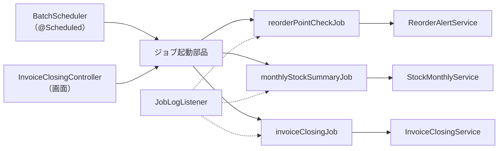
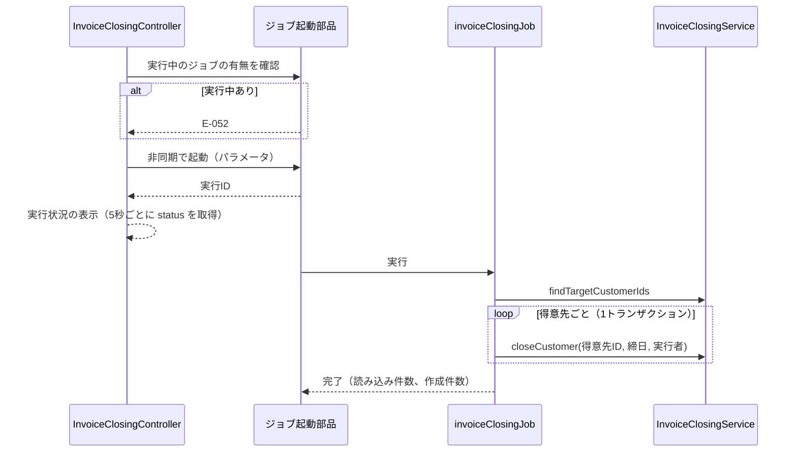

# バッチ詳細設計

| 項目 | 内容 |
|---|---|
| 文書名 | バッチ詳細設計 |
| 版数 | 第1.0版 |
| 作成日 | 2027/01/14 |
| 作成者 | 開発担当 |
| 対応する基本設計 | バッチ一覧（BAT-01～03） |

## 改訂履歴

| 版数 | 日付 | 変更内容 | 変更者 |
|---|---|---|---|
| 1.0 | 2027/01/14 | 新規作成 | 開発担当 |

> Spring Batch の API（ジョブの起動・実行状況の取得）は、採用バージョンで推奨される方法に従う。
> 具体的なクラス名は技術検証 P-05 の結果をもとに確定し、本書を改訂する。本書では役割で記述する。

## 1. 共通構成



| 項目 | 設計 |
|---|---|
| ジョブ定義 | 各サブシステムの `batch` パッケージに、ジョブごとの設定クラスを置く |
| 業務ロジックの場所 | Service に置く。ジョブ・ステップのクラスは、Service の呼び出しと件数の記録のみを行う |
| 起動時の自動実行 | 無効にする（アプリケーション起動時にジョブが実行されないようにする） |
| スケジュール | `BatchScheduler` に `@Scheduled(cron = …, zone = "Asia/Tokyo")` で定義する。cron 式は設定ファイルで変更可能とする |
| ジョブパラメータ | 業務パラメータに加え、実行ごとに異なる値（起動日時）を付与する。同じ業務パラメータで何度でも実行できるようにするためである |
| 実行履歴 | Spring Batch の実行管理テーブル（`BATCH_*`）に記録される |
| 共通リスナー（JobLogListener） | ジョブの開始・終了時に、アプリケーションログと操作ログ（BATCH）を出力する。異常終了時は ERROR ログを出力する（監視が検知する） |
| 実行ユーザー | スケジュール起動のバッチは、登録者・更新者を 0（システム）とする |

## 2. BAT-01 発注点チェック（reorderPointCheckJob）

| 項目 | 内容 |
|---|---|
| 起動 | 毎日 22:00（cron：`0 0 22 * * *`） |
| パラメータ | `alertDate`（実行日）、`launchedAt` |
| 構成 | 1ステップ（タスクレット）。`ReorderAlertService.rebuild(alertDate)` を呼び出す |
| トランザクション | 全体で1トランザクション（削除と登録を同時に確定する） |

### 処理（ReorderAlertService.rebuild）

1. `DELETE FROM t_reorder_alert`
2. 以下の SQL で抽出結果を登録する。
3. 登録件数を返す（ステップの書き込み件数として記録する）。

```sql
INSERT INTO t_reorder_alert
  (alert_date, product_id, warehouse_id, quantity, allocated_quantity,
   on_order_quantity, reorder_point, standard_order_quantity, created_at, created_by)
SELECT #{alertDate}, pw.product_id, pw.warehouse_id,
       COALESCE(s.quantity, 0), COALESCE(s.allocated_quantity, 0),
       COALESCE(o.on_order_quantity, 0),
       pw.reorder_point, pw.standard_order_quantity, #{now}, 0
  FROM m_product_warehouse pw
  JOIN m_product   p ON p.product_id   = pw.product_id   AND p.enabled = TRUE
  JOIN m_warehouse w ON w.warehouse_id = pw.warehouse_id AND w.enabled = TRUE
  LEFT JOIN t_stock s
         ON s.product_id = pw.product_id AND s.warehouse_id = pw.warehouse_id
  LEFT JOIN (SELECT d.product_id, h.warehouse_id,
                    SUM(d.quantity - d.received_quantity) AS on_order_quantity
               FROM t_purchase_order h
               JOIN t_purchase_order_detail d ON d.purchase_order_id = h.purchase_order_id
              WHERE h.status IN ('20', '30', '40')
              GROUP BY d.product_id, h.warehouse_id) o
         ON o.product_id = pw.product_id AND o.warehouse_id = pw.warehouse_id
 WHERE pw.reorder_point > 0
   AND COALESCE(s.quantity, 0) - COALESCE(s.allocated_quantity, 0)
       + COALESCE(o.on_order_quantity, 0) <= pw.reorder_point;
```

### 設計上の判断

| No | 判断 | 理由 |
|---|---|---|
| 1 | 1件ずつ読み込んで判定する方式（チャンク処理）ではなく、1本の SQL で抽出・登録する | 対象は最大 2,100 件であり、集合演算で数秒以内に完了する。1件ずつ処理する方式は、件数が少ない本処理では複雑になるだけである |
| 2 | 洗い替え（全件削除→登録）とする | 何度実行しても同じ結果になる。前日のアラートとの差分管理が不要になる |
| 3 | 画面の在庫照会（SCR-201）の「発注点以下」の判定と、同じ条件式を使用する | 画面とアラートで結果が食い違うことを防ぐ。条件式は SQL の共通部品（MyBatis の `<sql>`）として1か所に定義する |

## 3. BAT-02 月次在庫集計（monthlyStockSummaryJob）

| 項目 | 内容 |
|---|---|
| 起動 | 毎月1日 0:30（cron：`0 30 0 1 * *`） |
| パラメータ | `targetMonth`（YYYYMM。省略時は実行日の前月）、`launchedAt` |
| 構成 | 1ステップ（タスクレット）。`StockMonthlyService.summarize(targetMonth)` を呼び出す |
| トランザクション | 全体で1トランザクション |

### 処理（StockMonthlyService.summarize）

1. `DELETE FROM t_stock_monthly WHERE target_month = #{targetMonth}`
2. `INSERT INTO t_stock_monthly (…) SELECT #{targetMonth}, product_id, warehouse_id, quantity, allocated_quantity, #{now}, 0 FROM t_stock`
3. 登録件数を返す。

## 4. BAT-03 請求締め（invoiceClosingJob）

| 項目 | 内容 |
|---|---|
| 起動 | 画面（SCR-501）の「請求締め実行」から非同期で起動する |
| パラメータ | `closingDate`（締日）、`closingDay`（締日区分）、`customerId`（任意）、`executedBy`（実行者のユーザーID）、`launchedAt` |
| 構成 | 1ステップ（チャンク処理、チャンクサイズ 1） |
| トランザクション | 得意先1社ごとにコミットする |

### 4.1 ステップの構成

| 役割 | 処理 |
|---|---|
| 読み込み（Reader） | ステップ開始時に `InvoiceClosingService.findTargetCustomerIds` で対象の得意先IDの一覧を取得し、1件ずつ返す |
| 書き込み（Writer） | `InvoiceClosingService.closeCustomer(得意先ID, 締日, 実行者)` を呼び出す。請求が作成された場合は作成件数に加算する |



### 4.2 実行状況の取得（GET /billing/closings/{実行ID}/status）

| 項目 | 内容 |
|---|---|
| 返す内容 | 状態（実行中／完了／異常終了）、対象得意先数、処理済み得意先数、作成件数 |
| 取得元 | Spring Batch の実行管理情報（ステップの読み込み件数・書き込み件数） |
| 権限 | ACCOUNTING。他のジョブ（BAT-01、02）の実行IDを指定した場合は 404 とする |

### 4.3 設計上の判断

| No | 判断 | 理由 |
|---|---|---|
| 1 | チャンクサイズを 1（得意先1社ごとにコミット）とする | 1社でエラーが発生しても、他の得意先の請求を確定させるため。また、出荷の行ロックを長時間保持しないため（締め処理中も出荷登録ができる） |
| 2 | エラー発生時は、その得意先をスキップせず、ジョブを異常終了とする | 請求が一部の得意先だけ作成されていない状態に、経理担当が気づかないことを防ぐ。原因を解消してから再実行する |
| 3 | Spring Batch の再開機能（リスタート）は使用せず、毎回新しい実行として起動する | `closeCustomer` が「未請求の出荷だけを対象とする」ため、再実行すれば未処理の分だけが処理される。再開位置の管理が不要になる |
| 4 | 二重起動は、実行中のジョブ実行の有無で判定する | 同時に実行してもデータの整合性は保たれる（処理詳細 04 の7章）が、利用者の混乱を防ぐため |
| 5 | 非同期起動とする | 5年後の件数（260社）で処理時間が数十秒～数分になる可能性があり、画面の応答を待たせないため（NF-09） |

## 5. 異常時の対応

| 事象 | 検知 | 対応 |
|---|---|---|
| BAT-01・02 が異常終了 | ERROR ログを監視が検知し、開発担当へ通知 | 原因を調査し、手動で再実行する（運用手順書に手順を定める）。再実行は、管理者用のコマンドまたは管理用エンドポイントから行う |
| BAT-01・02 が所定の時刻までに終了しない | 終了ログが出力されないことを監視が検知 | 同上 |
| BAT-03 が異常終了 | 画面に E-090 と受付番号を表示。ERROR ログ | 経理担当から開発担当へ連絡。原因解消後、経理担当が画面から再実行する |
| アプリケーションがバッチ実行中に停止した | 実行管理テーブルに「実行中」のまま残る | 起動時に、実行中のまま残っているジョブ実行を「異常終了」に更新する処理を行う（二重起動チェックで起動できなくなることを防ぐ） |

## 6. 単体テスト・結合テストの方針

| 対象 | 方法 |
|---|---|
| Service（rebuild、summarize、closeCustomer） | Testcontainers の PostgreSQL を使用し、データを登録して結果を検証する（SQL の正しさが処理の中心のため、Mapper をモック化しない） |
| ジョブ | Spring Batch のテスト支援機能でジョブを起動し、終了状態と件数を検証する |
| 再実行 | 同じパラメータで2回実行し、結果が変わらないこと（BAT-01、02）、2回目の作成件数が0であること（BAT-03）を確認する |
| 異常系 | `closeCustomer` が2社目で例外を送出した場合、1社目の請求が確定し、ジョブが異常終了となることを確認する |
