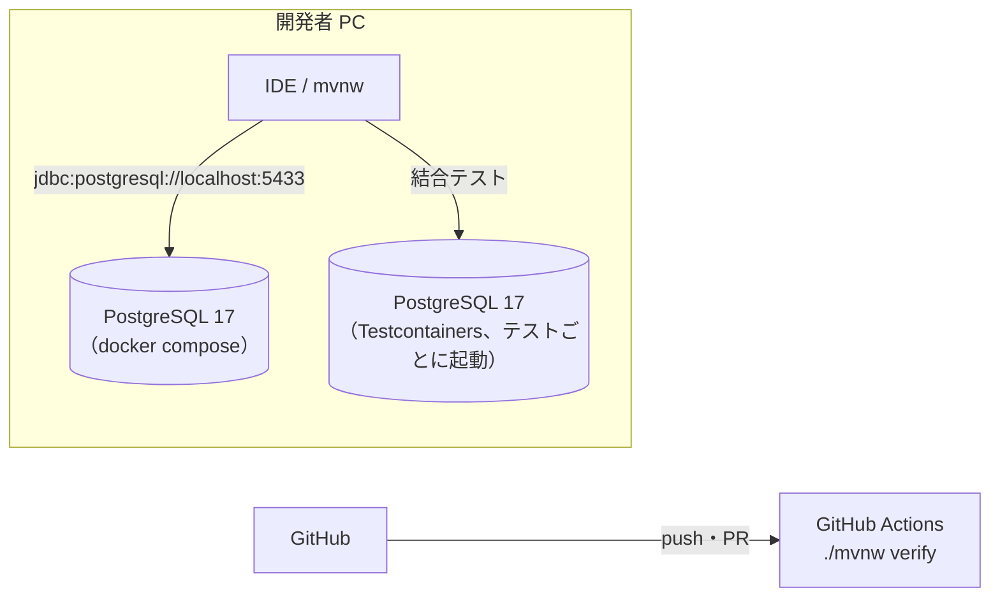

# 開発環境構築手順書

| 項目 | 内容 |
|---|---|
| 文書名 | 開発環境構築手順書 |
| 版数 | 第1.1版 |
| 作成日 | 2027/01/18 |
| 作成者 | 開発担当 |
| 承認者 | — |

## 改訂履歴

| 版数 | 日付 | 変更内容 | 変更者 |
|---|---|---|---|
| 1.0 | 2027/01/18 | 新規作成 | 開発担当 |
| 1.1 | 2027/01/25 | 3.4 に初回ログインの手順（初期管理者）を追加 | 開発担当 |

> 本書は、開発者の PC（Windows 11）に開発環境を構築し、ビルド・テスト・起動ができる状態にする手順を定める。
> 保守を引き継ぐ担当者が本書だけで同じ環境を作れることを目的とする。

## 1. 前提となるソフトウェア

| ソフトウェア | バージョン | 用途 | 備考 |
|---|---|---|---|
| JDK | 21 | ビルド・実行 | Temurin または Oracle JDK。`java -version` で 21 であることを確認する |
| Docker Desktop | 最新版 | 開発用 PostgreSQL、結合テスト（Testcontainers） | WSL 2 バックエンド |
| Git | 最新版 | ソース管理 | `core.autocrlf` は既定のままでよい（改行コードは `.gitattributes` で統一している） |
| IDE | Eclipse（Spring Tools）または IntelliJ IDEA Community | 開発 | 技術選定書 2.5 |

Maven のインストールは不要である。リポジトリに同梱した Maven Wrapper（`mvnw` / `mvnw.cmd`）が、初回実行時に Maven 3.9.16 を自動で取得する。

## 2. 構成



| 項目 | 設定 |
|---|---|
| 開発用 DB | docker compose で起動。ホスト側ポートは **5433**（PC にインストールされた PostgreSQL の 5432 と競合しないため。環境変数 `DB_PORT` で変更可） |
| DB ユーザー | `hanbai_owner`（テーブル所有者、Flyway が使用）、`hanbai_app`（アプリケーションが使用、DML のみ）。セキュリティ設計 5章（NF-31） |
| プロファイル | 指定なしで `dev`。テストは `test`（Maven が自動で指定）、サーバーは環境変数 `SPRING_PROFILES_ACTIVE`（`stg`／`prd`） |
| テーブル | アプリケーション起動時に Flyway が `src/main/resources/db/migration` の DDL を適用する |

## 3. 構築手順

### 3.1 リポジトリの取得

```bash
git clone https://github.com/Casis009/sales-mgmt-portfolio.git
cd sales-mgmt-portfolio
```

### 3.2 開発用 DB の起動

```bash
docker compose up -d --wait
docker compose ps        # hanbai-db が healthy であること
```

初回起動時に `docker/postgres/init/01_create_app_user.sh` が実行され、アプリケーション用ユーザーが作成される。
DB を初期化し直す場合は `docker compose down -v` でデータを削除してから再度起動する。

### 3.3 ビルドとテスト

```bash
./mvnw verify            # Windows のコマンドプロンプトでは mvnw.cmd verify
```

| 実行される内容 | 結果の確認先 |
|---|---|
| Checkstyle（コーディング規約） | 違反があるとビルドが失敗する。`target/checkstyle-result.xml` |
| 単体テスト（`*Test`） | `target/surefire-reports/` |
| 結合テスト（`*IT`、Testcontainers） | `target/failsafe-reports/` |
| SpotBugs | 指摘があるとビルドが失敗する。`target/spotbugsXml.xml` |
| JaCoCo（カバレッジ） | `target/site/jacoco/index.html` |

結合テストは Docker Desktop が起動している必要がある。初回はコンテナイメージの取得に時間がかかる。

### 3.4 アプリケーションの起動

```bash
./mvnw spring-boot:run
```

起動後、`http://localhost:8080/actuator/health` が `{"status":"UP"}` を返すことを確認する。


#### 初回ログイン

ユーザーが1人もいない DB で起動すると、初期管理者が作成される（セキュリティ設計 1章 No.8）。

| 項目 | 値 |
|---|---|
| URL | `http://localhost:8080/login` |
| ログインID | `admin` |
| パスワード | `Admin2027`（開発環境の既定値。環境変数 `HANBAI_INITIAL_ADMIN_PASSWORD` で変更できる） |

初回ログイン後はパスワード変更画面に遷移するため、新しいパスワードを設定する。以降のユーザーはユーザー管理（メニュー →「ユーザー一覧」→「新規登録」）で登録する。
検証・本番環境では既定値を持たないため、初回起動時に環境変数でパスワードを渡す（08 移行・リリース工程で手順化する）。

## 4. よくあるエラー

| 症状 | 原因 | 対処 |
|---|---|---|
| 起動時に「ユーザー "hanbai_owner" のパスワード認証に失敗しました」（日本語・韓国語などのメッセージ） | PC にインストールされた PostgreSQL に接続している | docker compose のポートを確認する（既定 5433）。`DB_PORT` を変えた場合は、起動時にも同じ値を環境変数で渡す |
| 結合テストが「Could not find a valid Docker environment」で失敗する | Docker Desktop が起動していない | Docker Desktop を起動してから再実行する |
| 結合テストの開始が数分止まる | Docker Desktop の起動直後で、コンテナの作成が遅れている | そのまま待つ。改善しない場合は Docker Desktop を再起動する |
| Checkstyle で「First sentence of Javadoc is missing an ending period」 | Javadoc の1文目が「。」で終わっていない | 1文目を「。」で終える |
| `docker compose up` 後に権限エラー（permission denied for table …） | 初期化スクリプトが実行される前のボリュームが残っている | `docker compose down -v` で作り直す |

## 5. 関連ファイル

| ファイル | 内容 |
|---|---|
| `pom.xml` | 依存ライブラリ・プラグインのバージョン（技術検証結果報告書 3章で確定） |
| `docker-compose.yml`、`docker/postgres/init/` | 開発用 DB |
| `src/main/resources/application*.yml` | 共通・環境別の設定 |
| `src/main/resources/db/migration/` | Flyway の DDL（V1 業務テーブル、V2 BATCH_*、V3 権限） |
| `config/checkstyle/`、`config/spotbugs/` | 静的解析の設定 |
| `.github/workflows/ci.yml` | CI |
