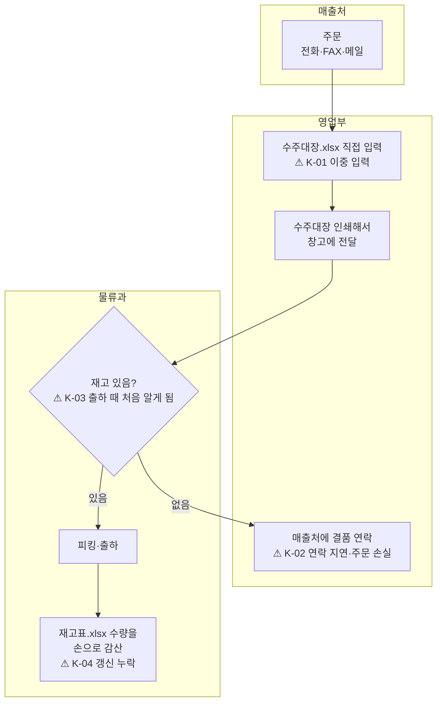
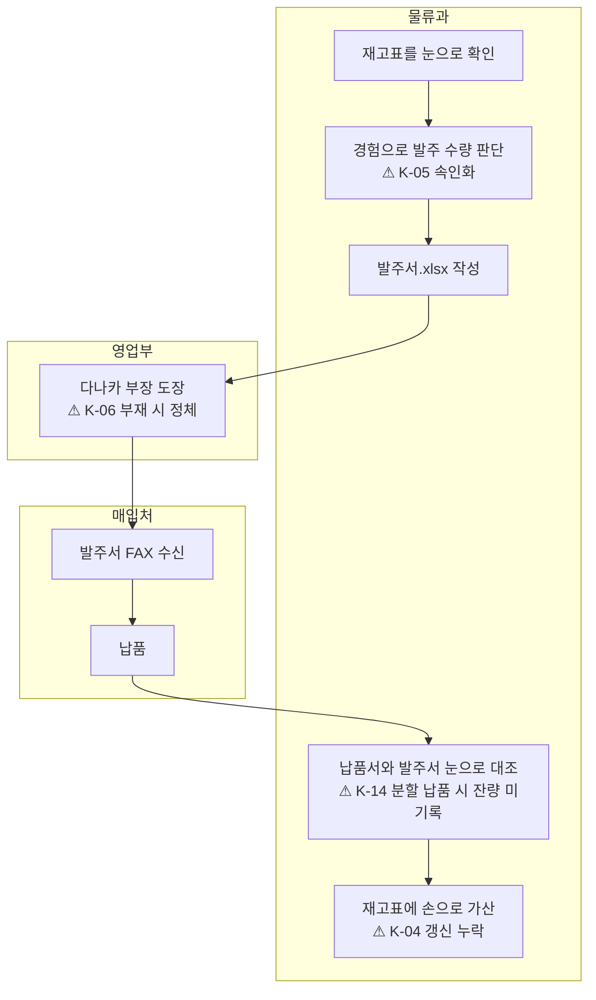
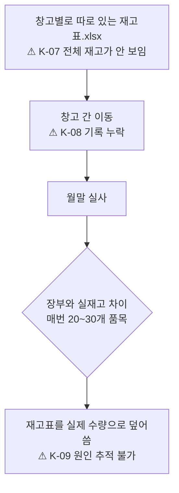
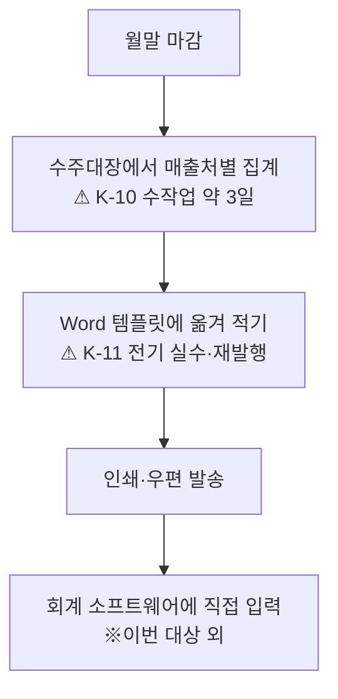

# 현행 업무 흐름도(As-Is)

> ※ 일본어 원본(정본): `docs/ja/01_要件定義/03_現行業務フロー_AsIs.md` (1.1판, 2026/11/26: K-14 추가, 고객 확인 완료)
> 그림의 ⚠ 표시는 과제 목록(04)의 과제 번호에 대응한다.

## 1. 수주~출하

## 2. 발주~입하

## 3. 재고·실사

## 4. 청구

