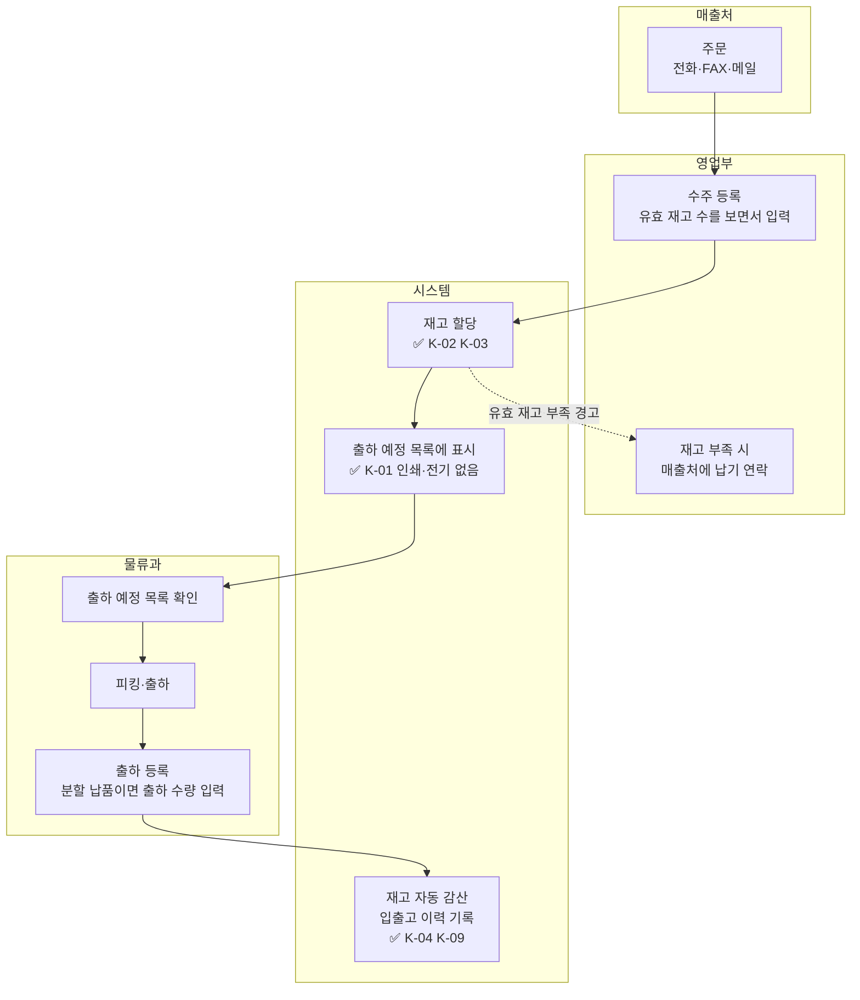
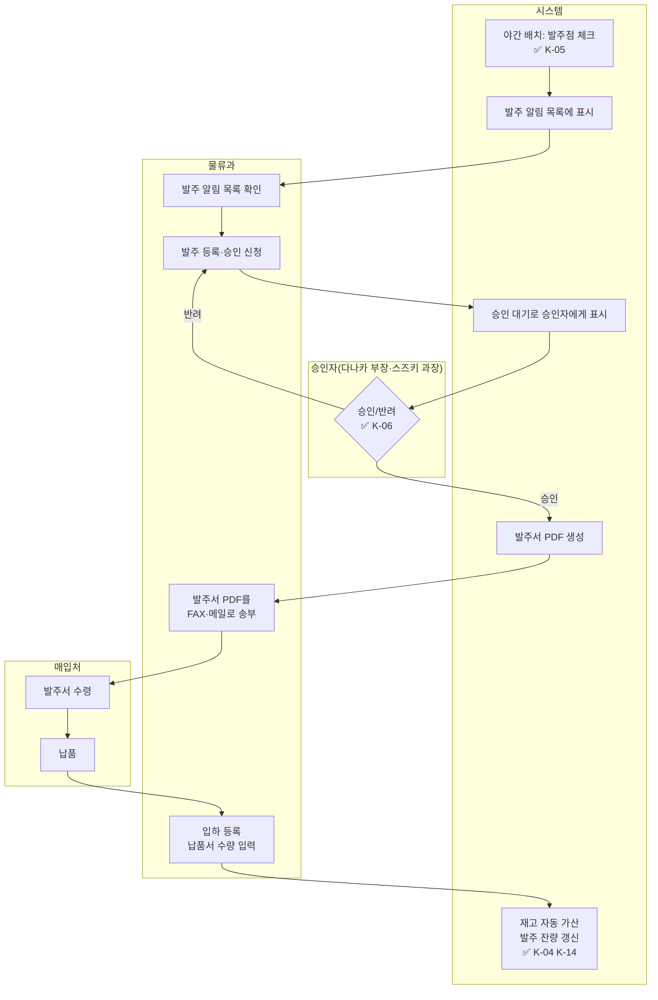
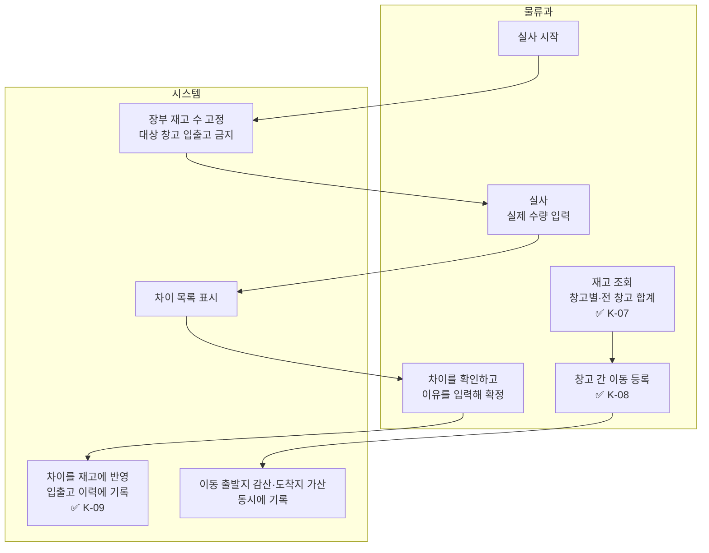
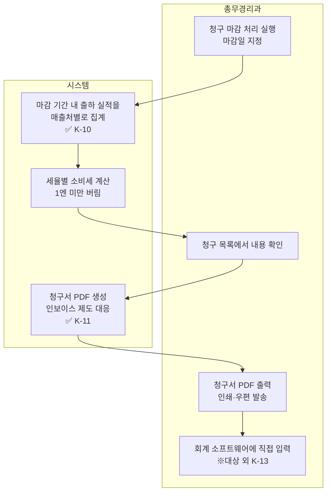

# 신규 업무 흐름도(To-Be)

> ※ 일본어 원본(정본): `docs/ja/01_要件定義/07_新業務フロー_ToBe.md` (1.0판, 2026/11/30)
> 그림의 ✅는 해결하는 과제 번호(04 과제 목록)를 나타낸다. 「시스템」 레인이 이 시스템의 처리다.

## 1. 수주~출하

## 2. 발주~입하

## 3. 재고·실사

## 4. 청구

## 5. 과제와 해결 방법 대응

| 과제 | 내용 | 해결 방법(To-Be) | 대응 기능 |
|---|---|---|---|
| K-01 | 수주 정보 이중 입력 | 수주 데이터를 출하·청구까지 이어받음 | F-401, F-404, F-501 |
| K-02 | 결품 연락 지연 | 수주 입력 시 유효 재고 수 표시 | F-401 |
| K-03 | 재고 부족을 출하 때 알게 됨 | 수주 등록 시 재고 할당 | F-401 |
| K-04 | 재고표 갱신 누락 | 출하·입하 등록과 동시에 재고 자동 갱신 | F-304, F-404 |
| K-05 | 발주 판단의 속인화 | 발주점 체크 배치와 발주 알림 목록 | F-104, F-306, F-601 |
| K-06 | 승인자 부재 시 정체 | 시스템 승인(승인자 2명) | F-302 |
| K-07 | 전 창고 재고가 안 보임 | 재고 조회(창고별·합계) | F-201 |
| K-08 | 창고 간 이동 기록 누락 | 창고 간 이동 등록 | F-204 |
| K-09 | 재고 차이 원인 추적 불가 | 입출고 이력·조작 로그 | F-202, F-004, F-005 |
| K-10 | 청구서 작성에 약 3일 | 청구 마감 처리로 자동 집계 | F-501 |
| K-11 | 전기 실수로 재발행 | 청구서 PDF 자동 생성 | F-503 |
| K-12 | 변경자를 모름 | 인증·권한·조작 로그 | F-001, F-003, F-004 |
| K-13 | 회계 소프트웨어 직접 입력 | **대상 외**(2차 개발에서 검토) | — |
| K-14 | 분할 납품 시 독촉 누락 | 발주 명세별 입하 완료 수량 관리, 발주 잔량 조회 | F-304, F-305 |
