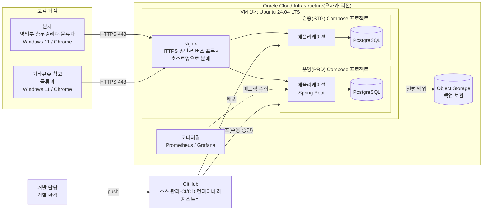

# 시스템 구성도

> ※ 일본어 원본(정본): `docs/ja/02_基本設計/01_システム構成図.md` (1.1판, 2027/01/15: VM 1대에 운영·검증을 다른 Docker Compose 프로젝트로 분리하는 구성으로 변경)

## 1. 전체 구성

## 2. 환경 목록

| 환경 | 용도 | 배치 | 사용자 |
|---|---|---|---|
| 개발(DEV) | 구현, 단위 테스트 | 개발 담당 PC(Docker Compose로 DB 실행) | 개발 담당 |
| 검증(STG) | 통합·시스템·인수 테스트, 이관 리허설 | OCI VM(운영과 같은 VM, 다른 Compose 프로젝트) | 개발 담당, 고객(인수 테스트 시) |
| 운영(PRD) | 실제 운영 | OCI VM | 고객 |

## 3. 서버 구성
예산 제약으로 VM은 1대(NF-05: 이중화 없음). VM 1대 위에 운영(PRD)과 검증(STG)을 **다른 Docker Compose 프로젝트**로 두고 컨테이너·네트워크·DB·데이터 볼륨을 환경별로 나눈다. Nginx만 두 환경이 같이 쓰고 호스트명으로 분배한다.

| 컨테이너 | 소프트웨어 | 역할 | 공개 포트 |
|---|---|---|---|
| nginx(공용) | Nginx | HTTPS 종단(Let's Encrypt), 호스트명으로 PRD/STG 분배 | 443(외부), 80(443으로 리다이렉트) |
| prd-app / stg-app | Spring Boot(Java 21) | 화면, 업무 처리, 장표 출력, 배치(앱 내부 스케줄러로 기동) | 내부만 |
| prd-db / stg-db | PostgreSQL 17 | 데이터 보관(환경별로 다른 컨테이너·볼륨) | 내부만 |

| 항목 | 운영(PRD) | 검증(STG) |
|---|---|---|
| Compose 프로젝트명 | hanbai-prd | hanbai-stg |
| 호스트명 | hanbai.(도메인) | stg.hanbai.(도메인) |
| 메모리 상한(app / db) | 2GB / 2GB | 1GB / 1GB |
| 배치 스케줄 기동 | 켬 | 끔(필요할 때 수동 기동) |
| 접속원 제한 | 고객 거점 고정 IP | 고객 거점 + 개발 담당 고정 IP |

- 배치는 애플리케이션 내부 스케줄러로 기동한다. 운영 애플리케이션이 1인스턴스라 이중 기동은 생기지 않는다. 검증 환경은 스케줄 기동을 꺼서 운영과 동시에 무거운 처리가 돌지 않게 한다.
- 검증 환경의 부하(성능 테스트 등)가 운영에 영향을 주지 않도록 컨테이너별 CPU·메모리 상한을 둔다. 성능 테스트는 운영 시간 외에 한다.
- 장표(PDF)는 애플리케이션 안에서 만들고 파일로 저장하지 않는다(출력할 때마다 생성).

## 4. 네트워크·보안

| 통신 | 송신원 | 목적지 | 포트 | 제어 |
|---|---|---|---|---|
| 화면 사용 | 고객 거점 고정 IP(본사·기타큐슈 창고) | nginx | 443 | OCI 시큐리티 리스트로 송신원 IP 제한(NF-29) |
| 유지보수 | 개발 담당 고정 IP | VM | 22(SSH·공개키 인증) | 위와 같음. 비밀번호 인증 비활성 |
| 배포 | GitHub Actions | VM | 22 | 배포 전용 사용자·키 사용 |
| 인증서 갱신 | VM | Let's Encrypt | 443(나가는 방향) | DNS 인증 방식(80번을 외부에 열지 않으므로) |
| 앱 → DB | app | db | 5432 | Docker 내부 네트워크만 |

## 5. 운영 작업

| 작업 | 시각 | 내용 | 대응 요건 |
|---|---|---|---|
| 발주점 체크 배치(BAT-01) | 매일 22:00 | 앱 안에서 실행 | NF-10 |
| 월별 재고 집계 배치(BAT-02) | 매월 1일 0:30 | 앱 안에서 실행 | NF-10 |
| DB 백업 | 매일 2:00 | `pg_dump`를 받아 Object Storage에 보관(일별 7세대·월별 12세대) | NF-13 |
| 로그 로테이션 | 매일 | 애플리케이션 로그를 일별로 전환, 90일 보유 | NF-16 |

## 6. 비기능 요건과의 대응

| 요건 | 구성상의 대응 |
|---|---|
| NF-02 가동률 99% | 컨테이너 자동 재시작(restart: always), 생존 감시 |
| NF-03 RTO 4시간 | VM 장애 시 새 VM에 Compose 일체를 전개하고 백업에서 복원하는 절차 정비 |
| NF-04 RPO 전날 야간 | 일별 백업 |
| NF-28 통신 암호화 | Nginx에서 TLS 1.2 이상만 허용 |
| NF-35 환경 분리 | PRD와 STG를 다른 Compose 프로젝트·다른 DB 컨테이너·다른 볼륨으로(VM은 공용) |
| NF-03 RTO 4시간 | VM 장애 시 운영·검증 모두 정지. 복구는 운영 우선 |
