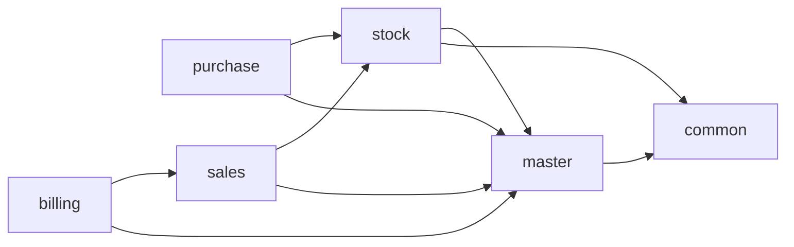

# 기능 구성도

> ※ 일본어 원본(정본): `docs/ja/02_基本設計/02_機能構成図.md` (1.1판, 2026/12/24: CR-01로 F-406 추가)

## 1. 서브시스템 구성

| 서브시스템 | 식별자 | 기능 |
|---|---|---|
| 공통 | common | F-001 로그인·로그아웃, F-002 비밀번호 변경, F-003 사용자 관리, F-004 조작 로그 기록, F-005 조작 로그 조회, F-006 대시보드 |
| 마스터 관리 | master | F-101 상품, F-102 창고, F-103 거래처, F-104 발주점 설정 |
| 재고 관리 | stock | F-201 재고 조회, F-202 입출고 이력 조회, F-203 재고 조정, F-204 창고 간 이동, F-205 실사, F-602 월별 재고 집계 배치 |
| 구매 관리 | purchase | F-301 발주 등록, F-302 발주 승인, F-303 발주서 PDF, F-304 입하 등록, F-305 발주 조회, F-306 발주 알림 조회, F-601 발주점 체크 배치 |
| 판매 관리 | sales | F-401 수주 등록, F-402 수주 조회, F-403 출하 예정 조회, F-404 출하 등록, F-405 수주 목록 CSV, F-406 출하 취소 |
| 청구 관리 | billing | F-501 청구 마감 처리, F-502 청구 조회, F-503 청구서 PDF, F-504 청구 마감 취소 |

## 2. 서브시스템 간 관계

| 서브시스템 | 의존 대상 | 설명 |
|---|---|---|
| common | — | 인증·권한·조작 로그·채번·예외 처리 등 전 서브시스템이 사용 |
| master | common | 상품·창고·거래처·발주점 |
| stock | common, master | 재고 수량 갱신은 모두 재고 관리의 공통 부품(재고 갱신 서비스)을 통해서만 한다 |
| purchase | common, master, stock | 입하 등록 시 재고 관리를 호출해 재고 가산 |
| sales | common, master, stock | 수주 등록 시 할당, 출하 등록 시 재고와 할당 감산 |
| billing | common, master, sales | 판매 관리의 출하 실적을 집계. 재고에는 영향 없음 |

> 의존 방향은 한쪽으로만 둔다. 재고 관리에서 구매 관리·판매 관리를 호출하지 않는다(순환 의존 금지).

## 3. 기능과 설계서 대응

| 기능 ID | 화면 | 장표 | 배치 |
|---|---|---|---|
| F-001 | SCR-001 | — | — |
| F-002 | SCR-003 | — | — |
| F-003 | SCR-011, SCR-012 | — | — |
| F-004 | (전 화면 공통 내부 처리) | — | — |
| F-005 | SCR-013 | — | — |
| F-006 | SCR-002 | — | — |
| F-101 | SCR-101, SCR-102 | — | — |
| F-102 | SCR-111, SCR-112 | — | — |
| F-103 | SCR-121, SCR-122 | — | — |
| F-104 | SCR-102(발주점 설정란) | — | — |
| F-201 | SCR-201 | — | — |
| F-202 | SCR-202 | — | — |
| F-203 | SCR-203 | — | — |
| F-204 | SCR-204 | — | — |
| F-205 | SCR-211, SCR-212 | — | — |
| F-301 | SCR-302 | — | — |
| F-302 | SCR-303 | — | — |
| F-303 | SCR-303 | RPT-02 | — |
| F-304 | SCR-304 | — | — |
| F-305 | SCR-301, SCR-303 | — | — |
| F-306 | SCR-305 | — | — |
| F-401 | SCR-402 | — | — |
| F-402 | SCR-401, SCR-403 | — | — |
| F-403 | SCR-404 | — | — |
| F-404 | SCR-405 | — | — |
| F-405 | SCR-401 | — | — |
| F-406 | SCR-403 | — | — |
| F-501 | SCR-501 | — | BAT-03 |
| F-502 | SCR-502, SCR-503 | — | — |
| F-503 | SCR-503 | RPT-01 | — |
| F-504 | SCR-503 | — | — |
| F-601 | — | — | BAT-01 |
| F-602 | — | — | BAT-02 |
