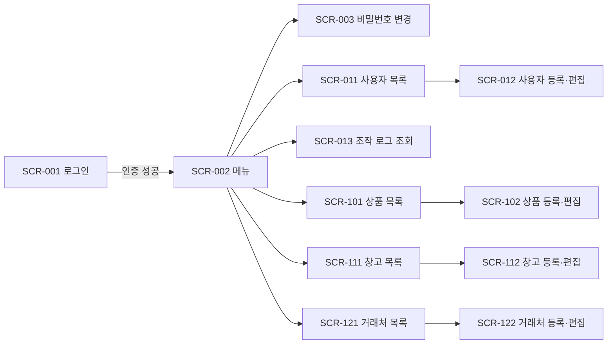
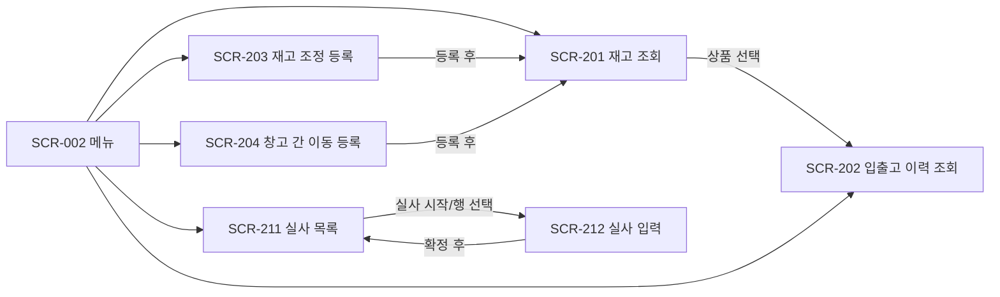
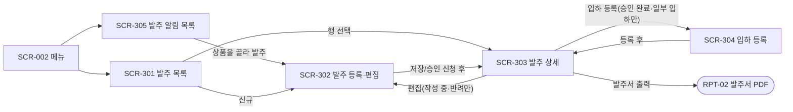
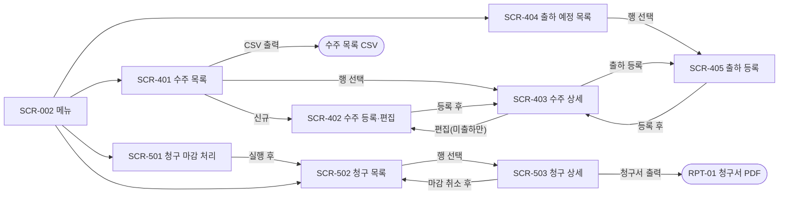

# 화면 전이도

> ※ 일본어 원본(정본): `docs/ja/02_基本設計/04_画面遷移図.md` (1.1판, 2026/12/24: CR-01 반영)
> 모든 화면은 헤더의 「메뉴」로 SCR-002에 돌아갈 수 있다. 그림에서는 생략한다.

## 1. 공통·마스터 관리

## 2. 재고 관리

## 3. 구매 관리

## 4. 판매 관리·청구 관리

## 5. 전표 상태 전이

### 5.1 발주

| 현재 상태 | 조작 | 다음 상태 |
|---|---|---|
| (없음) | 저장 | 작성 중 |
| 작성 중 / 반려 | 승인 신청 | 승인 대기 |
| 승인 대기 | 승인 | 승인 완료 |
| 승인 대기 | 반려 | 반려 |
| 승인 완료 / 일부 입하 | 입하 등록(잔량 있음) | 일부 입하 |
| 승인 완료 / 일부 입하 | 입하 등록(잔량 없음) | 입하 완료 |
| 일부 입하 | 잔량 취소 | 입하 완료 |
| 작성 중 / 반려 / 승인 완료(미입하) | 취소 | 취소 |

### 5.2 수주

| 현재 상태 | 조작 | 다음 상태 |
|---|---|---|
| (없음) | 등록(재고 할당) | 수주 완료(受注済) |
| 수주 완료 / 일부 출하 | 출하 등록(잔량 있음) | 일부 출하 |
| 수주 완료 / 일부 출하 | 출하 등록(잔량 없음) | 출하 완료 |
| 일부 출하 | 잔량 취소(할당 해제) | 출하 완료 |
| 수주 완료 | 취소(할당 해제) | 취소 |
| 일부 출하 / 출하 완료 | 출하 취소(출하 완료 수량이 남음) | 일부 출하 |
| 일부 출하 / 출하 완료 | 출하 취소(출하 완료 수량이 0이 됨) | 수주 완료 |

※ 출하 취소는 잔량 취소를 하지 않은 수주의 미청구 출하에 한한다(BR-17).

### 5.3 청구

| 현재 상태 | 조작 | 다음 상태 |
|---|---|---|
| (없음) | 청구 마감 처리 | 확정 |
| 확정 | 청구서 출력(첫 회) | 발행 완료 |
| 확정 | 마감 취소 | 취소 |
| 발행 완료 | 청구서 출력(재발행) | 발행 완료 |

### 5.4 실사

| 현재 상태 | 조작 | 다음 상태 |
|---|---|---|
| (없음) | 실사 시작(대상 창고 입출고 금지) | 진행 중 |
| 진행 중 | 확정(차이를 재고에 반영) | 확정 |
| 진행 중 | 중지(재고는 변경하지 않음) | 중지 |

(상태 전이도 그림은 일본어 원본 참조)
