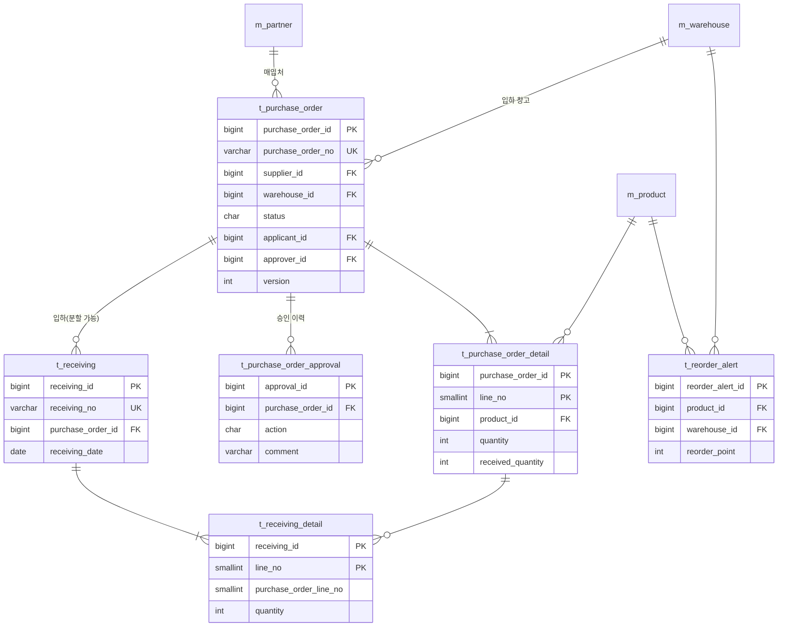
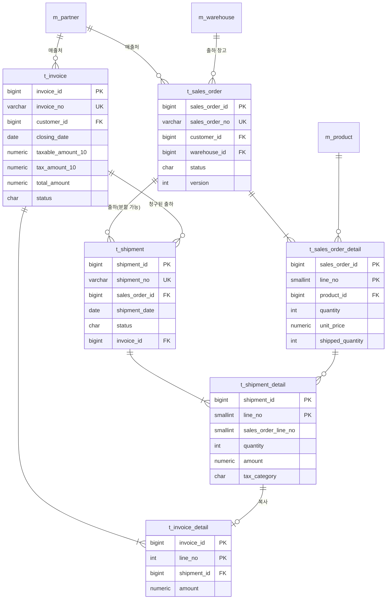
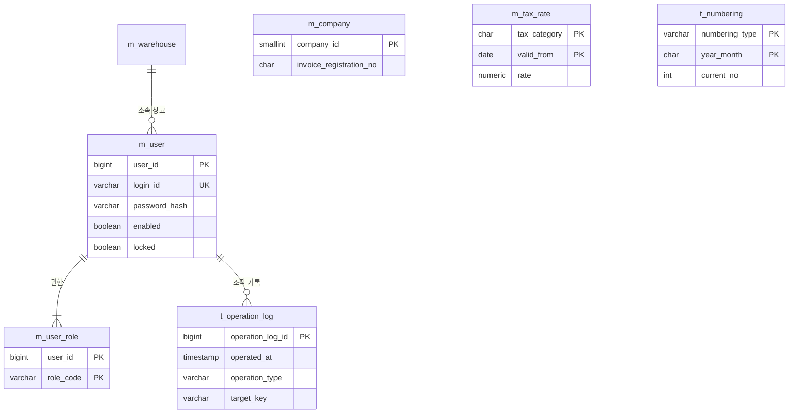

# ER도

> ※ 일본어 원본(정본): `docs/ja/02_基本設計/08_ER図.md` (1.0판, 2026/12/17)
> 속성은 기본 키와 주요 항목만 나타낸다. 전 항목은 「10 테이블 정의서」 참조.

## 1. 마스터·재고

```mermaid
erDiagram
    m_product ||--o{ m_product_warehouse : "발주점 설정"
    m_warehouse ||--o{ m_product_warehouse : ""
    m_product ||--o{ t_stock : "재고 보유"
    m_warehouse ||--o{ t_stock : ""
    t_stock ||--o{ t_stock_movement : "증감 기록"
    m_partner ||--o{ m_product : "주 매입처"
    m_warehouse ||--o{ t_stocktaking : "실사 실시"
    t_stocktaking ||--|{ t_stocktaking_detail : ""
    m_product ||--o{ t_stocktaking_detail : ""
    t_stock ||--o{ t_stock_monthly : "월말 시점 저장"

    m_product {
        bigint product_id PK
        varchar product_code UK
        varchar product_name
        numeric standard_sales_price
        numeric standard_purchase_price
        char tax_category
    }
    m_warehouse {
        bigint warehouse_id PK
        varchar warehouse_code UK
        varchar warehouse_name
    }
    m_partner {
        bigint partner_id PK
        varchar partner_code UK
        boolean is_customer
        boolean is_supplier
        smallint closing_day
    }
    m_product_warehouse {
        bigint product_id PK
        bigint warehouse_id PK
        int reorder_point
        int standard_order_quantity
    }
    t_stock {
        bigint product_id PK
        bigint warehouse_id PK
        int quantity
        int allocated_quantity
    }
    t_stock_movement {
        bigint stock_movement_id PK
        char movement_type
        int quantity
        int quantity_after
        varchar slip_no
    }
    t_stocktaking {
        bigint stocktaking_id PK
        bigint warehouse_id FK
        char status
    }
    t_stocktaking_detail {
        bigint stocktaking_id PK
        bigint product_id PK
        int book_quantity
        int actual_quantity
    }
    t_stock_monthly {
        char target_month PK
        bigint product_id PK
        bigint warehouse_id PK
        int quantity
    }
```

## 2. 구매

## 3. 판매·청구

## 4. 공통

## 5. 설계상의 판단

| No | 판단 | 이유 |
|---|---|---|
| 1 | 재고는 「현재 수량」(t_stock)과 「증감 이력」(t_stock_movement)을 둘 다 둔다 | 재고 조회·할당에서는 현재 수량을 빠르게 가져와야 한다. 한편 차이 원인 추적(K-09)에는 이력이 필요하다. 이력 합계를 매번 계산하는 방식은 건수가 늘수록 느려져서 채택하지 않는다 |
| 2 | 입출고 이력에 「변동 후 재고 수」를 둔다 | 이력만으로 임의 시점의 재고 수를 확인할 수 있고 t_stock과의 불일치를 찾아낼 수 있다 |
| 3 | 매출처와 매입처를 한 테이블(m_partner)로 하고 플래그로 구분한다 | 같은 회사가 매출처와 매입처를 겸할 때 이중 등록을 피하기 위해 |
| 4 | 수주 명세·출하 명세·청구 명세에 단가·세 구분·품명(청구만)을 복사해 보관한다 | 상품 마스터를 바꿔도 과거 전표·청구서 내용이 바뀌지 않게 하기 위해 |
| 5 | 청구와 출하의 관계는 출하에 청구 ID(invoice_id)를 두어 나타낸다 | 「미청구 출하」를 invoice_id IS NULL로 판정할 수 있어 이중 청구를 구조적으로 막는다 |
| 6 | 소비세율을 마스터(m_tax_rate)로 하고 적용 시작일을 둔다 | 세율 개정 때 프로그램을 바꾸지 않고 대응하기 위해 |
| 7 | 전표 번호는 채번 테이블(t_numbering)로 관리한다 | 연월마다 1부터 시작하는 번호로 하기 위해. DB 시퀀스로는 연월별 리셋이 안 된다 |
| 8 | 마스터·전표 헤더에 version(갱신 횟수)을 둔다 | 낙관적 배타 제어에 사용 |
